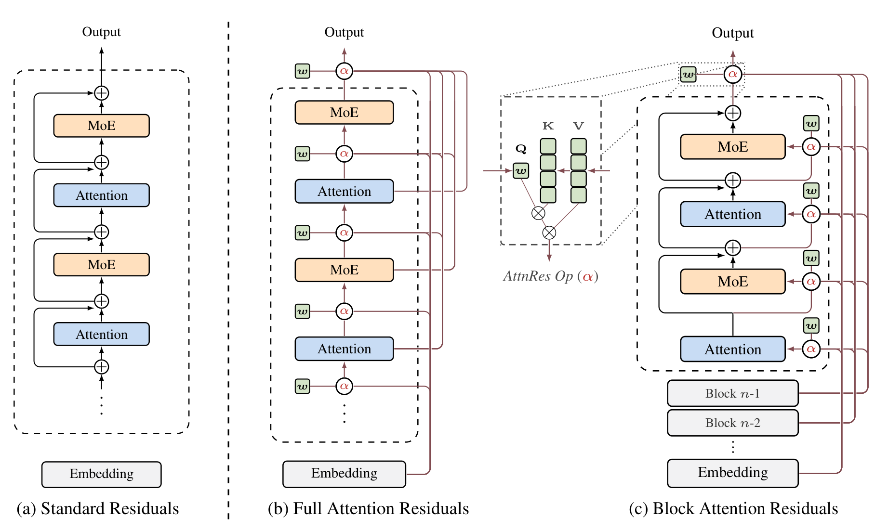

# Attention Residuals 技术报告

## 来源

- 原始 PDF：[raw/2603.15031v1.pdf](../../raw/2603.15031v1.pdf)
- 标题：Attention Residuals
- 版本/日期：arXiv:2603.15031v1，2026-03-16（21 页）
- 团队：Kimi Team。附录 A 把 Guangyu Chen、Yu Zhang、Jianlin Su 标为同等贡献
- 代码：[MoonshotAI/Attention-Residuals](https://github.com/MoonshotAI/Attention-Residuals)
- 概念页：[Attention Residuals](../concepts/attention-residuals.md)
- 后续生产集成：[Kimi K3 技术报告](kimi-k3.md)

## 核心结论

标准 PreNorm 残差把先前所有层的输出按固定权重 1 加进同一个状态。展开之后，层 \(l\) 看到的是一份均匀累加，隐状态幅度随深度按 \(O(L)\) 增长，每一层的相对贡献被稀释（§1，引 PreNorm 与 SiameseNorm 的讨论）。AttnRes 把这条累加换成沿深度的 softmax：每层用一个可学习伪 query，按内容给更早的层输出加权。

Full AttnRes 对全部前层输出做这次 attention。Block AttnRes 先在 block 内用普通求和把多层压成一个表示，再只对约 \(N\) 个 block 表示做 attention，从而把要保存和跨 pipeline stage 传递的状态从 \(O(Ld)\) 收到 \(O(Nd)\)。论文的经验句是 \(N \approx 8\) 在所测尺度上收回 Full 的大部分收益（§3.2，指向 §5）。

这句对应的直接测量是 Table 2：Block 固定 \(N=8\)，激活参数 194M–528M，\(L_b\) 为 12、13、14、16、17，上下文 8192。最大的集成跑是 [Kimi Linear](kimi-linear.md) 的 48B 总参 / 3B 激活、27 个 Transformer block（54 层）、约 1.4T token。93 层、2.8T 的 \(N\) 扫描不在这篇 PDF 里；那是 [Kimi K3](kimi-k3.md) 的生产配置。

## 机制（已据原文核实）

记号（§2）：单个 token 的隐状态 \(h_l \in \mathbb{R}^d\)，\(l \in \{1,\ldots,L\}\)，token embedding 是 \(h_1\)。attention 和 MLP 各算一层。标准残差是 \(h_l = h_{l-1} + f_{l-1}(h_{l-1})\)，展开为 \(h_l = h_1 + \sum_{i=1}^{l-1} f_i(h_i)\)。Highway 等门控仍只读上一层那个压缩状态。

**Full AttnRes（§3.1，Eq. 2–4）。** 层 \(l\) 的 query 是可学习向量 \(q_l = w_l\)。key 和 value 不另做投影：\(i=0\) 时为 embedding \(h_1\)，否则为层输出 \(f_i(h_i)\)。核是

\[
\phi(q,k)=\exp\!\big(q^\top \mathrm{RMSNorm}(k)\big),
\]

权重是这个核在所有来源上的 softmax。RMSNorm 用来避免大幅度输出主导权重。每个 token 的算力是 \(O(L^2 d)\)，存层输出要 \(O(Ld)\)。论文把深度写成通常 \(L<1000\)，因此相对序列长度，这笔算力可以接受（§3）。普通训练里这些激活本来就要留给反传，Full 不额外占内存；一旦上激活重算和 pipeline parallelism，层输出必须留住并跨 stage 传递，内存和通信才变成 \(O(Ld)\)。

**Block AttnRes 在做什么（§3.2）。** 把 \(L\) 层分成 \(N\) 个 block，每 block \(S=L/N\) 层；除不尽时最后一个 block 取余数。block 内把层输出加总成一个表示 \(b_n=\sum_{j\in B_n} f_j(h_j)\)，\(b_n^i\) 是该 block 前 \(i\) 层的部分和。\(b_0=h_1\)，embedding 始终是一个来源。block \(n\) 的第 \(i\) 层，value 矩阵是：

- \(i=1\)（block 首层）：\(V=[b_0,b_1,\ldots,b_{n-1}]^\top\)
- \(i\ge 2\)：在上面之外再加上当前部分和 \(b_n^{i-1}\)

key 与权重仍用 Eq. 2–3。最后的输出层聚合全部 \(N\) 个 block 表示。\(N=L\) 退回 Full AttnRes；\(N=1\) 退回标准残差，同时把 embedding 单独留成 \(b_0\)。

Block 把 Full 的来源从「每一层一个向量」换成「每个已完成 block 一个和，再加上本 block 里正在长的部分和」。跨 block 的历史长度被 \(N\) 卡住，block 内部仍是加法残差。

> Figure 1（原文第 1 页）："(a) Standard Residuals: standard residual connections with uniform additive accumulation. (b) Full AttnRes: each layer selectively aggregates all previous layer outputs via learned attention weights. (c) Block AttnRes: layers are grouped into blocks, reducing memory from \(O(Ld)\) to \(O(Nd)\)."

**\(N\) 与开销。** 论文写：每层改为 attend \(N\) 个 block 表示后，内存从 \(O(L)\) 降到 \(O(N)\)，计算从 \(O(L^2)\) 降到 \(O(N^2)\)；内存和通信的带 \(d\) 写法是 \(O(Ld)\to O(Nd)\)（§3.2）。§3.2 的经验句是 \(N\approx 8\) 收回大部分收益，每个 token 只需存 8 个 hidden state，并指向 §5。这是 \(N\approx 8\) 这个设计点上的说法。§5.2 的 48B 集成另行写明 9 个 block 再加 embedding，共 10 个深度来源。

推理侧把一个 block 内的伪 query 批在一起（§4.2，Algorithm 1）：Phase 1 对已完成 block 做一次 batched inter-block attention，Phase 2 按部分和做 intra-block attention，再用 online softmax 合并。论文称合并与直接计算精确等价。Table 1 给的是残差机制本身的每 token 每层访存，不含 \(f_l\) 内部 I/O。表中「典型值」是 \(L=128\)、\(N=8\)、\(S=16\)、mHC 的 \(m=4\)，用来比 I/O，不是 Table 2 的训练配置。

| 方案 | 每层总 I/O（符号） | 典型值 |
| --- | --- | ---: |
| 标准残差 | \(3d\) | \(3d\) |
| mHC（\(m\) 路） | \((8m+2)d+2m^2+4m\) | \(34d\) |
| Full AttnRes（两阶段摊销） | \((S+N)d\) | \(24d\) |
| Block AttnRes（两阶段摊销） | \(\big(N/S+5\big)d\) | \(5.5d\) |

正文同时写 Block 的摊销读是 \((N/S+3)d\)、写是 \(2d\)，加起来就是表里的 \((N/S+5)d\)。在上述典型值下，三者的每层 I/O 分别是标准残差 \(3d\)、Block \(5.5d\)、\(m=4\) 的 mHC \(34d\)。

训练：不开 pipeline 时，论文称额外开销可忽略；开 pipeline 后再加跨 stage 缓存（只传增量 block），测得端到端开销小于 4%（§4.1）。推理：论文称典型负载上端到端延迟开销小于 2%（§4.2）。prefill 若把 8 个 block 的表示按 128K token 存下，论文给出 15 GB；沿序列维切到 \(P\) 个 tensor-parallel 设备后约 1.9 GB/设备，再配合 16K 的 chunked prefill 则低于 0.3 GB/设备。这三句都没有写出对应的隐藏维、并行度或具体负载名称。

参数上，每层只加一个 RMSNorm 和一个 \(w_l\)。论文要求全部伪 query **初始化为 0**：初始 logits 相同，AttnRes 在训练起点退化为等权平均。正文说这一点经经验验证，能避免训练不稳；没有单独的初始化消融表。

## 实验尺度与结论

骨干与 [Kimi Linear](kimi-linear.md) 相同：Moonlight / DeepSeek-V3 式 MoE，KDA 与 MLA 按 3:1 交错，每层后面接 MoE。唯一改动是残差换成 AttnRes（§5 开头）。

**Scaling（§5.1，Table 2，已据原文核实）。** 五个尺寸各训三套：PreNorm baseline、Full AttnRes、Block AttnRes（\(N=8\)）。上下文 8192，cosine 学习率。同一尺寸内超参按 baseline 选定，作者写明这个设置偏向 baseline。激活参数不含 embedding。\(L_b=L/2\)，是 Transformer block 数。

| 激活参数 | tokens | \(L_b\) | \(H\) | \(d_{\mathrm{model}}\) | Baseline | Block \(N=8\) | Full | mHC-lite |
| --- | ---: | ---: | ---: | ---: | ---: | ---: | ---: | ---: |
| 194M | 38.7B | 12 | 12 | 896 | 1.931 | 1.909 | 1.899 | 1.906 |
| 241M | 45.4B | 13 | 13 | 960 | 1.895 | 1.875 | 1.874 | 1.869 |
| 296M | 62.1B | 14 | 14 | 1024 | 1.829 | 1.809 | 1.804 | 1.807 |
| 436M | 87.9B | 16 | 16 | 1168 | 1.766 | 1.746 | 1.737 | 1.747 |
| 528M | 119.0B | 17 | 17 | 1264 | 1.719 | 1.693 | 1.692 | 1.694 |

学习率从 \(2.99\times 10^{-3}\) 降到 \(2.02\times 10^{-3}\)，表中 batch size 列从 192 到 432；脚注没有给 batch 的单位。拟合是 \(L=A\times C^{-\alpha}\)，\(C\) 以 PFLOP/s-days 计：Baseline \(1.891\times C^{-0.057}\)，Block \(1.870\times C^{-0.058}\)，Full \(1.865\times C^{-0.057}\)。三条斜率接近，AttnRes 的损失在整个计算区间更低。按拟合曲线，在 5.6 PFLOP/s-days 处 Block 为 1.692、Baseline 为 1.714，作者把它换成 \(1.25\times\) 的计算优势。这是曲线上的点。Table 2 最大一行的实测是 Block 1.693、Full 1.692，文中说 Full 与 Block 的差距在最大尺寸收到 0.001。

Table 2 的参照列是 mHC-lite。作者概括为 Full 优于 mHC、Block 与之相当，同时 Block 的每层 I/O 是 \(5.5d\) 而不是 mHC \(m=4\) 的 \(34d\)。逐行看，241M 上 mHC-lite 的 1.869 低于 Full 的 1.874；194M–296M 上 mHC-lite 也略低于 Block。最大两行 Block 与 mHC-lite 相差 0.001。「全部尺寸上都更好」不能从这张表读出。

**48B / 3B 集成（§5.2）。** 最大模型用完整 Kimi Linear 48B 配置：27 个 Transformer block（54 层），256 个 routed expert 中激活 8 个，再加 1 个 shared expert，48B 总参、3B 激活。Block AttnRes 每 block 6 层，得到 9 个 block，加上 embedding 共 10 个深度来源。

训练配方对齐 Kimi Linear 的 1.4T token 跑：上下文 4096，Muon，WSD，全局 batch 8M token。最终模型分两段：1T token 的 WSD 预训练，然后约 400B 高质量 token 的 mid-training。mid-training 之后继续把序列加长到 32K；MLA 无位置编码，因此不做 YaRN 或 attention temperature 重标定。训练动态的比较写明是 1T token 上的 baseline 与 Block：验证损失更低，差距在 decay 段拉开；baseline 的输出幅度随深度单调变大，Block 把增长限制在 block 内，边界处的选择性聚合把累加重置；baseline 的梯度集中在最浅层，Block 的 softmax 竞争使梯度沿深度更均匀。这些是 §5.2 的文字结论。

下游表是同一预训练配方之后的对照（Table 3）。协议跟随 Kimi Linear。MMLU-Pro 两边都是 52.2，其余行 AttnRes 更高。摘要里的 “improves … across all evaluated tasks” 比这张表强；表文写的是 matches or outperforms。正文点名的幅度是 GPQA-Diamond +7.5、Minerva Math +3.6、HumanEval +3.1、MMLU +1.1、TriviaQA +1.9。表内 Math 一行是 53.5→57.1，与 +3.6 一致。

| 任务 | Baseline | AttnRes |
| --- | ---: | ---: |
| MMLU | 73.5 | 74.6 |
| MMLU-Pro | 52.2 | 52.2 |
| GPQA-Diamond | 36.9 | 44.4 |
| BBH | 76.3 | 78.0 |
| ARC-Challenge | 64.6 | 65.7 |
| HellaSwag | 83.2 | 83.4 |
| TriviaQA | 69.9 | 71.8 |
| GSM8K | 81.7 | 82.4 |
| MGSM | 64.9 | 66.1 |
| Math | 53.5 | 57.1 |
| CMath | 84.7 | 85.1 |
| HumanEval | 59.1 | 62.2 |
| MBPP | 72.0 | 73.9 |
| CMMLU | 82.0 | 82.9 |
| C-Eval | 79.6 | 82.5 |

**消融在哪一档模型上（§5.3，Table 4）。** 损失对得上 Table 2 的 436M 行：baseline 1.766，Full 1.737，Block 1.746。该行 \(L_b=16\)、\(H=16\)、87.9B token。§5.3 正文称 “16-head model from Table 2”。脚注写 \(L_b=L/2\)，§5.2 又把 27 个 Transformer block 写成 54 层，所以这一档是 \(L=32\)：16 个 token-mixing 层加 16 个 MLP 层。Table 4 caption 写作 “16-layer model”，这个 16 与该行的 \(L_b\)、\(H\) 相同。§5.3 把 \(S\) 扫到 32，与 \(L=32\) 对齐。\(N=8\) 时 \(S=L/N=4\)，Table 4 的 Block（\(S=4\)）和 Table 2 该行的 Block 损失同为 1.746。

| 变体 | 验证损失 |
| --- | ---: |
| Baseline（PreNorm） | 1.766 |
| DenseFormer | 1.767 |
| mHC | 1.747 |
| Full AttnRes | 1.737 |
| Full，input-dependent query | 1.731 |
| Full，input-independent mixing | 1.749 |
| Full，sigmoid 代替 softmax | 1.741 |
| Full，去掉 RMSNorm | 1.743 |
| SWA（\(W=1+8\)） | 1.764 |
| Block（\(S=4\)） | 1.746 |
| Block，multihead（\(H=16\)） | 1.752 |
| Block，去掉 RMSNorm | 1.750 |

DenseFormer 用固定、与输入无关的标量系数访问全部前层输出，损失 1.767，相对 baseline 没有收益。mHC 到 1.747。Full 1.737，Block \(S=4\) 为 1.746。把 query 改成从当前隐状态投影，损失进一步到 1.731，但每层多一个 \(d\times d\) 投影，解码时要顺序访问内存，因此默认仍用学习到的 \(w_l\)。去掉 query/key、改成与输入无关的标量，损失到 1.749。softmax 换成 sigmoid 到 1.741。Block 上做 \(H=16\) 的分头深度聚合到 1.752，高于单向量的 1.746。去掉 RMSNorm 时 Full 到 1.743、Block 到 1.750。只保留最近 8 层输出再加 embedding 的 SWA 损失是 1.764，略低于 baseline 的 1.766，仍高于 Full 的 1.737 和 Block 的 1.746。论文写它相对 baseline 有改进，但远不及 Full 和 Block。

§5.3 写 block size 扫描：\(S=2,4,8\) 的损失落在 1.746 附近，\(S=16,32\) 朝 baseline 1.766 移动。实践中把 block 数固定在约 8，理由是 §4 的基础设施效率。Table 4 的 mHC 行损失 1.747，与 Table 2 在 436M 的 mHC-lite 相同；两处引用分别是 mHC 与 mHC-lite，论文没有写明是不是同一次实现。

**深度–宽度重分配（§5.4.1）。** 固定计算约 \(6.5\times 10^{19}\) FLOPs、激活参数约 \(2.3\times 10^8\)，并把每专家 MLP 扩展比按内部观察固定在 \(d_{\mathrm{ff}}/d_{\mathrm{model}}\approx 0.45\)。在 \(d_{\mathrm{model}}/L_b\in\{15,30,45,60,75\}\) 与 \(H/L_b\in\{0.3,0.4,0.5,0.6,0.7\}\) 的 \(5\times 5\) 网格上，AttnRes 的 25 格损失都低于 baseline，差距 0.019–0.063。两边的最优点都在 \(H/L_b\approx 0.3\)。baseline 的最低损失在 \(d_{\mathrm{model}}/L_b\approx 60\)（1.847），AttnRes 移到 \(d_{\mathrm{model}}/L_b\approx 45\)（1.802）。固定参数预算下，更小的 \(d_{\mathrm{model}}/L_b\) 表示更深、更窄。论文把这写成诊断：更深模型的推理延迟更高，这个偏好不直接变成部署建议。

§5.4.2 对上述 16-head 模型的权重描述了三条文字结论：每层最强的权重仍在直接前驱，同时出现少量跨层跳连；embedding 一直保有权重，pre-attention 的感受野比 pre-MLP 更宽；Block（\(N=8\)）保留了对角主导、embedding 持续和层间分工。

## 与 Kimi K3 的边界

[Kimi K3](kimi-k3.md) 在 93 层上使用 Block AttnRes，并引用本文的 “\(N\approx 8\) recovers most of the benefit across model scales”。这句在本文里指向 §5。§5 里跨尺寸的对照是 Table 2：\(N\) 固定为 8，激活 194M–528M，\(L_b\) 12–17，token 预算 38.7B–119B，上下文 8192。block size 扫描是这一张表里的 436M 那一档，不是五个尺寸各自再扫 \(N\)。

48B 集成没有扫 \(N\)。它把每 block 的层数定成 6，在 54 层上得到 9 个 block 加 embedding。预训练加 mid-training 约 1.4T token，上下文从 4096 写到后来的 32K。K3 的 93 层、2.8T、以及 \(N=8\) 乘 12 层再加末尾不完整 block，都不在这篇 PDF 里。把 “\(N\approx 8\)” 读成 93 层生产模型上的最优分块，超出了本文测量的范围。

## 证据边界

- 摘要的 “all evaluated tasks” 与 Table 3 不一致：MMLU-Pro 是 52.2 对 52.2。以表为准。
- 「Full 全面优于 mHC-lite」与 Table 2 的 241M 行不一致。以表为准。
- \(1.25\times\) 是拟合曲线在 5.6 PFLOP/s-days 的换算，不是 48B 跑出来的 FLOPs 比。
- 训练动态写的是 1T token。Table 3 的 caption 是同一预训练配方之后；32K 续训没有单独的分数表。
- 训练开销 “小于 4%”、推理 “小于 2%”、128K prefill 的 15 GB / 1.9 GB / 0.3 GB，都没有伴随负载、隐藏维或设备数。Table 1 的 \(L=128,S=16\) 只是 I/O 示例。
- 伪 query 零初始化被写成必须，并称已经验验证；没有初始化对照表。input-dependent query 的 1.731 低于默认 Full 的 1.737，作者因投影和解码访问没有采用。
- §5.4.1 的更深度偏好，论文自己限定为诊断，不作为部署建议。

## 相关页面

- 概念：[Attention Residuals](../concepts/attention-residuals.md)（与 CLVR、Gated Residual、K3 生产配置的跨报告边界）
- 集成架构：[Kimi Linear 技术报告](kimi-linear.md)（48B/3B 的宿主）、[Kimi K3 技术报告](kimi-k3.md)（93 层上的 Block AttnRes）
