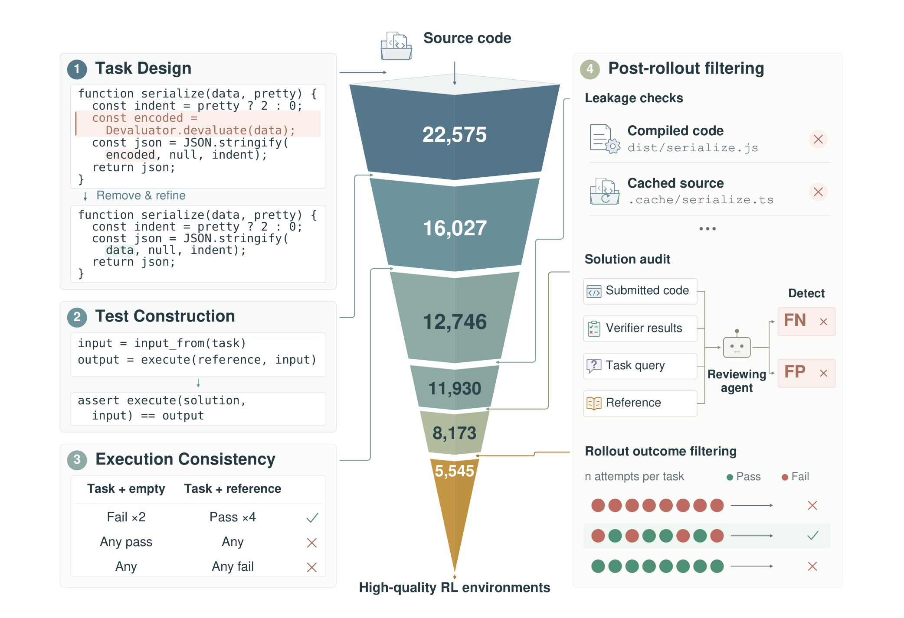
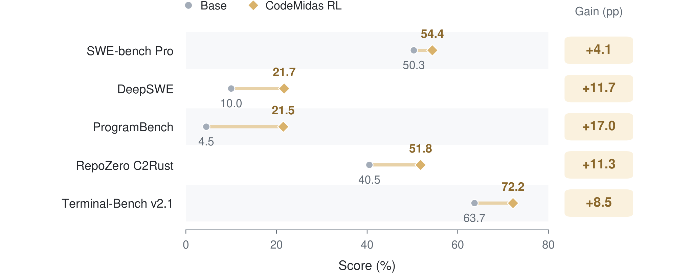
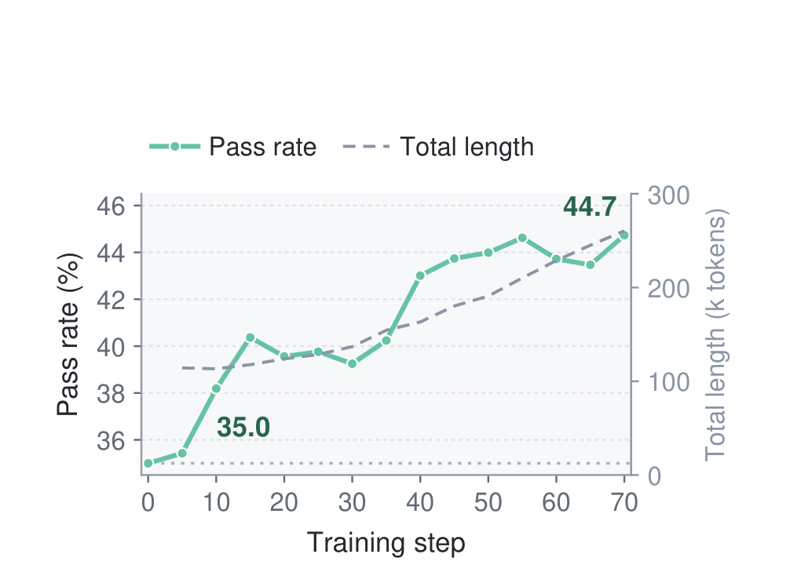
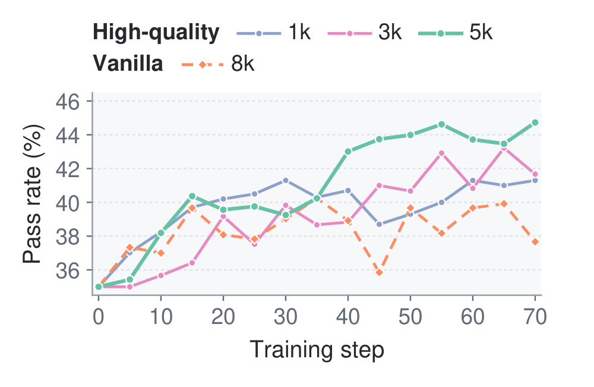
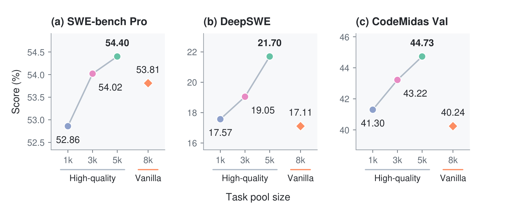
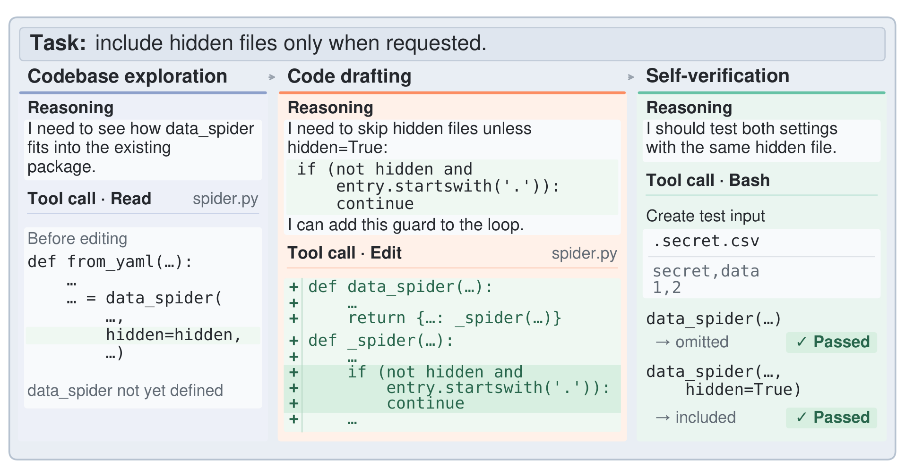

# CodeMidas：从源码本身规模化 coding RL 环境

## 来源

- 原始 PDF：[`raw/2609.22068v1.pdf`](../../raw/2609.22068v1.pdf)
- 标题：CodeMidas: Scaling Agentic Coding RL Environments from Code Itself
- 版本 / 日期：arXiv:2609.22068v1，2026-09-18，15 页
- 作者：Bowen Ye 等。单位是小米 LLM Core、北京大学、香港大学、中国人民大学。通讯作者 Tong Yang、Fuli Luo。Bowen Ye 的工作完成于小米实习
- 学生策略：MiMo-V2.5（Xiaomi MiMo Team, 2026，<https://mimo.xiaomi.com/mimo-v2-5>）。本篇不给架构、参数量或发布权重
- 代码 / 数据：正文没有给出仓库或数据地址
- 模型链接：**未建模型页**。贡献是环境构造和一次 GRPO 训练，不是新模型实体

## 核心结论

1. **任务专属输入只有源码**（摘要、§2.1、Table 1）。已有流水线把任务绑在 issue、PR、commit、现成测试或书面说明上。CodeMidas 这五列都是 ✓，语言覆盖 23。同表里只有它同时不依赖现成测试和书面说明。
2. **最终留下 5,545 道训练任务，来自 3,185 个开源仓库、23 种语言、15 个技术领域**（§3.5）。每道题是任务说明、容器化开发环境和隐藏的可执行 verifier。Solver 在解题期间看不到 verifier；grader 注入后只回 0/1（§3）。
3. **在 MiMo-V2.5 上用 GRPO 训练后，五张外部榜都高于初始策略**（Figure 5）。摘要里的 +11.7%、+17%、+8.5% 与图上的 Gain (pp) 是同一组点差，分别对应 DeepSWE 10.0→21.7、ProgramBench Almost Solved 4.5→21.5、Terminal-Bench v2.1 63.7→72.2。+17.0 是 Almost Solved 的百分点，不是 4.5 的相对增幅。
4. **高质量任务变多，分数往上走；清洗过的 3k 已经超过未清洗的约 8k**（§5.1、Figure 8）。这是环境过滤的证据，不是「数据越多越好」。

同实验室后来的 [MiMo-V2.6](mimo-v2.6.md) 把 CodeMidas 写成代码任务的第四条通路：从已有代码库的已实现功能抽任务，不要求 issue 或 PR（V2.6 §4.2.1）。它和 issue/PR、内部开发请求、规格驱动、长程工程并列，不是那次代码 RL 的全部数据。

同一份 V2.6 Table 3 把 V2.5 Pro 写成 DeepSWE 19.0、ProgramBench 12.5、Terminal Bench 2.1 65.2。本篇初始策略是 10.0、Almost Solved 4.5、63.7。两篇都没有对齐 harness 和采样次数，见 [评测要点](#评测要点)。

## 架构与训练

环境构造分四段（Figure 1，§3.1–§3.4）。构造用的 agent 和后过滤里的 frontier model，正文都没有点名。

> Figure 1. CodeMidas overview. Four modules cover task design, test construction, execution consistency, and post-rollout filtering. The pyramid shows retained task counts respectly.（§3）

### 任务设计

Agent 看仓库结构和构建元数据，优先选需要跨代码库推理、且有公开入口和可观察结果的功能。入口可以是命令行、纯函数或有状态库 API。它划定范围，删掉选中的核心实现，再把剩余代码收成还能构建的起点；原实现单独留下当参考解。任务说明写输入、可观察行为和必须保留的公开接口。内部辅助函数和算法留给 solver（§3.1）。

### 执行锚定的测试

Agent 把说明里的行为要求映射成输入和边界，在参考副本上执行公开入口并记下结果。说明已经钉死的输出用参考执行当期望值；说明没写的部分只查已写约束，例如异常类型对了就行，不锁定错误信息的措辞。审查会去掉说明支撑不了的精确措辞、偶然顺序和内部结构。断言若依赖私有符号又没有行为替代，整题丢掉。改完的测试在参考解上重跑，之后输入和断言冻结，供 grader 使用（§3.2）。

### 环境与执行一致性

从一个统一基础镜像安装依赖。清理会删掉可能暴露已删实现的编译产物、缓存和构造 agent 留下的文件，并删掉与目标功能相关的原有测试。然后在训练运行时下开六个新容器：两个放起点代码，四个放参考解。两个起点都必须失败，四个参考解都必须通过。Figure 1 把「起点出现任何一次通过」或「参考解出现任何一次失败」画成拒绝（§3.3）。

### 训练前的 rollout 过滤

执行检查只覆盖起点和参考解。RL 之前还有三道（§3.4）：

- **泄漏**。对抗 agent 在 solver 可见环境里找编译产物、缓存、构造残留和已安装的项目副本，试图不写目标实现就交差。另一路审查对照参考解和 verifier。确认泄漏能绕过实现工作的题丢掉。
- **解答与测试是否一致**。一个 coding agent 每题试四次。审查 agent 看着轨迹、提交、测试输出、任务说明、verifier 和参考解，标出假阳性（判错的实现却通过）和假阴性（判对的实现却失败）。有 verifier 缺陷的题丢掉。
- **对错都要出现**。一个 frontier model 每题做若干次，只留既有成功也有失败的题。全对或全错可能是太易、太难，或测试仍弱、说明仍漏；正文写这些结果本身分不出原因。尝试次数和模型名字没有写。

漏斗上印着 22,575、16,027、12,746、11,930、8,173、5,545。侧栏用连线指到不同层。正文没有逐层命名中间五档是哪一次过滤之后的存量，只说明最终 5,545 来自 3,185 个仓库。

### 数据集

语言按仓库的主语言标注。前十种覆盖 5,445 / 5,545（98.2%），其余 100 题分布在另外 13 种语言（Figure 2，§3.5）。

| 语言 | 题数 | 占比 |
| --- | ---: | ---: |
| Python | 1,185 | 21.37% |
| TypeScript | 1,015 | 18.30% |
| Go | 897 | 16.18% |
| C++ | 695 | 12.53% |
| JavaScript | 624 | 11.25% |
| C | 409 | 7.38% |
| Java | 331 | 5.97% |
| Rust | 141 | 2.54% |
| Ruby | 106 | 1.91% |
| Kotlin | 42 | 0.76% |

领域标签来自仓库。Systems、Web、Dev Tools 合计 45.6%。Other 是 18 道未标注题（Figure 3）。

| 领域 | 占比 | 领域 | 占比 |
| --- | ---: | --- | ---: |
| Systems | 17.42% | Blockchain | 3.55% |
| Web | 14.61% | Desktop | 3.28% |
| Dev Tools | 13.56% | Security | 3.25% |
| AI/ML | 9.11% | Game Dev | 3.08% |
| Data Science | 7.57% | Hardware | 2.67% |
| Multimedia | 7.14% | Automation | 2.02% |
| Specialized | 6.89% | Mobile | 1.57% |
| Cloud/DevOps | 3.95% | Other | 0.32% |

参考补丁按增删的源码行计数，含注释和空行。中位数 142 行，四分位距 66–305。65.9% 的补丁至少碰到两个源文件（Figure 4，§3.5）。

Table 1 的符号：✓ 表示该列输入不需要，♦ 表示流水线的一部分需要，✗ 表示需要。列名是 “w/o”，所以 ✓ 表示可以不靠这一类开发记录。

| 方法 | 不需要 issue | 不需要 PR | 不需要 commit | 不需要现成测试 | 不需要书面说明 | 语言数 |
| --- | --- | --- | --- | --- | --- | ---: |
| SWE-rebench V2 | ♦ | ✗ | ✗ | ✗ | ✓ | 20 |
| daVinci-Env | ✗ | ✗ | ✗ | ✗ | ✓ | 1 |
| R2E-Gym | ✓ | ✓ | ✗ | ♦ | ✓ | 1 |
| SWE-smith | ✓ | ♦ | ♦ | ✗ | ✓ | 1 |
| SWE-Flow | ✓ | ✓ | ✓ | ✗ | ✓ | 1 |
| SWE-Hub | ✓ | ✓ | ✓ | ✗ | ♦ | 11 |
| R2E | ✓ | ✓ | ✓ | ✓ | ✗ | 1 |
| MindForge | ✓ | ✓ | ✓ | ✓ | ✗ | 15 |
| CodeMidas | ✓ | ✓ | ✓ | ✓ | ✓ | 23 |

daVinci-Env 是 Fu 等 arXiv:2603.13023。本库的 [daVinci-Agency](davinci-agency.md) 是另一篇：从 PR 链抽 SFT 监督，不是这张表里的环境合成。

和库内两条环境路线并读时，差异在任务种子。[Laguna](laguna-m1-xs2.md) 从 git commit 取说明、检出和隐藏测试，用 gold 通过、空解失败做双端检查。CodeMidas 的双端检查是两个起点失败、四个参考解通过，种子是删掉实现之后的源码，不要求 commit。[GLM-5.3 发布博客](glm-5-3-blog.md) 写 verifier 不看参考解；本篇的期望值来自参考实现的执行。

## 后训练

算法引用 [DeepSeekMath](deepseekmath.md) 的 GRPO。奖励是 verifier 的 0/1。Table A1 写明 **advantage 的标准差归一化关掉**。DeepSeekMath 的 outcome GRPO 会做组内 \((r-\mathrm{mean})/\mathrm{std}\)；本篇没有重写目标公式，只在配置表里关掉这一项。表里也没有 KL 系数、采样温度和总步数。学习曲线画到 step 70。

| 设置 | 值 |
| --- | --- |
| 初始策略 | MiMo-V2.5 |
| 训练池 | 5,545 |
| 算法 / 奖励 | GRPO / 二元执行结果 |
| 标准差归一化 | 关闭 |
| Batch / 每题 rollout | 32 / 32 |
| 最大 prompt / response | 8,192 / 516,096 token |
| 每条 rollout 最大 turn | 500 |
| 最大 staleness | 8 |
| 优化器 | Adam，学习率 \(5\times 10^{-6}\)，无 warmup |
| Adam \((\beta_1,\beta_2)\)、\(\epsilon\) | \((0.95, 0.95)\)、\(10^{-15}\) |
| 梯度裁剪 / weight decay | 1 / 0 |
| CodeMidas Val | 200 题，每题 3 次；与训练集以及五张外部榜都不相交 |

§5.1 的四个池共用这套配置。1k 和 3k 是高质量全集的随机子集。约 8,000 的 vanilla 样本取自过滤之前，每题已有说明、环境和 verifier，但没有 §3.3 的清洗与一致性检查，也没有 §3.4 的三道 rollout 过滤。

## 评测要点

初始策略和 RL checkpoint 用同一套评测。五张外部榜用官方任务集：SWE-bench Pro、DeepSWE v1.1、ProgramBench、RepoZero C2Rust、Terminal-Bench v2.1。ProgramBench 报 Almost Solved，即至少通过该题 95% 测试的任务比例；其余报 pass rate。正文没有写 harness、温度、每题采样次数。

> Figure 5. Performance gains from RL on CodeMidas. Initial MiMo-V2.5 scores (gray) and CodeMidas RL scores (gold). ProgramBench reports Almost Solved; all other evaluations report pass rate.（§4.2）

| 评测 | 初始 | CodeMidas RL | 点差 |
| --- | ---: | ---: | ---: |
| SWE-bench Pro | 50.3 | 54.4 | +4.1 |
| DeepSWE | 10.0 | 21.7 | +11.7 |
| ProgramBench（Almost Solved） | 4.5 | 21.5 | +17.0 |
| RepoZero C2Rust | 40.5 | 51.8 | +11.3 |
| Terminal-Bench v2.1 | 63.7 | 72.2 | +8.5 |

Figure 5 的 54.4 和 21.7 与 Figure 8 全池的 54.40、21.70 对得上，所以主结果是 5,545 那一池。ProgramBench、RepoZero、Terminal-Bench 没有放进规模消融。

CodeMidas Val 的通过率从 35.0% 到 44.7%。正文说 step 40 之后的检查点大约比初始策略高 8–10 个百分点，同时轨迹变长（Figure 6，§4.2）。图的右轴是总长度（千 token）；端点长度正文没有写数字。

> Figure 6. Learning curve on CodeMidas Val. Pass rate (green, left axis) and mean total length (gray-blue dashed, right axis) during RL on CodeMidas.（§4.2）

### 规模与过滤

1k 在 step 30 到 41.30，3k 在 step 65 到 43.22，全池从 step 40 到 step 70 的每个已评估检查点都领先，step 70 为 44.73（Figure 7，§5.1）。8k 的 40.24 没有写步数。Figure 7 上 8k 后段低于 41，所以 40.24 对不上 step 70 的终点读数；44.73−40.24=4.49 是正文给出的分差，不是正文声明的同一步差。

> Figure 7. Learning curves on CodeMidas Val. Pass rates at five-step intervals from step 0 to 70, without smoothing.（§5.1）

> Figure 8. Task scale and quality. Scores on SWE-bench Pro, DeepSWE, and CodeMidas Val. Connected circles denote high-quality 1k, 3k, and 5k pools; diamonds denote vanilla 8k. Panels use different y-axis ranges.（§5.1）

| 池 | SWE-bench Pro | DeepSWE | CodeMidas Val |
| --- | ---: | ---: | ---: |
| 高质量 1k | 52.86 | 17.57 | 41.30 |
| 高质量 3k | 54.02 | 19.05 | 43.22 |
| 高质量 5,545 | 54.40 | 21.70 | 44.73 |
| vanilla 约 8k | 53.81 | 17.11 | 40.24 |

1k、3k、5k 在三列上都逐级变高。全池相对 8k 的点差是 0.59、4.59、4.49。3k 在三列上都高于 8k。1k 在 DeepSWE 和 Val 上高于 8k，在 SWE-bench Pro 上是 52.86 对 53.81。正文把「更少但洗过的数据可以胜过更多未洗数据」说在 3k 和全池上，没有把 1k 也说成全面胜过 8k。SWE-bench Pro 的纵轴只有大约两个百分点，视觉斜率被放大了。

### 行为

指标在附录 B。探索是第一次改代码之前、去重后的读/搜索次数。起草率是 Write/Edit 载荷里、步长为 4 的 16 字符片段有多少已经出现在此前的推理中。自验证是最后一次仓库编辑之后，不同验证命令的个数。

Table 2 比较训练早段和晚段的 rollout 均值，早段晚段的 step 窗口没有定义。变化由未四舍五入的均值算出。

| 行为 | 早 | 晚 | 变化 |
| --- | ---: | ---: | ---: |
| 编辑前读/搜索 | 27.2 | 40.1 | +12.9 |
| 起草率 | 0.358 | 0.629 | +0.271 |
| 编辑后不同验证命令 | 2.03 | 2.53 | +0.50 |

在同一题、同一 checkpoint 的 CodeMidas Val 上，agent 自己写下并执行检查的 rollout，平均通过率高 4.2 个百分点（95% CI 1.8–6.6）。按 checkpoint 中位数切开，探索差 +0.7（CI −1.9 到 3.7），起草差 +1.95（CI −0.04 到 3.96）。区间按整题重采样。只有自验证这一条的区间不含 0。

> Figure 9. Codebase exploration, code drafting, and self-verification in one rollout.（§5.2）

Table 3 是外部榜上前三个已观察 checkpoint 到后三个的均值。测量子集可以随 checkpoint 变。Terminal-Bench 的起草率标成 N/A，正文没有解释；该指标的定义依赖 Write/Edit 载荷。

| 评测 | 探索 | 起草率 | 自验证命令 | assistant turn |
| --- | --- | --- | --- | --- |
| SWE-bench Pro | 23.1→35.5 | 0.304→0.653 | 0.80→0.96 | 37.3→50.1 |
| ProgramBench | 55.7→83.6 | 0.106→0.361 | 0.93→0.99 | 155.1→122.8 |
| Terminal-Bench v2.1 | 11.9→16.8 | N/A | 2.01→2.61 | 59.2→69.5 |

探索在三张外部榜上都增加。ProgramBench 的交互变短，同时探索变多。验证集上的变长（Figure 6）不能写成所有任务类型的轨迹都变长。

### 和 MiMo-V2.6 表的关系

[MiMo-V2.6](mimo-v2.6.md) Table 3 的 V2.5 Pro 列：DeepSWE v1.1 19.0，ProgramBench 12.5，Terminal Bench 2.1 65.2。本篇的 MiMo-V2.5 初始值是 10.0、Almost Solved 4.5、63.7，RL 之后是 21.7、21.5、72.2。Terminal-Bench 的 63.7 和 65.2 接近，DeepSWE 与 ProgramBench 差一截，而且本篇的 ProgramBench 明确是 Almost Solved。两篇都没有把采样次数和 harness 写成可对照的协议。本页不把 21.7 读成 V2.6 表里的 19.0，也不把本篇的点差加到 V2.6 的列上。V2.6 的 Pro / Flash 是另一代模型和另一次后训练。

## 待追问

- **数字相互矛盾**：本篇 MiMo-V2.5 与 [MiMo-V2.6](mimo-v2.6.md) Table 3 的 V2.5 Pro，在 DeepSWE、ProgramBench、Terminal-Bench 2.1 上不是同一组数。缺的是两边的 harness、采样次数，以及 ProgramBench 是否同为 Almost Solved。
- **需核对原文**：Figure 8 的 1k / 3k / 5k 验证集分数分别落在 step 30 / 65 / 70，三张外部榜和 8k 的 40.24 没有按池给出 step。Figure 7 的 8k 终点读数低于 40.24。
- **需核对原文**：漏斗六档没有阶段名。构造 agent、泄漏审查、解答审计和 outcome filtering 用的模型没有名字；outcome filtering 的尝试次数只写了 several。
- **需核对原文**：五张外部榜的 pass rate 没有写每题几条、用哪张 harness。Table 2 的早/晚窗口，以及 Table 3 里 Terminal-Bench 起草率为 N/A 的原因，正文都没有写。

## 相关页面

- [MiMo-V2.6](mimo-v2.6.md) — 同实验室后一版报告里的 V2.5 Pro 列，协议未与本篇对齐
- [DeepSeekMath](deepseekmath.md) — GRPO 出处；本篇关掉标准差归一化
- [Laguna M.1/XS.2](laguna-m1-xs2.md) — 从 commit 造可验证环境，双端检查喂 SFT 和 RL
- [daVinci-Agency](davinci-agency.md) — PR 链上的 SFT；表中的 daVinci-Env 是另一篇
- [GLM-5.3 官方发布博客](glm-5-3-blog.md) — 环境生产与 verifier 审计；该页路线不看参考解
- [Agentic engineering](../concepts/agentic-engineering.md)
- [Agentic 模型的后训练](../concepts/post-training-for-agentic-models.md)
- [Agentic 评测体系](../concepts/agentic-evaluation-benchmarks.md)
