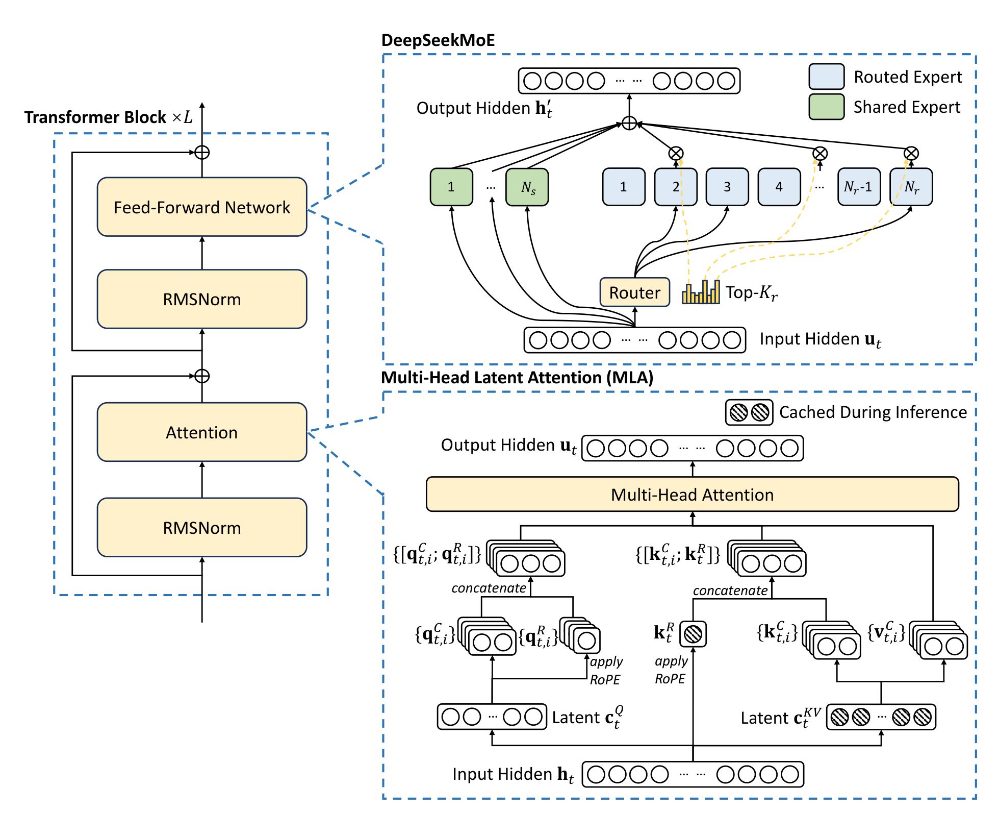

# DeepSeek-V3 技术报告

## 来源

- 原始 PDF：[raw/2412.19437v2.pdf](../../raw/2412.19437v2.pdf)
- 标题：DeepSeek-V3 Technical Report
- 版本/日期：arXiv:2412.19437v2，2025-02-18。首页即该条目。
- 团队：DeepSeek-AI
- 概念页：[Multi-Head Latent Attention](../concepts/multi-head-latent-attention.md)、[MoE 负载均衡谱系](../concepts/moe-load-balancing.md)、[多 Token 预测](../concepts/multi-token-prediction.md)

## 核心结论

DeepSeek-V3 是 671B 总参数、每 token 激活 37B 的 MoE 语言模型，预训练 14.8T token。注意力与前馈的基本骨架是已在 [DeepSeek-V2](deepseek-v2.md) 里验证过的 [MLA](../concepts/multi-head-latent-attention.md) 和 DeepSeekMoE。摘要和 §1 把额外策略写成两件：一是为负载均衡采用 auxiliary-loss-free（引用 Wang et al. 2024a，即 [Loss-Free Balancing](loss-free-balancing.md)），二是把 multi-token prediction（MTP）设为训练目标。

全文训练用 2.788M H800 GPU 小时（Table 1，按 $2/GPU·hour 折合 $5.576M）。作者写明全程没有不可恢复的 loss spike，也没有回滚。Table 6 的 caption 把聊天版写成表内最好的开源模型，并与 GPT-4o-0513、Claude-3.5-Sonnet-1022 竞争；分项谁高谁低以下表为准。

§2 写明：没有点名的细节遵循 V2。相对 V2，这一节点名的架构例外是 DeepSeekMoE 的 auxiliary-loss-free；MTP 在 §2.2。注意力节只复述 MLA。

## 架构与训练

### 规模与 MLA

> Figure 2（原文截图，§2.1）：Illustration of the basic architecture of DeepSeek-V3. Following DeepSeek-V2, we adopt MLA and DeepSeekMoE for efficient inference and economical training.

§2.1.1 把 MLA 公式再写一遍：KV 压到 latent $c^{KV}_t$，解耦 key 为 $k^R_t=\mathrm{RoPE}(W^{KR} h_t)$，推理时只缓存这两个向量；query 也做低秩压缩，原文给出的目的仍是降低训练激活显存。注意力输出前的缩放分母是 $\sqrt{d_h+d_h^R}$。

§4.2 的宽度与 [V2 超参段](deepseek-v2.md) 是同一组五个数（已重读两份 PDF）：$n_h=128$、$d_h=128$、$d_c=512$、$d_c'=1536$、$d_h^R=64$。变的是外壳：61 层、hidden 7168。V2 是 60 层、hidden 5120。V3 还写：压缩 latent 之后另有 RMSNorm，宽度瓶颈处另有缩放，并且「As DeepSeek-V2」。这句把这两处写成沿用，不是新的注意力变体。

投影形状随 hidden 从 5120 变为 7168，低秩宽度本身不变。矩阵与缓存元素数的展开见 [MLA 概念页](../concepts/multi-head-latent-attention.md#从-v2-到-v4)。

### DeepSeekMoE 与 auxiliary-loss-free

§4.2：除前三层外，FFN 都换成 MoE。每层 1 个 shared expert、256 个 routed expert，专家中间维 2048；每 token 激活 8 个 routed expert，并保证送到至多 4 个节点。V2 超参段是「除第一层外」换成 MoE，且为 2 shared + 160 routed、每 token 激活 6 个、专家中间维 1536。这是层类型和专家规模，不是 MLA 宽度。

门控有一处作者自己标成 “Slightly different from DeepSeek-V2”：亲和分改为 $s_{i,t}=\mathrm{Sigmoid}(u_t^\top e_i)$，再在被选中的亲和分上归一化得到门控值。V2 对应公式是 $s_{i,t}=\mathrm{Softmax}_i(u_t^\top e_i)$，选中后的门控直接取该亲和分（V2 式 (21)–(22)，已重读）。

**Auxiliary-loss-free（§2.1.2，引用 Wang et al. 2024a）。** 每个专家有 bias $b_i$。top-K 看的是 $s_{i,t}+b_i$，但乘到 FFN 输出上的门控仍来自原始亲和分 $s_{i,t}$。每个训练步结束时，看这一步整个 batch 的专家负载：过载则该 bias 减 $\gamma$，欠载则加 $\gamma$。$\gamma$ 称为 bias update speed。原文把这一步写成固定步长的加减，没有重印方法论文 Algorithm 1 的 $e_i=\bar c-c_i$ 与 $\mathrm{sign}$ 符号。方向与所引论文一致：过载下调、欠载上调。方法论文 Figure 4 的扫描和「甜点值」论证不是本报告的句子；本报告只在 §4.2 给出自己的 $\gamma$ 日程。

§4.2：前 14.3T token $\gamma=0.001$，最后 500B token $\gamma=0$。$\gamma=0$ 写的是停止更新，原文没有写 bias 被清零。

**互补的 sequence-wise balance loss。** 主平衡靠上面的 bias。为避免单条序列内部极端失衡，另加

$$\mathcal{L}_{\mathrm{Bal}}=\alpha\sum_{i=1}^{N_r} f_i P_i$$

$\alpha$ 取极小值。§4.2 设 $\alpha=0.0001$。式 (18) 的 $f_i$ 用指示函数统计 $s_{i,t}$ 是否落入未加 bias 的 top-K；式 (16) 的实际路由用的是 $s_{i,t}+b_i$。两式在原文里就是这样并列的，正文没有说明这两个 top-K 集合为何不同。

**Node-limited routing。** 与 V2 的 device-limited routing 同类，限制改到节点：每个 token 最多送到 $M$ 个节点，节点按该节点上专家里最高的 $K_r/M$ 个亲和分之和来选。训练取 $M=4$。代入 §4.2 的 $K_r=8$，即每个候选节点取最高的 2 个亲和分再求和（本页代入，不是另一条超参）。路由专家均匀放在 8 个节点共 64 张 GPU 上。作者称在此约束下，训练框架几乎能把计算和 all-to-all 完全重叠。

**不丢 token。** 作者把训练全程的负载平衡归因于上述策略，因此训练不丢 token；推理侧另有部署策略保证负载，推理也不丢 token。这和 V2 训练时的 device-level token-dropping 是两套写法。

### MTP

§2.2 受 Gloeckle et al. (2024) 启发，但实现不同：Gloeckle 用相互独立的输出头并行预测额外 token；V3 用 $D$ 个顺序模块，每一深度都保留完整因果链。作者把「保留因果链」比作 EAGLE，并写明 EAGLE 的目标是 speculative decoding，这里用 MTP 是为了改进训练。

第 $k$ 个 MTP 模块与主模型共享 embedding 和 output head，自带一个 Transformer block 和投影 $M_k\in\mathbb{R}^{d\times 2d}$。输入是上一深度的表示与再往后一个 token 的 embedding，各自 RMSNorm 后拼接再投影。损失是各深度交叉熵的平均，再乘权重 $\lambda$。

发布配置 $D=1$：除下一个 token 外，再预测一个 token。§4.2：前 10T token $\lambda=0.3$，其余 4.8T token $\lambda=0.1$。

推理时可以丢掉 MTP 模块，主模型单独工作；也可以把这些模块转成 speculative decoding。§5.4.3：第二 token 的接受率在不同生成主题上约为 85%–90%，据此给出 1.8 倍 TPS。这是该节的实测范围，不是某张基准表的一格。

### 预训练日程与花费

语料相对 V2 提高了数学和编程比例，并把多语覆盖扩到英语、中文以外。文档打包，训练时不做跨样本的 attention mask。Fill-in-the-Middle 用 Prefix-Suffix-Middle，比例 0.1。分词器是 byte-level BPE，词表 128K；新的 pretokenizer 把标点与换行合成 token，训练时随机拆开其中一部分，用来减轻无结尾换行的 few-shot 提示上的 token boundary bias。

优化器 AdamW，$\beta_1=0.9$，$\beta_2=0.95$，weight decay 0.1，梯度裁剪 1.0。预训练序列长度 4K。学习率：前 2K 步从 0 线性升到 $2.2\times 10^{-4}$，保持到 10T token，再在 4.3T token 上余弦降到 $2.2\times 10^{-5}$；最后 500B token 里，前 333B 保持 $2.2\times 10^{-5}$，后 167B 改为 $7.3\times 10^{-6}$。batch 在前 469B token 内从 3072 增到 15360，之后保持 15360。可学习参数初始化标准差 0.006。

长上下文在预训练之后用 [YaRN](yarn.md) 做两段，各 1000 step，从 4K 到 32K 再到 128K。原文写配置与 V2 一致，且只加在解耦共享 key $k^R_t$ 上：scale $s=40$，$\alpha=1$，$\beta=32$，$\sqrt{t}=0.1\ln s+1$。第一段序列 32K、batch 1920；第二段序列 128K、batch 480。两段学习率都是 $7.3\times 10^{-6}$。Figure 8 的 Needle-in-a-Haystack 是监督微调之后的结果，原文只给出「直到 128K 都稳健」的定性结论，本页不另嵌该图，也不补一个图上没有写成表格的分数。

| 阶段 | H800 GPU 小时 | 美元（$2/GPU·hour） |
| --- | ---: | ---: |
| Pre-Training | 2664K | $5.328M |
| Context Extension | 119K | $0.238M |
| Post-Training | 5K | $0.01M |
| Total | 2788K | $5.576M |

> Table 1（§1）：费用只包含 DeepSeek-V3 的正式训练，不含在此之前的架构、算法或数据消融。

正文另写：每 1T token 180K H800 GPU 小时，在 2048 张 H800 上 3.7 天；预训练不到两个月。$14.8\times 180=2664$，与表内预训练小时数一致（本页核对）。

集群是 2048 张 H800，节点内 8 卡 NVLink，节点间 InfiniBand。训练框架用 DualPipe 做流水线并行并重叠计算与通信，另有跨节点 all-to-all kernel；内存优化之后，这次训练不使用 tensor parallelism。FP8 混合精度被写成首次在极大规模模型上验证；AdamW 的一阶、二阶矩用 BF16，master weight 和用于累加的梯度仍是 FP32。§3.5 是给后续芯片的通信卸载和 FP8 累加精度建议，不是这轮训练已经换到的硬件。

### 小模型消融不能当成 671B 的配方对照

Table 4（MTP）和 Table 5（auxiliary-loss-free）都是小 MoE（15.7B 总参 / 2.4B 激活，1.33T token）和大 MoE（228.7B / 20.9B；MTP 用 540B token，负载均衡用 578B token）。推理时丢掉 MTP 模块，所以表内对比的推理成本相同。原文的概括是 most benchmarks 上更好。表内反例包括：Table 4 大模型 MMLU 67.5（baseline）对 66.6（带 MTP）；Table 5 大模型 MMLU 68.3（aux-loss-based）对 67.2（aux-loss-free），小模型 MBPP 36.6 对 35.8。

Table 5 的 aux-loss-free 列是去掉全部 auxiliary loss 之后只留 bias。正式的 671B 训练仍保留 $\alpha=0.0001$ 的 sequence-wise loss。两列不是同一训练目标。

§4.5.3 用 1B / 3B 的验证 loss 比较三种目标：1B 上 sequence-wise auxiliary loss 2.258，auxiliary-loss-free 与 batch-wise auxiliary loss 都是 2.253；3B 上分别是 2.085 与 2.080、2.080。同一节用 16B 模型在 Pile 测试集的三个域上比较专家负载，并写 auxiliary-loss-free 的专家专业化更强。这组 loss 和 16B 负载都不是 671B 运行本身。

## 后训练

### SFT

指令数据 1.5M 条，领域各自构造。推理数据（数学、编程竞赛、逻辑）来自内部 DeepSeek-R1。作者写 R1 样本准确率高，但有 overthinking、格式差、过长的问题。做法是先为代码、数学或通用推理各训一个专家模型（该专家自己走 SFT + RL），用它给最终模型产数据。每个实例有两类样本：`<problem, original response>`，以及带系统提示的 `<system prompt, problem, R1 response>`。系统提示要求反思和检验。专家模型的 RL 用高温采样，在没有这条系统提示时也把两类模式混进回答；原文写「hundreds of RL steps」后，中间 RL 模型学会并入 R1 的模式。RL 结束后用拒绝采样整理最终 SFT 数据。这里的步数指的是专家模型，不是 671B 最终 RL 的步数表。

非推理数据（创作、角色、简单问答）由 DeepSeek-V2.5 生成，人工核对正确性。

最终 SFT：从 DeepSeek-V3-Base 微调 2 个 epoch，余弦学习率从 $5\times 10^{-6}$ 降到 $1\times 10^{-6}$。序列由多条样本打包，但用 sample masking，使这些样本互不可见。

### RL：规则奖励、模型奖励与 GRPO

规则奖励用于能判定的题：数学要求把最终答案放进指定格式（例如 box），LeetCode 用编译器和测试用例。自由形式且有参考答案的题，由奖励模型判断是否匹配；创作类没有标准答案，奖励模型直接按问题和回答给反馈。奖励模型从 DeepSeek-V3 的 SFT checkpoint 训起。偏好数据除最终奖励外还包含通向该奖励的 chain-of-thought，作者写这是为了降低特定任务上的 reward hacking。

RL 算法与 V2 一样采用 [GRPO](deepseekmath.md)（Shao et al., 2024）：不用与策略同规模的 critic，advantage 来自同组输出奖励的均值和标准差，目标里有概率比的 clip，以及相对 reference 的 KL。式 (26) 的 $\varepsilon$ 和 $\beta$ 在本节没有给出 V3 的数值。提示覆盖代码、数学、写作、角色扮演和问答。

§5.4.1 的蒸馏对照做在 DeepSeek-V2.5 上，不是 671B 全程。Table 9：短 CoT 数据训出的 V2.5 baseline，LiveCodeBench-CoT Pass@1 为 31.1（平均长度 718），MATH-500 为 74.6（长度 769）；换上专家 checkpoint 产生的蒸馏数据后为 37.4（783）和 83.2（1510）。原文写蒸馏提高了分数，也明显拉长了回答，并为 V3 挑选了平衡点，但没有给出 V3 自己的混合比例。Table 9 的 baseline 是这组短 CoT 对照；Table 6 里发布版 V2.5-0905 的 LiveCodeBench-CoT 是 29.2，两格不要并成同一次运行。

§5.4.2：在难以用外部工具验证的一般场景，用 constitutional AI，把 DeepSeek-V3 自己的投票评测当作反馈。Table 8 是它作为生成式奖励模型的 RewardBench 分数，见下节。

## 评测要点

评测数字只取能对上表格的格子。Figure 1 的六项与 Table 6 同一行一致，下面直接用 Table 6。输出长度上限 8192 token。AIME 2024 与 CNMO 2024 温度 0.7、16 次平均；MATH-500 贪心解码。SWE-Bench Verified 用 agentless 框架。少于 1000 个样本的基准用不同温度多次测试。Codeforces 列是 percentile。

Table 6 中与 Figure 1 对齐的六项（聊天模型，8K 输出上限）：

| 基准 | DeepSeek-V3 | V2.5-0905 | Qwen2.5-72B-Inst | Llama-3.1-405B-Inst | GPT-4o-0513 | Claude-3.5-Sonnet-1022 |
| --- | ---: | ---: | ---: | ---: | ---: | ---: |
| MMLU-Pro (EM) | 75.9 | 66.2 | 71.6 | 73.3 | 72.6 | 78.0 |
| GPQA-Diamond (Pass@1) | 59.1 | 41.3 | 49.0 | 51.1 | 49.9 | 65.0 |
| MATH-500 (EM) | 90.2 | 74.7 | 80.0 | 73.8 | 74.6 | 78.3 |
| AIME 2024 (Pass@1) | 39.2 | 16.7 | 23.3 | 23.3 | 9.3 | 16.0 |
| Codeforces (Percentile) | 51.6 | 35.6 | 24.8 | 25.3 | 23.6 | 20.3 |
| SWE Verified (Resolved) | 42.0 | 22.6 | 23.8 | 24.5 | 38.8 | 50.8 |

同表里 V3 的另外几格：MMLU 88.5（Llama-3.1-405B-Inst 88.6），DROP 91.6，SimpleQA 24.9（GPT-4o-0513 为 38.2），C-SimpleQA 64.8（表内最高），LongBench v2 48.7，Aider-Polyglot 49.6（Claude-3.5-Sonnet-1022 为 45.3）。§5.3.2 把 AIME、MATH-500、CNMO 相对 Qwen2.5-72B 写成大约 10 个绝对点。按 Table 6 相减：AIME $39.2-23.3=15.9$，MATH-500 $90.2-80.0=10.2$，CNMO $43.2-15.9=27.3$（本页计算）。三行不能同时收成「大约 10」。

Base 模型在 Table 3，全部模型用同一套内部框架。表题写明：分差不超过 0.3 视为同一水平。V3-Base 在数学和代码的多行上高于表内另外三列，例如：

| 基准 | V2-Base | Qwen2.5 72B Base | Llama-3.1 405B Base | V3-Base |
| --- | ---: | ---: | ---: | ---: |
| MMLU (EM, 5-shot) | 78.4 | 85.0 | 84.4 | 87.1 |
| BBH (EM, 3-shot) | 78.8 | 79.8 | 82.9 | 87.5 |
| HumanEval (Pass@1, 0-shot) | 43.3 | 53.0 | 54.9 | 65.2 |
| GSM8K (EM, 8-shot) | 81.6 | 88.3 | 83.5 | 89.3 |
| MATH (EM, 4-shot) | 43.4 | 54.4 | 49.0 | 61.6 |
| CMMLU (EM, 5-shot) | 84.0 | 89.5 | 73.7 | 88.8 |
| Pile-test (BPB，越低越好) | 0.606 | 0.638 | 0.542 | 0.548 |
| RACE-Middle (EM, 5-shot) | 73.1 | 68.1 | 74.2 | 67.1 |

CMMLU、Pile-test 和 RACE-Middle 上 V3-Base 不是该行最高或最低（BPB）。原文的概括是 most benchmarks，不是每一行。

RewardBench（Table 8）：

| 模型 | Chat | Chat-Hard | Safety | Reasoning | Average |
| --- | ---: | ---: | ---: | ---: | ---: |
| GPT-4o-0513 | 96.6 | 70.4 | 86.7 | 84.9 | 84.7 |
| Claude-3.5-sonnet-1022 | 96.4 | 79.7 | 91.1 | 87.6 | 88.7 |
| DeepSeek-V3 | 96.9 | 79.8 | 87.0 | 84.3 | 87.0 |
| DeepSeek-V3 (maj@6) | 96.9 | 82.6 | 89.5 | 89.2 | 89.6 |

## 推理部署里写明的并行

§3.4 的已部署数字与「正在探索」的动态冗余要分开。

Prefill 的最小单元是 4 节点 32 GPU。注意力为 TP4 + sequence parallelism，再加 DP8；MoE 为 EP32。浅层稠密 MLP 用 TP1。冗余专家按在线负载统计周期调整（举例为每 10 分钟），并在节点内重排，以免增加跨节点 all-to-all。Prefill 设 32 个冗余专家；每张 GPU 在原有 8 个专家之外再放 1 个冗余专家。Prefill 同时处理两个计算量接近的 micro-batch，用一个 batch 的 attention 与 MoE 重叠另一个 batch 的 dispatch 和 combine。

Decode 把 shared expert 当作必选的重负载专家，于是每个 token 在路由里选 9 个专家。最小单元是 40 节点 320 GPU：注意力 TP4 + SP + DP80，MoE 为 EP320。每张 GPU 只放 1 个专家，另有 64 张 GPU 负责冗余专家和 shared expert。Dispatch / combine 走 InfiniBand 点对点，并用 IBGDA。

「每张 GPU 放更多专家（例如 16 个），每步只激活 9 个」以及 decode 阶段同时跑两个 micro-batch，原文都写成正在探索，不是上面已经写死的 8+1 与单专家部署。

## 证据边界与阅读提示

- 五个 MLA 宽度与 V2 超参段一致。61 层、hidden 7168、前三层稠密 FFN、sigmoid 门控、1 shared + 256 routed，都是 V3 自己的规模或门控写法，不改那五个宽度。
- §2 的注意力是 MLA。lightning indexer 与 token 级稀疏选择写在后续报告 [DeepSeek-V3.2](deepseek-v32.md)，不在本 PDF 的架构节。
- 与 [Loss-Free Balancing](loss-free-balancing.md) 的关系停在本报告的引用和 §2.1.2、§4.2 自己写下的规则：bias 只进 top-K，更新是过载减 $\gamma$、欠载加 $\gamma$，$\gamma$ 先 0.001 再在最后 500B token 置 0，另加 $\alpha=0.0001$ 的序列级损失。方法论文的 Figure 4、以及更晚模型报告里的配方，都不是本报告的句子。
- Table 5 的 aux-loss-free 列去掉了全部 auxiliary loss；671B 正式训练保留序列级项。式 (18) 的频率统计用未加 bias 的 top-K，式 (16) 的路由用 $s+b$。
- MTP 与负载均衡的分数消融在 15.7B / 228.7B，不在 671B。Table 9 的 R1 蒸馏是 V2.5 对照。
- Table 3 注明评测框架相对以往有变动，因此表内 V2-Base 与先前公布结果有小幅差别。本页不把 Table 3 的 V2 列回写成 V2 论文旧表。
- 引言里「在 MATH-500 上超过 o1-preview」没有配 o1 的表内分数。本页不补这个数。
- 训练费用不含先前研究与消融。附录 B 的 FP8 对 BF16 曲线没有收成单一百分比。

## 相关页面

- 上一代与负载均衡对照：[DeepSeek-V2](deepseek-v2.md)、[MoE 负载均衡谱系](../concepts/moe-load-balancing.md)、[Loss-Free Balancing](loss-free-balancing.md)
- 注意力宽度与后续稀疏化：[Multi-Head Latent Attention](../concepts/multi-head-latent-attention.md)、[DeepSeek-V3.2](deepseek-v32.md)
- MTP 与 GRPO 的方法页：[多 Token 预测](../concepts/multi-token-prediction.md)、[DeepSeekMath](deepseekmath.md)（GRPO 的提出处）
- 上下文扩展方法：[YaRN](yarn.md)
