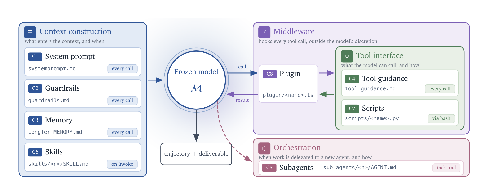
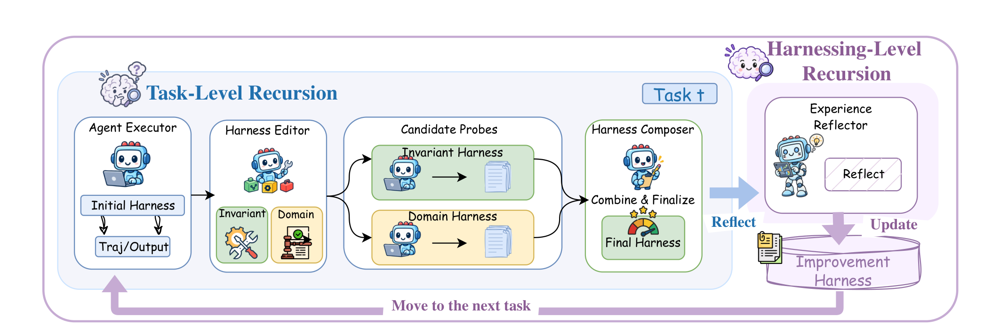
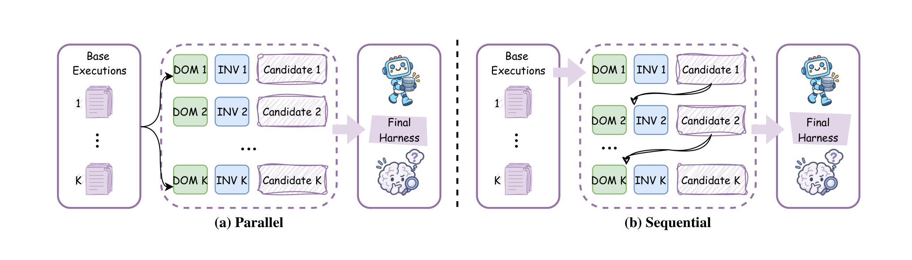
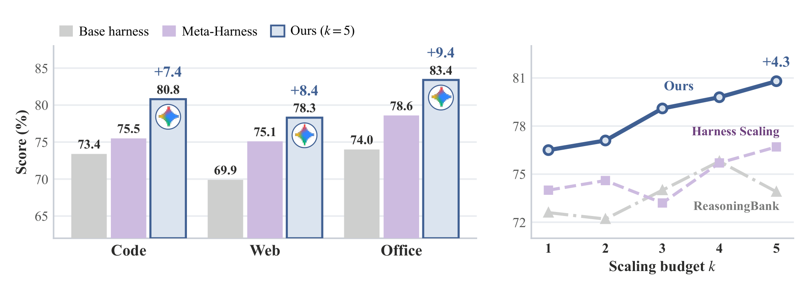
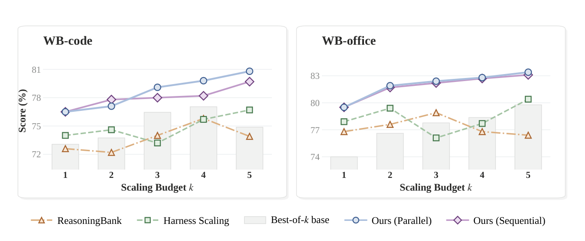
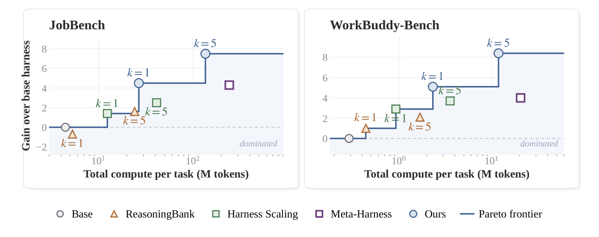
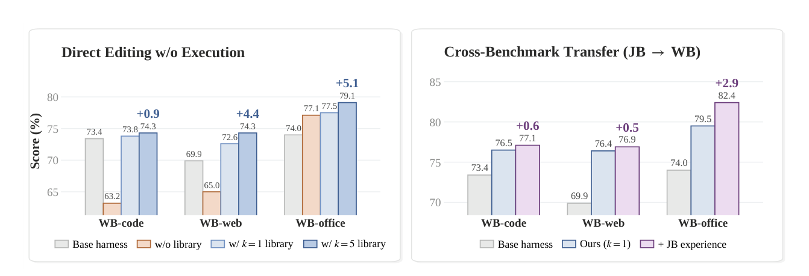
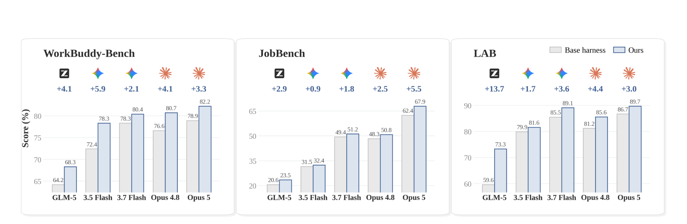

# Harness²

## 来源

- 本地 PDF：[`raw/2610.14224v1.pdf`](../../raw/2610.14224v1.pdf)
- 原文：[arXiv:2610.14224v1](https://arxiv.org/abs/2610.14224)（2026-10-09 提交，cs.AI；PDF 页眉印 2026-10-12）
- 作者：Ruiyao Xu（Northwestern；脚注写明实习于 Google Cloud AI Research）、Yanfei Chen、Zhongying CuiZhu、Bhavana Dalvi Mishra、Yifei Ming、Han Yu、Rujun Han、Chen-Yu Lee、Tomas Pfister。单位是 Northwestern 与 Google Cloud AI Research。通讯作者 ruiyaoxu2028@u.northwestern.edu，以及 yanfeichen、cuizz、chenyulee @google.com（原文确证，首页）
- 篇幅：37 页。正文到第 13 页的结论，参考文献至第 16 页，其后是方法对照、基准协议、实现、补充实验与六段提示词
- 项目链接（印在首页）：[github.com/google-research/harness2](https://github.com/google-research/harness2)、[harness2.github.io](https://harness2.github.io)
- 未建模型页：执行器是冻结的 [GLM-5](glm-5.md)、Gemini 3.5 Flash 等已有模型。被改的是执行 harness 和跨任务改进库

## 核心结论

1. **自改进的对象是两层 harness，不是权重。** 任务级递归改当前题的执行 harness；harness 级递归在交卷之后，把采纳的 harness 和有执行对照支持的教训写入改进库。模型权重、阶段指令和决策规则保持不动（原文确证，§2.1 定义、式 (4)）。
2. **下一题不继承上一题的执行 harness。** 每题都从公共初始 harness $\mathrm{H}_0$ 起步。库里的组件要在 Propose 时被选出来复用或改写，并对照本题证据重核其中的工作区事实（原文确证，§2.3 Reuse；Appendix H Prompt 1）。
3. **编辑信号是行为对照，不是正确答案。** Propose–Probe–Compose 比较同一题、同一模型、同一环境下的轨迹和交付物。对照用来看改动有没有改变目标行为，不验证交付物是否正确。评测分数、rubric 和 grader 结论不进入编辑会话（原文确证，§2.2.1、Appendix D.2）。
4. **单步在四组执行器–初始 harness 上都高于各自的 base。** 最大的一跳是 WorkBuddy-Bench 上 GLM-5 / OpenCode 的三域宏平均 64.2→75.7（+11.5）、JobBench 上 Gemini 3.5 Flash / OpenCode 的 31.5→36.0（+4.5）、LAB Partial 上 GLM-5 / OpenCode 的 59.6→71.4（+11.8 个百分点）。并行 $k=5$ 在这三套上再加 2.9–3.9、3.0–4.2 和 2.6–6.7（原文确证，Table 1–2、§3.2）。
5. **这些增益不是「更强的编辑器」独有。** 主表的编辑器是 Claude Opus 4.8。另有一组实验让执行器和编辑器是同一个模型、OpenCode、$k=2$：从 GLM-5 到 Claude Opus 5 的五个模型在三套基准上都高于自己的 base。正文点名的是 Opus 5 的 +3.3 / +5.5 / +3.0，以及 GLM-5 在 LAB 的 +13.7（原文确证，§4、Figure 8）。这组协议与主表的 $k=1$ + Opus 4.8 编辑器不是同一设置。

## 架构与训练

本文没有新的网络，也没有预训练。「架构」是冻结模型外面的八个可编辑文件，加上两层递归。

### 八个组件

执行 harness 沿用 AHE 的文件分解，再加一个 middleware，共 $K=8$。OpenCode 上常驻的是系统提示、guardrails、memory、工具说明；技能经 skill 工具按需加载，子 agent 经 task 工具另开上下文，脚本走 shell，TypeScript plugin 插在工具循环里。Codex 上常驻文本放在 `AGENTS.md`，按需组件相同。库存 harness 里，常驻文件除基准自带说明外是空的；每个按需目录只有一个占位，用来让编辑器发现这个杠杆存在（原文确证，§2.1、Appendix D.1、Table 5）。

> 原文 Figure 2：The eight harness components in Harness², grouped by their role in the runtime.

| 组 | 组件 | 何时进上下文 | 原文给的角色 |
| --- | --- | --- | --- |
| 上下文 | C1 系统提示、C2 guardrails、C3 memory | 每次调用 | 人设与总流程；与任务无关的硬约束；域内可持久的事实 |
| 上下文 | C6 skills | 被调用时 | 窄流程；不调用则不占上下文 |
| 工具 | C4 工具说明 | 每次调用 | 现有工具何时用、怎么用 |
| 工具 | C7 scripts | 经 bash | 确定性操作，不靠逐 token 推理 |
| 编排 | C5 subagents | task 工具 | 唯一会多开一个推理上下文的组件 |
| middleware | C8 plugin | 工具循环内部 | 约束行为，而不是再写一条可被跳过的提示 |

Table 5 把 C3 写成「域内跨任务持久的事实」。实验协议同时规定每题从 $\mathrm{H}_0$ 重新挂载，跨题保留的是改进库，不是上一题的执行树（原文确证，Table 5 与 §2.3）。因此 C3 是组件类型允许写下的内容；本题的 memory 文件不会自动变成下一题的常驻上下文。

### 任务级：Propose–Probe–Compose

一次对照步骤作用在当前执行 harness $\mathrm{H}$ 和本题已有记录 $\mathrm{E}$ 上，改进 harness $\mathrm{R}_t$ 在整题期间固定：

$$
(\mathrm{H}', e', \xi) = \Phi(q_t, \mathrm{H}, \mathrm{E}; \mathrm{R}_t).
$$

它交回后继 harness、这次执行记录，以及含对照、候选、组合决定和后继执行的步骤记录 $\xi$（原文确证，式 (1)）。

- **Propose。** 先采一条参考执行。参考只暴露 harness 的行为，不判定交付物对错。然后出两份候选：invariant 针对规划、工具、上下文或委派这类可跨域复发的缺陷；domain 针对当前域的知识、流程和约束。候选是直接改组件文件得到的可执行 harness，可以复用库里的组件，但任务事实必须用本题证据核对。
- **Probe。** 每个候选在同一题、匹配的模型和环境下再跑一遍。与参考比较轨迹和交付物，看改动是缓解了目标缺陷、行为没变，还是引入了回退。随机性和模型共有偏差限制了这份证据的可靠性。
- **Compose。** 阅读参考、候选、相对当前 harness 的 diff 和本题全部执行证据，可以合并有支持的改动、改写冲突、只采纳一方，或保留当前 harness。每条决定要绑到一条具体观察。组合结果再执行一次，得到 $e'$。

> 原文 Figure 3：The Harness² pipeline. Task-level recursion proposes invariant and domain-specific harness edits, probes their effects, and composes a successor execution harness. After each task, harnessing-level recursion updates the improvement harness.

### 并行与串行

正整数 $k$ 是探索预算。并行是每个 scope $k$ 个候选、$k$ 次组合；串行是 $k$ 步链式修订。改进 harness 在题内仍然固定。$k=1$ 时两种形式都退回上面的单步，并且不做最终选择（原文确证，§2.2.2）。

> 原文 Figure 4：(a) Parallel recursion probes multiple candidates and independently composes successor harnesses. (b) Sequential recursion carries each refined harness and accumulated execution evidence into the next step.

并行收集当前 harness 的 $k$ 条参考执行，再独立提议并探测 $k$ 个 invariant 与 $k$ 个 domain 候选。$k$ 个组合会话各自看到全池，各交一份后继并执行。实现只做一次群体更新：$k$ 控制宽度，不控制深度（原文确证，式 (2)）。

串行从 $\mathrm{H}^{(0)}=\mathrm{H}_0$ 起做 $k$ 步。初始历史里有 $k$ 条 base 执行，每步之后把 $\xi^{(r)}$ 追加进去。后步可以按新旧证据保留、修改或纠正前步的改动（原文确证，式 (3)）。

$k>1$ 时，一个 agent 选择器只比较匿名交付物和任务材料，交回已有输出，看不到来源 harness，也不合成新内容。被选中的 harness 记为 $\mathrm{H}^\star_t$，星号表示采纳，不是已验证的最优。选择本身不再改 harness（原文确证，§2.2.2 Final Selection）。

### Harness 级递归

交卷后回顾完整改进记录 $\mathrm{D}_t$（参考、候选、探测、组合决定、选中结果）。反思只保留有执行对照支持的教训；仅仅选中一份输出，不构成可迁移性。库条目是一份可执行 harness 加 `EXPERIENCE.md`（适用情境、教训、证据），另有索引。证据不足就不新增经验条目（原文确证，式 (4)、§2.3、Appendix D.2）。

每个基准域有自己的库目录。域内任务按顺序跑，后题可以读先题的条目。各基准流开始时库为空。模型权重、阶段指令和决策规则不随库更新（原文确证，Appendix D.2、§3.1）。

编辑会话把证据放在工作目录的文件里，不内联进提示。有守卫拒绝任何含 grader 结论、rubric 或分数的目录。无效树（技能没有触发句、脚本不能编译、技能调用了却没带上的辅助文件）重试一次；再失败就继承该阶段开始时的树，并记下回退。单次 rollout 上限 200 个模型回合、3600 秒；WorkBuddy-Bench 使用其容器超时，是基准默认的两倍（原文确证，Appendix D.1–D.2）。

提示词要求每条编辑能指到轨迹里的一个时刻，优先顺序是：各次运行已经分歧（模型做得到，只是需要被告诉）、反复出现的具体失败、轨迹里可见但尚未发生的风险。技能目录名必须原样出现在常驻文本的触发句里，否则验证前就会整份丢弃。Harness 可以改「怎么做」，提示词禁止改交付物的字段、列、表或顺序（原文确证，Appendix H Prompt 1）。

### 和邻近 RSI 差在改哪一层

| 系统 | 冻结的东西 | 被改的对象 | 改进信号 |
| --- | --- | --- | --- |
| Harness² | 执行器权重、阶段指令、决策规则 | 本题执行 harness；跨题改进库 | 无标签行为对照；评测分数不进编辑 |
| [Dream-RSI](dream-rsi.md) | coding agent、评测器、执行接口 | 探索策略代码 | 已记录发现树上的回放分 |
| [Macaron MindForge](macaron-v1.md) | base 权重 | HCP / skill / hook，通过后再用轨迹训 LoRA | 真实 harness 上的任务评测 |
| [SoL-Pi](sol-pi.md) | Pi 0.84.2 核心 | 交互环里的 token 开销 | 预声明能力地板内的 auto-research |
| [Prime Agent](prime-agent.md) | L0 权重 | 一条轨迹内的 notes、memories、skills、subagent specs | 轨迹中的 refine |

相关工作把 [Continual Harness](prime-agent.md)（arXiv:2605.09998）记为连续 episode 内的在线适配，并写明「单独一个连续 episode 还不构成这里的任务流协议」。Harness² 的流是逐题、不回放已完成任务、未来题不可见；本题可以在预算内反复执行（原文确证，§5、Appendix A.1 Streaming）。

## 后训练

没有权重后训练。主表编辑器是 Claude Opus 4.8，在 OpenCode 里以高推理力度跑 agent 会话；修订和反思的基线也用这个编辑器。执行器是冻结的 Gemini 3.5 Flash 与 GLM-5，初始 harness 是现成的 OpenCode 与 Codex，每套基准四组配置共用同一步改进（原文确证，§3.1）。

## 评测要点

### 协议

三套职业基准，各自一条测试流。主表是三轮独立流的均值和标准差，每轮打乱任务顺序。`+ Recursion` 行是并行 $k=5$ 相对 $k=1$ 的均值变化，没有再给标准差。`#Steps` 是执行器会话里的模型回合数，不是含编辑成本的总 token（原文确证，§3.1、Appendix B）。

| 基准 | 测试规模 | 分数 | 评判 | 谁能看到训练/开发集 |
| --- | --- | --- | --- | --- |
| WorkBuddy-Bench | 按类别对半切后的测试半：Code 40、Web 35、Office 50 的一半即 25 | 检查项通过比例；Avg. 是三域宏平均 | 确定性检查加 LLM/VLM；需要模型时用 Gemini 3.5 Flash。期望值不暴露给流水线 | 只有 Meta-Harness 用训练半 |
| JobBench | 冻结 31/34 切分中的 34 题测试 | 加权 rubric 得分 / 满分 | Claude Opus 4.8。rubric 不给执行器、编辑器、选择器 | 只有 Meta-Harness 用训练半 |
| LAB | 100 题 held-out，按业务领域分层，覆盖四种工作类型和上下文长度，含一条超过一百万 token 的事项 | Partial：逐条准则的通过率。没有可执行检查 | Claude Sonnet 4.6 | 24 题开发集只给 Meta-Harness 搜索 |

WorkBuddy 的评判模型与其中一个执行器同名；JobBench 的评判与主表编辑器同名。原文没有讨论这两处重叠会不会改变名次。

基线：Base 是初始 harness 不改。ReasoningBank 不改 harness，按嵌入检索同域最近任务的记忆，写回上下文。Meta-Harness 在搜索集上离线搜 harness 代码，测试时原样部署（WorkBuddy / JobBench 用训练半，LAB 用 24 题开发集；10 轮、每轮 2 个候选、每题 3 次重复、margin 0.01）。Harness Scaling 对每题隔离地改 harness，不跨题携带状态，修订会话也看不到分数。Best-of-$k$ 只在缩放图里出现：同一初始 harness 独立执行 $k$ 次，用与 Harness² 相同的选择器交一份交付物（原文确证，§3.1、Appendix C）。

### 主表

WorkBuddy-Bench 的单元格是分数均值（三轮标准差）。最好的单步结果按论文的说法看 Avg.，不是每一个域。

| 执行器 / 初始 harness | 方法 | Code | Web | Office | Avg. |
| --- | --- | --- | --- | --- | --- |
| Gemini 3.5 Flash / OpenCode | Base | 73.4 (3.6) | 69.9 (4.2) | 74.0 (2.2) | 72.4 (0.9) |
| | ReasoningBank | 72.6 (3.1) | 70.7 (6.9) | 76.8 (2.1) | 73.4 (2.5) |
| | Meta-Harness | 75.5 (1.7) | 75.1 (0.6) | 78.6 (1.4) | 76.4 (0.7) |
| | Harness Scaling | 74.0 (1.1) | 74.0 (1.9) | 77.9 (1.3) | 75.3 (0.7) |
| | Harness² $k=1$ | 76.5 (1.3) | 76.4 (4.5) | 79.5 (3.1) | 77.5 (2.5) |
| | $+k=5$ | +4.3 | +1.9 | +3.9 | +3.3 |
| Gemini 3.5 Flash / Codex | Base | 74.0 (1.7) | 72.5 (1.2) | 77.0 (2.2) | 74.5 (1.6) |
| | ReasoningBank | 73.5 (3.3) | 65.7 (2.2) | 78.4 (0.9) | 72.5 (2.2) |
| | Meta-Harness | 74.6 (3.3) | 67.8 (1.5) | 77.6 (1.6) | 73.3 (0.8) |
| | Harness Scaling | 75.5 (2.1) | 69.3 (3.8) | 76.7 (3.8) | 73.8 (1.7) |
| | Harness² $k=1$ | 79.4 (3.6) | 74.7 (3.8) | 78.5 (2.4) | 77.5 (2.0) |
| | $+k=5$ | +1.6 | +2.6 | +4.3 | +2.9 |
| GLM-5 / OpenCode | Base | 58.4 (5.2) | 59.2 (6.9) | 75.1 (3.2) | 64.2 (1.4) |
| | ReasoningBank | 63.3 (4.3) | 61.4 (4.2) | 72.0 (0.9) | 65.6 (1.2) |
| | Meta-Harness | 69.0 (1.2) | 61.9 (4.1) | 78.1 (1.3) | 69.7 (0.6) |
| | Harness Scaling | 60.3 (2.6) | 63.4 (2.2) | 79.8 (3.0) | 67.8 (1.3) |
| | Harness² $k=1$ | 77.1 (2.7) | 69.1 (3.3) | 80.8 (2.6) | 75.7 (2.2) |
| | $+k=5$ | +4.8 | +5.3 | +1.7 | +3.9 |
| GLM-5 / Codex | Base | 56.8 (2.7) | 59.6 (1.0) | 76.9 (2.4) | 64.4 (1.2) |
| | ReasoningBank | 50.2 (3.8) | 66.3 (2.5) | 75.8 (4.2) | 64.1 (0.9) |
| | Meta-Harness | 76.8 (1.9) | 67.8 (4.1) | 77.9 (2.8) | 74.2 (1.6) |
| | Harness Scaling | 49.5 (3.9) | 60.9 (1.7) | 78.2 (2.4) | 62.9 (1.3) |
| | Harness² $k=1$ | 74.9 (1.5) | 70.0 (4.3) | 81.1 (2.0) | 75.3 (1.3) |
| | $+k=5$ | +2.3 | +3.3 | +3.2 | +3.0 |

+11.5 是 GLM-5 / OpenCode 的 Avg.（64.2→75.7），其中 Code 58.4→77.1。单步之后，GLM-5 的两套 Avg. 75.7 与 75.3 高于 Gemini 在对应初始 harness 上的 base 72.4 与 74.5。GLM-5 / Codex 的 Code 上，离线 Meta-Harness 的 76.8 仍高于单步 Harness² 的 74.9；论文声称超过基线的是 Avg.，不是每个域（原文确证，Table 1、§3.2）。

执行器步数不必随分数上升。GLM-5 / OpenCode 的 Avg. 步数从 13.5 到 13.7，分数 +11.5。Gemini 3.5 Flash / OpenCode 的 Avg. 步数从 25.4 降到 21.9，再加并行递归还要 −0.8。ReasoningBank 在编码任务上最多比 base 低 6.6（GLM-5 / Codex 的 Code，56.8→50.2）。Harness Scaling 在十二个基准–配置对里有七对低于 base（原文确证，Table 1、§3.2）。

> 原文 Figure 1：Left: WorkBuddy-Bench by domain for Gemini 3.5 Flash under OpenCode. Harness² with parallel recursion at $k=5$ exceeds the strongest baseline in every domain, Meta-Harness. Right: on WB-code, Harness² keeps improving as the budget $k$ grows.

左图三域是 80.8 / 78.3 / 83.4，相对 base 的 +7.4 / +8.4 / +9.4 与 Table 1 的 $k=1$ 再加递归增量一致（76.5+4.3、76.4+1.9、79.5+3.9）。

JobBench 分数与 LAB Partial。单元格仍是三轮均值（标准差）。

| 执行器 / 初始 harness | 方法 | JobBench | LAB Partial |
| --- | --- | --- | --- |
| Gemini 3.5 Flash / OpenCode | Base | 31.5 (1.1) | 79.9 (0.6) |
| | ReasoningBank | 30.8 (2.3) | 77.3 (3.1) |
| | Meta-Harness | 35.8 (1.0) | 81.6 (3.9) |
| | Harness Scaling | 32.9 (3.1) | 78.9 (4.3) |
| | Harness² $k=1$ | 36.0 (2.3) | 81.9 (0.6) |
| | $+k=5$ | +3.0 | +2.6 |
| Gemini 3.5 Flash / Codex | Base | 33.9 (2.6) | 71.6 (1.3) |
| | ReasoningBank | 30.2 (2.7) | 74.8 (0.9) |
| | Meta-Harness | 34.8 (1.6) | 76.5 (2.1) |
| | Harness Scaling | 33.6 (0.6) | 67.9 (2.4) |
| | Harness² $k=1$ | 35.3 (3.5) | 75.6 (4.5) |
| | $+k=5$ | +4.2 | +2.9 |
| GLM-5 / OpenCode | Base | 20.6 (2.0) | 59.6 (2.7) |
| | ReasoningBank | 20.7 (1.2) | 71.3 (1.3) |
| | Meta-Harness | 20.9 (2.3) | 60.0 (1.1) |
| | Harness Scaling | 19.3 (2.2) | 67.8 (2.8) |
| | Harness² $k=1$ | 24.2 (0.9) | 71.4 (2.9) |
| | $+k=5$ | +4.2 | +6.7 |
| GLM-5 / Codex | Base | 23.6 (2.3) | 58.1 (2.3) |
| | ReasoningBank | 22.8 (3.9) | 63.8 (3.3) |
| | Meta-Harness | 23.9 (1.4) | 59.0 (1.4) |
| | Harness Scaling | 17.5 (3.3) | 63.7 (2.8) |
| | Harness² $k=1$ | 24.8 (0.2) | 65.9 (2.7) |
| | $+k=5$ | +3.1 | +4.8 |

四组配置里，单步 JobBench 分数都高于同表其他方法。LAB 上，Gemini / Codex 的 Meta-Harness 76.5 高于单步 75.6，这是论文点名的例外。GLM-5 / OpenCode 的 LAB 上，ReasoningBank 71.3 与 Harness² 71.4 落在彼此的标准差里。Gemini 在 JobBench 上的单步增益是 +4.5 与 +1.4，GLM-5 是 +3.6 与 +1.2：JobBench 上更大的一跳在更强的执行器（原文确证，Table 2、§3.2）。

并行 $k=5$ 之后，JobBench 上 OpenCode 与 Codex 的初始差距从 Gemini 的 2.4、GLM-5 的 3.0 都收到 0.5。WorkBuddy 上 Gemini 的差距从 2.1 收到 0.4，GLM-5 的差距从 0.2 增到 1.3。递归没有一律抹平初始 harness 的差别（原文确证，§3.2）。

### 预算、算力与消融

> 原文 Figure 5：Performance comparison on WB-code and WB-office as the scaling budget $k$ increases.

正文写两条递归曲线从 $k=1$ 到 $5$ 单调上升：并行在 Code 上 76.5→80.8，Office 上 79.5→83.4。这两个 $k=1$ 端点与 Table 1 的 Gemini 3.5 Flash / OpenCode 一致；这一段没有把执行器名字再写一遍。$k=5$ 时并行高于串行，Code 在 $k=2$ 时串行更高。两种递归在 $k=2$ 时都高于图中每条基线的 $k=5$。Harness Scaling 在两个域上都从 $k=2$ 退到 $k=3$。并行会话可以并发，实际延迟还取决于并发额度和 rollout 时长（原文确证，§4、Figure 5）。

> 原文 Figure 6：Compute–performance trade-off on JobBench and WorkBuddy-Bench.

总 token 计入最终交付之前的执行和改写。Gemini 3.5 Flash / OpenCode 上，$k$ 从 1 到 5 使相对 base 的增益在 JobBench 上从 4.5 到 7.5，在 WorkBuddy-Bench 上从 5.1 到 8.4。这两个 $k=1$ 增益等于 Table 1–2 的宏平均差（72.4→77.5、31.5→36.0）。图上两个 Harness² 点在经验 Pareto 前沿上。Meta-Harness 的算力高于 $k=5$ 的 Harness²，性能更低（原文确证，§4、Figure 6）。附录 F 写明这是有界预算上的代价刻画，没有给出普遍最优的 $k$。

消融固定 Gemini 3.5 Flash / OpenCode、$k=1$，因此和测试时预算分开。去掉库：仍逐题改进，但不读不写库。去掉分工：两个编辑器都变成通用角色，候选数和探测预算不变，只是不再按声明的 scope 读轨迹。去掉组合：两份候选都探测，然后交证据所偏向的那一份，不再拼接（原文确证，§4、Table 3）。

| 设置 | WorkBuddy Avg. | JobBench |
| --- | ---: | ---: |
| Harness² | 77.5 | 36.0 |
| 无库 | 74.4 | 34.2 |
| 无分工 | 74.6 | 32.3 |
| 无组合 | 75.9 | 34.1 |

三者分别掉 3.1 / 1.8、2.9 / 3.7、1.6 / 1.9。

另一组消融是在已经改进好的 harness 上删组件，不再重跑改进。Full 是并行 $k=5$。

| 配置 | Code | Web | Office | Avg. |
| --- | ---: | ---: | ---: | ---: |
| Base | 73.4 | 69.9 | 74.0 | 72.4 |
| Harness² full | 80.8 | 78.3 | 83.4 | 80.8 |
| 去掉成组提示组件 | 78.8 | 76.0 | 83.1 | 79.3 |
| 去掉 skills | 77.2 | 71.4 | 77.9 | 75.5 |
| 去掉 scripts | 79.3 | 76.0 | 76.0 | 77.1 |

三域平均上，skills、scripts、提示组分别掉 5.3、3.7、1.5。Code 与 Web 上去掉 skills 最多（3.6 与 6.9），Office 上去掉 scripts 最多（7.4）。每一种删减后仍高于 base。论文写明这不建立可加性（原文确证，Table 6）。

### 库能不能帮到以后的题

> 原文 Figure 7：Left: direct refinement with the improvement harness. Right: JobBench-to-WorkBuddy-Bench library transfer for one-step refinement.

不给参考执行、候选探测和改进库，直接改 base，Code 73.4→63.2，Web 69.9→65.0。同一张图上 Office 是 74.0→77.1，正文只说 Code 与 Web 变差。$k=1$ 积累的库把三域放到 73.8 / 72.6 / 77.5；正文的说法是「恢复到 base」。$k=5$ 的库在不再继续探测的条件下，相对 base 为 +0.9 / +4.4 / +5.1，即 74.3 / 74.3 / 79.1。图中 base、单步 76.5 / 76.4 / 79.5 与 Table 1 的 Gemini 3.5 Flash / OpenCode 一致（原文确证，§4、Figure 7）。

右图是把 JobBench 上积累的库用于 WorkBuddy 的单步精炼，三域相对已经做完的单步再 +0.6 / +0.5 / +2.9（77.1 / 76.9 / 82.4）。

流结束后做 leave-one-out：每题重跑时拿掉它自己的条目，因此看得到更晚的题。WorkBuddy 77.5→79.4，JobBench 36.0→37.7。论文把它标成回顾性复用，不是在线增益，并写明重复执行本身也可能造成差值（原文确证，§4、Figure 11）。

库的来源统计：修改过的文件里，能在精炼当时的库快照中找到出处的，LAB 与 WB-office 为 22%，JobBench 为 47%。至少一半行来自某条目的只有 2–10%。技能和脚本大约占各基准编辑的一半。测量前去掉了在该基准已采纳 harness 里出现于五分之一以上的样板行（原文确证，§E.2、Figure 10）。

### 同一个模型改自己，以及换执行器

> 原文 Figure 8：Base harness versus Harness² with OpenCode at $k=2$. Annotations show score gains.

Figure 8 是位图。下面的格子按图中标注读出；正文只书面确认了 Opus 5 的三项增益和 GLM-5 在 LAB 的 +13.7。GLM-5 与 Gemini 3.5 Flash 的 base 与 Table 1–2 的 OpenCode 列一致。

| 模型 | WorkBuddy | JobBench | LAB |
| --- | --- | --- | --- |
| GLM-5 | 64.2→68.3（+4.1） | 20.6→23.5（+2.9） | 59.6→73.3（+13.7） |
| Gemini 3.5 Flash | 72.4→78.3（+5.9） | 31.5→32.4（+0.9） | 79.9→81.6（+1.7） |
| Gemini 3.7 Flash | 78.3→80.4（+2.1） | 49.4→51.2（+1.8） | 85.5→89.1（+3.6） |
| Claude Opus 4.8 | 76.6→80.7（+4.1） | 48.3→50.8（+2.5） | 81.2→85.6（+4.4） |
| Claude Opus 5 | 78.9→82.2（+3.3） | 62.4→67.9（+5.5） | 86.7→89.7（+3.0） |

把为 Gemini 3.5 Flash / OpenCode 精炼的 harness 原样套到别的执行器上：GLM-5 的 Code 从 58.5 到 75.8（+17.3）；Gemini 3.7 Flash 的 Code +0.3、Office +6.4；Opus 4.8 为 +2.6 与 +1.1。Table 1 里 GLM-5 / OpenCode 的 Code 三轮均值是 58.4 (5.2)。三人都在 Code 和 Office 上高于自己的 base，增益随执行器和域变化很大（原文确证，§E.3、Figure 12）。

生产 harness 对照用的是同一个 Gemini 3.5 Flash：CodeBuddy、OpenCode、Codex、Claude Code 各自不改，对比从 OpenCode 出发、$k=5$ 的 Harness²。固定 harness 里没有一个三域都领先：Claude Code 在 Code 和 Office 上最好，Codex 在 Web 上领先。Harness² 比最强的固定对手高 4.6 / 5.8 / 4.9，相对自己的起点是 Figure 1 的 +7.4 / +8.4 / +9.4。这组对照含额外的测试时计算（原文确证，§E.5、Figure 13）。

工具调用（Gemini 3.5 Flash、OpenCode、$k=1$）：错误率在三套上都下降，JobBench 从 14.4% 到 9.1%。调用次数在 WorkBuddy 上 20.0→17.8，在 JobBench 与 LAB 上 27.4→32.8、20.8→25.2。分数上升不必伴随更短的执行（原文确证，Table 7）。

### 选择器和编辑都会选错

附录 E.6 把九个低于参照的结果分成三类，分数是事后评的，流水线当时看不到。选择器可以偏好更弱的候选：WB-code 上池子里有 95 分的输出，选中了 55；LAB 上更窄的覆盖把 54 打到 26。错误前提会传遍候选：一条字面键名规则或未检查的缓存假设带来 2–11 分的损失，编辑器自己写的检查脚本可以报 PASS。其余回退混有结果波动、评判会话没有返回结论，以及编辑没有碰到被评的准则。论文用这些例子说明：选择要同时看覆盖和精度，探测要能挑战候选之间共享的假设，重复执行才能把编辑效果和结果波动分开（原文确证，§E.6、Figure 14）。

案例只说明诊断如何落到组件，不代表平均幅度。JobBench 的一份制片任务上，base 43.1 的失败是数字没有跨文件核对、写完没有重新打开；组合后保留了两路干预的四处编辑，重跑 77.8。Figure 15–19 还有从只改工具说明（60→100）到八个组件全写（Opus 5 自改，72→100）的个例（原文确证，§4、Figure 9、§E.7）。

附录 F 的边界就两条：递归要额外的执行和编辑会话，并行只减延迟、不取消这些计算；没有地面真值时，行为对照和模型判断仍受执行波动与共享偏差影响，不保证正确，也不保证改动会迁到另一题。

## 相关页面

- [Agent harness](../concepts/agent-harness.md) - 这层膜的跨报告位置
- [Agentic engineering](../concepts/agentic-engineering.md) - 长周期任务把瓶颈放在运行系统上
- [Dream-RSI](dream-rsi.md) - 同样不改发现 agent；信号是发现树回放分
- [Macaron-V1 技术报告](macaron-v1.md) - MindForge 搜可评测的 HCP
- [Prime Agent 技术报告](prime-agent.md) - Continual Harness 写在一条轨迹的 L3 状态里
- [SoL-Pi 官方博客](sol-pi.md) - 在固定 Pi 上削 token，不改题面规则
- [GLM-5 技术报告](glm-5.md) - 主表执行器之一，权重在本实验中冻结
