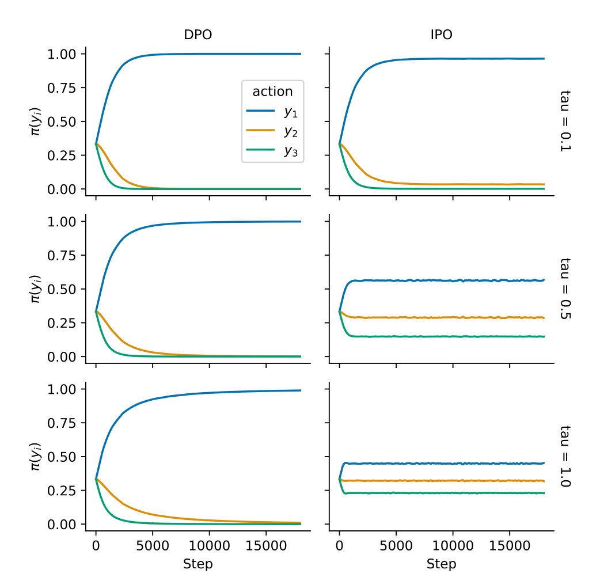
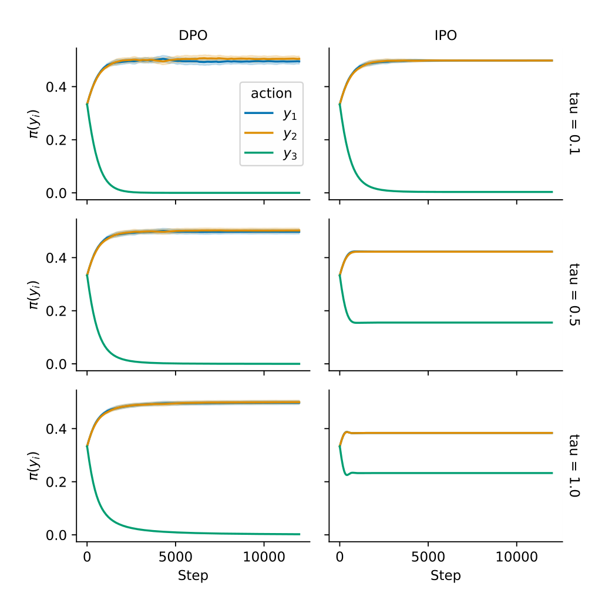

# IPO：Identity Preference Optimisation

## 来源

- 文件：`raw/2310.12036v2.pdf`
- 标题：A General Theoretical Paradigm to Understand Learning from Human Preferences
- 团队 / 日期：Mohammad Gheshlaghi Azar、Mark Rowland、Bilal Piot、Daniel Guo、Daniele Calandriello、Michal Valko、Rémi Munos；Google DeepMind；arXiv:2310.12036v2，2023-11-22。PDF 页眉写 Under review，本文件没有会议版本信息。
- arXiv：<https://arxiv.org/abs/2310.12036>
- 定位：这是 **离线偏好的一般目标 ΨPO**，以及其中 Ψ 取恒等的 **IPO**。不发布模型。实验是 2–3 个动作的 bandit，没有语言模型。
- 易混：本页是 Identity-ΨPO。不要和 [Iterative RPO](iterative-rpo.md)（DPO+NLL）或 [ORPO](orpo.md)（SFT + odds ratio）混名。IPO 的 $\tau$ 是 KL 系数，对应 [DPO](dpo.md) 的 $\beta$，损失形式不同。

## 核心结论

1. **DPO 绕开了奖励模型，仍依赖 Bradley-Terry。** RLHF 有两处近似：成对偏好换成点奖励，以及奖励模型要泛化到策略新采样的动作。DPO 去掉第二处，目标仍把偏好写成 Elo / logit（§1、§4.1）。
2. **ΨPO 用成对偏好直接写目标。** 对非降函数 $\Psi:[0,1]\to\mathbb{R}$，最大化 $\mathbb{E}[\Psi(p^*(y\succ y'\mid x))]-\tau D_{\mathrm{KL}}(\pi\|\pi_{\mathrm{ref}})$（Eq. 6）。$\Psi(q)=\log(q/(1-q))$ 且 Bradley-Terry 成立时，最优策略与 RLHF、DPO 相同（Proposition 1）。
3. **确定性偏好会把 KL 系数消掉。** 若 $p^*(y\succ y')=1$，Bradley-Terry 要求奖励差趋于 $+\infty$，Eq. 7 的最优策略把落败动作的概率打到 0，与 $\tau$ 无关。有限样本里真偏好是 0.8 也可能被估成 1，于是经验最优同样忽略 $\pi_{\mathrm{ref}}$（§4.2）。作者认为 RLHF 实践里奖励模型欠拟合，反而把策略拉回参考策略；DPO 不训奖励模型，这条欠拟合正则就没了。
4. **IPO 是 $\Psi$ 取恒等。** 目标变成总偏好减 KL（Eq. 8）。采样损失把 log-ratio 间隙回归到 $1/(2\tau)$，用平方而不是 logistic（Algorithm 1、Eq. 17）。$\tau$ 大时解靠近 $\pi_{\mathrm{ref}}$，$\tau\to 0$ 才变成确定性最优。
5. **边界：** 唯一性要求 $\mathrm{Supp}(\mu)=\mathrm{Supp}(\pi_{\mathrm{ref}})$（Theorem 2）。支撑更小时 Appendix A.2 给出无穷多解。实验是无上下文的 3 动作 bandit，10 个种子。作者把「扩到人类偏好上的语言模型」写成未来工作（§6）。后来的语言模型对照在 [SimPO](simpo.md) Table 4，不在本 PDF。

## 架构与训练

### ΨPO，以及 DPO 落在哪一档

群体形式的 DPO（Eq. 5）在 Bradley-Terry 完美拟合、且奖励是 logistic 回归最优时，与 KL 正则 RLHF（Eq. 3）的全局最优重合。Proposition 4 放宽了一点：只要 Bradley-Terry 损失有最小值，DPO 与「用这个最小值当奖励的 RLHF」最优策略相同，即使真实 $p^*$ 本身不是 Bradley-Terry。

闭式最优（Eq. 7）：

$$
\pi^*(y)\propto\pi_{\mathrm{ref}}(y)\exp\Bigl(\tau^{-1}\mathbb{E}_{y'\sim\mu}\bigl[\Psi(p^*(y\succ y'))\bigr]\Bigr).
$$

$\Psi=\mathrm{logit}$ 时，括号里的期望等于 $r(y)-\mathbb{E}[r]$，回到 DPO / RLHF。

### IPO 的平方损失

记

$$
h_\pi(y,y')=\log\frac{\pi(y)\,\pi_{\mathrm{ref}}(y')}{\pi(y')\,\pi_{\mathrm{ref}}(y)}.
$$

$\Psi$ 为恒等时，根方程是 $h_\pi(y,y')=\tau^{-1}(p^*(y\succ\mu)-p^*(y'\succ\mu))$。作者把它收成平方损失（Eq. 13）。Proposition 3：把偏好概率换成一次 Bernoulli 样本 $I(y,y')$，损失只差一个与 $\pi$ 无关的常数。偏好对 $(y_w,y_l)$ 对称地贡献 $I=1$ 和 $I=0$ 两项后，经验损失等价于（Eq. 17、Algorithm 1）

$$
\mathbb{E}_{(x,y_w,y_l)\sim\mathcal{D}}\Biggl[\Biggl(h_\pi(y_w,y_l\mid x)-\frac{1}{2\tau}\Biggr)^2\Biggr].
$$

和 [DPO](dpo.md) Eq. 7 的差别就在这一步。两边用的是同一个间隙 $h_\pi$。DPO 最小化 $-\log\sigma(\tau\, h_\pi)$，确定性标签会把 $h_\pi$ 往 $+\infty$ 推。IPO 把 $h_\pi$ 拉向有限目标 $1/(2\tau)$：正则越强（$\tau$ 越大），允许的 chosen / rejected log-ratio 间隙越小。

两动作、均匀 $\pi_{\mathrm{ref}}$、$p^*(y_1\succ y_2)=1$ 时，DPO 对任何 $\tau$ 都得到 $\pi(y_1)=1$。IPO 得到 $\pi^*(y_1)=\sigma(1/(2\tau))$（§5.3.1；正文写成 $\sigma(0.5\tau^{-1})$）。

Theorem 2：在 $\mathrm{Supp}(\mu)=\mathrm{Supp}(\pi_{\mathrm{ref}})$ 且策略支撑与 $\mu$ 相同的集合里，$L(\pi)$ 的局部极小就是唯一全局极小 $\pi^*$。证明把损失看成 logits 上的正定二次型，只在全 1 方向平坦，而那个方向不改变 softmax 策略。Appendix A.2：若 $\mu$ 盖不住动作空间，只约束到被采样的动作对，同一个损失有无穷多个全局最小。

## 后训练

IPO 本身是离线损失，训练时不再采样，也不另训奖励模型。Algorithm 1 从 $\pi=\pi_{\mathrm{ref}}$ 起步，对数据集里的 $(x,y_w,y_l)$ 最小化上面的平方损失。本 PDF 没有语言模型的学习率、epoch 或 $\tau$ 表。

## 评测要点

§5.4 只做无上下文 bandit。动作 $\{y_a,y_b,y_c\}$，策略是 $\mathbb{R}^3$ 上的 softmax，Adam 学习率 0.01，18000 step，mini-batch 9，每个超参 10 个种子、95% 置信区间。DPO 用 Eq. 4，IPO 用经验平方损失。

> 论文 Figure 1 原文标题："Comparison Between the Learning Curves of Action Probabilities of IPO and DPO for D1"（§5.4）

D1 $=\{(y_a,y_b),(y_b,y_c),(y_a,y_c)\}$ 是全序。DPO 在图中三个 $\tau$ 都收到确定性策略。IPO 在强正则（较大的 $\tau$）下保持非贪心。

> 论文 Figure 2 原文标题："Comparison Between the Learning Curves of Action Probabilities of IPO and DPO for D3"（§5.4）

D3 $=\{(y_a,y_b),(y_b,y_a)\}$，$(y_a,y_c)$ 未观察。DPO 把未见动作的概率打到 0，与 $\tau$ 无关。IPO 随正则加强，未见动作的概率下降更慢。

§6 写这些例子「足以证明」IPO 比 DPO 更适合从采样偏好学习。这句话的对象是上述 bandit。同一节把语言模型实验列为未来工作。

[SimPO](simpo.md) Table 4 后来在四组 7B/8B 设定里把 IPO 当作基线：AlpacaEval 2 的 length-controlled win rate 均低于同表 DPO（Mistral-Base 11.8 vs 15.1，Mistral-Instruct 20.3 vs 26.8，Llama-3-Base 14.4 vs 18.2，Llama-3-Instruct 35.6 vs 40.3），也都低于 SimPO。那是另一篇的协议，不是本页图的放大。

## 待追问

- **需实验或作者披露**：Theorem 2 的唯一性要求行为策略和参考策略支撑相同。语言模型的词表远大于偏好数据里出现过的续写。Appendix A.2 只给了 3 动作的反例，没有讨论常见 IPO 实现对这个条件做什么。

## 相关页面

- 前作损失：[DPO](dpo.md)（Eq. 7 是 $\Psi=\mathrm{logit}$ 时的 logistic；本页把它收进 ΨPO）
- 同轴的其他改写：[KTO](kto.md)（换价值函数，不需要 pair）、[ORPO](orpo.md)（去掉 $\pi_{\mathrm{ref}}$，odds ratio 加在 SFT 上）、[SimPO](simpo.md)（长度平均 log-prob + 目标 margin；Table 4 含 IPO 的语言模型基线）、[Iterative RPO](iterative-rpo.md)（DPO+NLL，名字易混）
- 比较：[LLM RL policy optimization 对比](../comparisons/llm-rl-policy-optimization.md)
- 概念：[Agentic 模型的后训练](../concepts/post-training-for-agentic-models.md)
