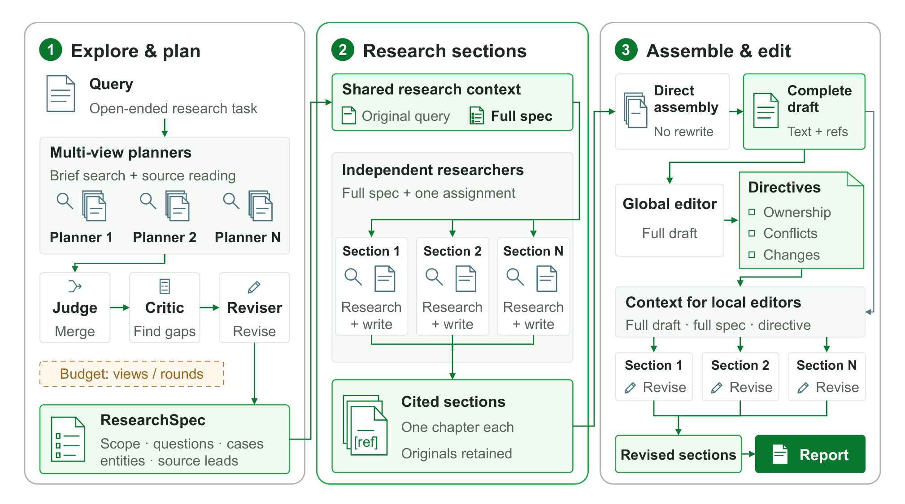
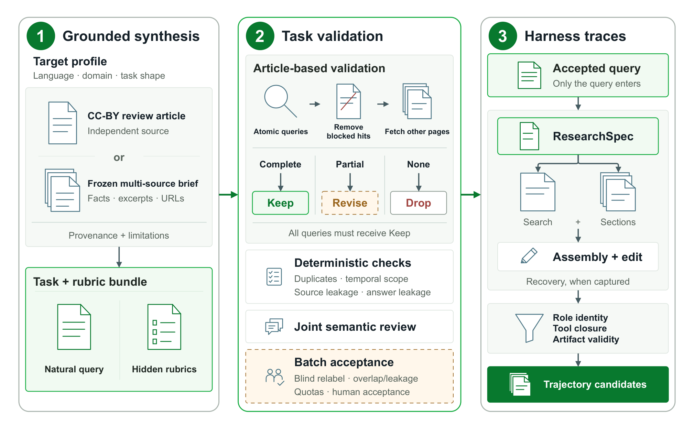
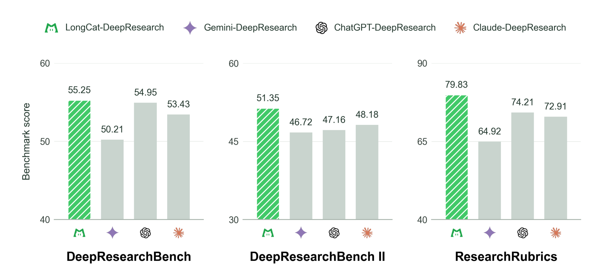
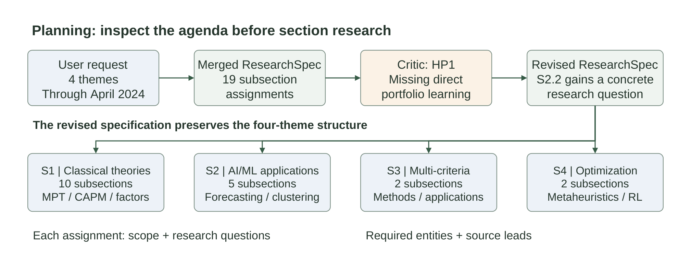
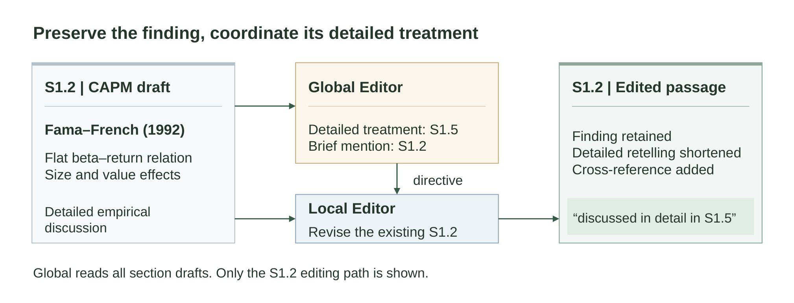

# LongCat-DeepResearch：ResearchSpec 分段研究与局部修订

## 来源

- 原始 PDF：[`raw/2609.36071v1.pdf`](../../raw/2609.36071v1.pdf)
- 标题：LongCat-DeepResearch Technical Report
- 版本 / 日期：arXiv:2609.36071v1，2026-09-28。评论写 23 页、5 图；本地 PDF 为 23 页
- 作者：美团 LongCat Team。He Zhu 与 Yue Xu 为共同一作；通讯作者为 Yan Chen、Fan Yang、Lingchuan Liu。联系邮箱 `longcat-team@meituan.com`
- 项目页：<https://meituan-longcat.github.io/LongCat-DeepResearch/>
- 代码：<https://github.com/meituan-longcat/LongCat-DeepResearch>
- 模型链接：**未建模型页**。正文把参与主表的模型称为 current LongCat，把对照的上一版称为 LongCat-2.0（Table 5 caption）。参数量、层数、注意力和专家配置都没有写

## 为什么这篇在 wiki 里独占一席

它量的是一张写死的研究膜，而不是又一个搜索 agent 的端到端分数。开放式长报告的困难是：证据需求在调查开始前定不全，可是把整段调查史和不断重写的全文放进同一个上下文，又会挤掉还没显出用处的细节，并让早期发现锚定后面的检索。

LongCat 的做法是把早期迭代从全文挪到一份短的 **ResearchSpec**：范围、研究问题、必须覆盖的实体或案例、临时来源线索，以及带层级 ID（如 `S1.2`）的小节职责。规格在规划阶段改完后，分段调查期间保持固定。每个研究员拿到原问题、完整规格和**一个**分配，在自己的上下文里继续检索并写出带引用的完整小节。机械按规格顺序组装之后，全局编辑只决定重复材料归谁、哪里冲突、要改什么；局部编辑按指令改自己那一节，并仍能看到全文和规格。

同一套阶段接口也用来造研究题、任务级 rubric 和教师轨迹，供 LongCat 通用模型的 mid-training 与后训练使用。系统分没有把这条数据、某一次训练或某一个组件拆开。

## 核心结论

1. **在本文记录的四系统比较里，LongCat-DeepResearch 的三个公开总分最高：DeepResearchBench 55.25、DeepResearchBench II 51.35、ResearchRubrics 79.83。** 相对三家产品里的最高者，差分为 +0.30、+3.17、+5.62。这些是点估计，正文写明没有建立统计显著性（`§4.4`、Table 1）。内部基准总分 76.04，排在 ChatGPT-DeepResearch 的 76.59 之后，高于 Claude-DeepResearch 的 61.42 和 Gemini-DeepResearch 的 42.49。

2. **换流程的账比换模型的账大，但两边的预算并不相等。** 全量三榜上，上一版 LongCat-2.0 从有界 ReAct 再直接成文，换成当前 harness 之后，三榜从 47.65 / 33.13 / 60.33 到 53.58 / 48.68 / 71.90。同一张当前 harness 下，再换成当前模型，到 55.25 / 51.35 / 79.83（Table 5）。无权重均分 47.04 → 58.05 → 62.14。ReAct 的最终输出上限是 65,536 token，当前 harness 在这次对照里的单次调用上限是 32,000 token；累计上限同为 600 次模型调用、1,048,576 个 completion token、500 次搜索、500 次读页。正文写这些额度不表示实际算力相同，比较还包含恢复运行（`§B.3`）。

3. **规划侧，把多个视角合并进同一份规格，比再多修几轮更稳。** 固定的 ResearchRubrics 开发子集上，单作家规格 W0 的报告总分 81.67、计划覆盖 53.76%；三作家经 Judge 合并的 J0 升到 85.13% 与 60.47%。再加一轮 Critic/Reviser（R1）把覆盖拉到 63.14%，总分回到 84.34；第二轮（R2）覆盖 62.48%、总分 84.89。隐含要求在 R1 掉到 82.76，低于 J0 的 87.11（Table 3）。摘要里的 “further planning refinement has mixed effects” 指的是这一格。

4. **编辑能改可读性偏好的平均值，原生分数并不在两个榜上一起动。** 增强编辑三轮（B3）相对未编辑草稿 A0 的自动可读性偏好均分是 53.96（50 为持平）。拆开后，DeepResearchBench II 的平均偏好边距是 −0.183，ResearchRubrics 是 +0.500，合成 +0.158（`§B.5`、`§B.7`）。配对的原生分变化：DeepResearchBench II 的 B3−A0 为 +2.51，问题 bootstrap 区间 [+0.63, +4.78]；ResearchRubrics 为 +0.09，区间 [−0.79, +1.18] 盖住 0（Table 8）。区间只覆盖题目抽样，不覆盖重复生成或重复裁判。

## 架构与训练

### 三段 harness

> Figure 2. The LongCat-DeepResearch harness. Planning produces a shared ResearchSpec; independent Researchers produce complete section drafts; global editorial directives guide local revisions after assembly. ResearchSpec is fixed during section research, and both editor types receive the full assembled draft.（`§3.1`）

**先看资料再定计划。** 多名 Planning Writer 各自短暂搜索和阅读，再提出候选规格。Planning Judge 合并，Critic 再搜遗漏的问题和案例，Reviser 写回。组件研究里的 Full 使用三名 Planning Writer（`§5.1`）。视图数和修订轮数是规划预算；正文写增加它们的收益没有保证。分发前的校验器检查 ID 唯一、父子关系、连续编号和必填字段。非法计划会修复，或退回一份已经校验过的候选；校验失败则停止分发。规格里的发现和来源线索仍要后续调查核实。调查开始后再打开全局议程，被写成当前流水线之外的扩展。

**分段调查与写作在同一个 agent 里完成。** 研究员不依赖已经写成的其他小节，因此可以并行。工具交互留在各自分支里，写作时不必先把证据压成给另一个作家的摘要。组件对照里的 “One whole-report Researcher” 仍拿到 Full 的完整 ResearchSpec，但只用一条研究史写出草稿。

**先组装，再协调。** 组装保留原文和引用，即使内容重叠。全局编辑和局部编辑都读完整草稿，因此仍受输入上下文长度限制。局部编辑的输出范围是一节，一次调用不必重写全文；重复把全文送进每次调用仍然贵。局部编辑使用草稿里已经出现的事实和引用。研究与编辑都可以漏掉有用细节。

两类编辑器读到的全文，和 Prime Agent 那种把策略构造留给模型的表达性膜不同：这里的阶段顺序、产物和职责是流程规定的。和 [Raven](raven.md) 的 DeepResearch Mixed 也不同，见评测一节。

### 模型侧只交代到检查点代际

Table 5 的 previous release 是 LongCat-2.0。当前行是 LongCat-DeepResearch 所用的 current LongCat。研究相关数据与其他数据一起，进入 LongCat 通用模型的 mid-training 和后训练，用来提高深度研究能力（`§3.2`）。训练步数、损失、数据量和优化器都没有写。系统分明确不隔离这条数据管线、单一数据源或单一训练阶段。

项目页与仓库说明（外部，[项目页](https://meituan-longcat.github.io/LongCat-DeepResearch/)、[README](https://github.com/meituan-longcat/LongCat-DeepResearch)）：开源的是 harness，调用方自己接 `llm`、`web_search` 和 `web_fetch`；数据构造、数据集、隐藏 rubric、训练轨迹和训练代码不在仓库里。项目页把评测模型写成基于 LongCat-2.0、并增强了深度研究能力，这些改进准备并进下一版通用模型。这是仓库自述，不是论文里的架构规格。

## 后训练

后训练算法没有展开。本节能核实的是**数据怎么从同一张 harness 里长出来**，以及它没有被写成主表增益的来源。

> Figure 3. Evidence-grounded construction of research tasks and trajectories. Questions and rubrics are constructed from independent source material; only the query is supplied to the answering agent.（`§3.2`）

两条造题路线：独立授权的综述文章，或一份冻结的多源简报（事实、摘录、URL、来源限制）。事实性条目必须有支持证据；分析性条目写明应做的比较或推断。Rubric 可以包含隐式要求和负向条件，正文把这个区分归到 ResearchRubrics。构造用的证据和 rubric 不进入答题 agent 看到的问题。

基于文章的路线对原子信息回忆条目做有预算的可搜索性检查：另找来源，去掉被排除的构造文章，抓取其余页面，看完整事实要求是否被支持。完整、部分、缺失分别是 KEEP、REVISE、DROP。门槛是所有保留条目都得到 KEEP。确定性检查覆盖重复 rubric、答案泄漏、被排除来源的泄漏和时间范围。联合语义审查看问题、证据和 rubric 是否是同一道研究任务。这个搜索只在预算内测证据是否找得到，不证明网上一定能答全。

通过的问题驱动教师跑同一张 harness。记录候选与最终 ResearchSpec、工具请求和观察、带引用的小节、组装稿和编辑决定。并行分支保留真实输入和依赖。过滤检查角色身份、工具调用与返回是否闭合、中间产物是否有效，并保留完整、部分和失败尝试的区别。每条记录标明教师和 harness。轨迹有效只是入选的一部分；数据集级重叠、按分布挑选，以及指定处的人工复核，是接受为训练数据之前的额外检查。

## 评测要点

### 主表

对照系统经各自官方客户端调用，自带工具和预算。客户端模型是 Gemini 3.7 Flash、GPT-5.6 Sol（xhigh）、Claude Opus 5（xhigh）。表里的产品名指这套完整 Deep Research 系统，不指裸模型（`§4.2`）。

生成时的输入是原任务提示。基准 rubric 和参考报告只用于打分。生成期间可以检索公开网页。DeepResearchBench 与 DeepResearchBench II 的裁判是 GPT-5.5（medium）；ResearchRubrics 的裁判是 Gemini 2.5 Pro。

> Figure 1. Overall scores on DeepResearchBench, DeepResearchBench II, and ResearchRubrics (higher is better). Green bars highlight LongCat-DeepResearch; gray bars show the three comparison systems.（首页图；设置见 `§4` 与 Appendix B）

| 指标 | Gemini-DeepResearch | ChatGPT-DeepResearch | Claude-DeepResearch | LongCat-DeepResearch |
| --- | ---: | ---: | ---: | ---: |
| DeepResearchBench 总分 | 50.21 | 54.95 | 53.43 | 55.25 |
| 全面性 | 49.47 | 55.41 | 53.71 | 56.21 |
| 洞察 / 深度 | 50.73 | 55.82 | 53.87 | 56.48 |
| 指令遵循 | 50.88 | 54.99 | 53.59 | 55.18 |
| 可读性 | 49.28 | 51.51 | 51.35 | 49.96 |
| DeepResearchBench II 总分 | 46.72 | 47.16 | 48.18 | 51.35 |
| 信息回忆 | 41.75 | 41.97 | 44.37 | 46.42 |
| 分析 | 51.28 | 52.26 | 51.15 | 60.69 |
| 呈现 | 84.81 | 86.98 | 81.02 | 83.13 |
| ResearchRubrics 总分 | 64.92 | 74.21 | 72.91 | 79.83 |
| 显式要求 | 76.36 | 83.57 | 79.64 | 86.97 |
| 隐式要求 | 60.25 | 70.36 | 70.57 | 79.52 |
| 指令遵循 | 62.39 | 74.47 | 74.22 | 66.27 |
| 引用质量 | 32.71 | 64.43 | 67.27 | 65.00 |
| 综合 | 60.41 | 69.14 | 70.29 | 78.92 |
| 表达 | 59.64 | 64.24 | 53.33 | 60.00 |
| 内部基准总分 | 42.49 | 76.59 | 61.42 | 76.04 |
| 内容 | 71.66 | 87.10 | 80.83 | 87.11 |
| 分析 | 18.61 | 66.58 | 44.07 | 70.74 |
| 呈现 | 21.35 | 74.64 | 53.20 | 52.99 |
| 四个总分的无权重平均 | 51.09 | 63.23 | 58.99 | 65.62 |

Table 1（`§4.4`）。四个总分的尺度和协议不同，最后一行只是描述性平均。

分项上的强弱和总分不一致。DeepResearchBench 的可读性 49.96，低于 ChatGPT 的 51.51 和 Claude 的 51.35。DeepResearchBench II 的分析 60.69 对次高 52.26，呈现 83.13 低于 ChatGPT 的 86.98。ResearchRubrics 上，指令遵循、引用质量和表达各自低于至少一家对照。内部基准上，内容和分析是四家里最高的（87.11、70.74），呈现 52.99 低于 ChatGPT 的 74.64，也略低于 Claude 的 53.20。内部总分的加权方式、题目数量和自动评测器名称都没有写。

### 三套公开协议

**DeepResearchBench** 有 100 道博士级研究任务、22 个领域，中英各 50（Du et al., 2025，arXiv:2506.11763）。RACE 在全面性、洞察/深度、指令遵循、可读性四个固定顶层维度里生成任务级标准和权重，同时给目标和一份强参考打分，相对分是 \(100 \times S_{\mathrm{tgt}}/(S_{\mathrm{tgt}}+S_{\mathrm{ref}})\)，先按题再宏平均。本次 LongCat 行覆盖全部 100 题，评测日期写 September 14。参考报告是 2025 年 4 月 Gemini-DeepResearch 的快照。基准另有 FACT（陈述–URL 是否被页面支持）；本文不报 FACT。FACT 也不单独建立来源权威性或每条主张为真。

**DeepResearchBench II** 有 132 题，同一套 22 领域分类，每种语言 66 题（Li et al., 2026a，arXiv:2601.08536）。基准论文报告 9,430 条原子 rubric。维度是信息回忆、分析和呈现。一条 rubric 仅当报告含有所要求的事实或推断时才通过；数字必须显式匹配。总分是各题通过比例的平均。若支撑句引用了被屏蔽的来源文章，该条官方记 −1。主表没有单独写 LongCat 完成了全部 132 题。

**ResearchRubrics** 把 101 条真实提示配上 2,593 条专家标准，含显式与隐式要求、综合、引用、指令遵循和表达（Sharma et al., 2025，arXiv:2511.07685）。LongCat 覆盖全部 101 题。先按题做加权分再宏平均。维度分的分子是分数乘权重之和，分母只用正权重；负权重只在分子里扣分。维度分不平均成总分。Appendix B.1 写 LongCat 在这一基准上的生成设置是开启 thinking、三名 Planning Writer、最多 20 轮工具、研究并发 3。这个句子挂在 ResearchRubrics 下，正文没有把它写成三榜共用配置。

### 官方榜快照不能当成这次的名次

Appendix A 把 2026-09-14 访问的官方 GPT-5.5（medium）榜和本文四系统并排，并写明下半组保留自己的快照与设置，**不是**官方榜条目，也不建立官方名次。榜来自 Hugging Face Space `muset-ai/DeepResearch-Bench-Leaderboard` 的修订 `ad8fc70b0e6c`，文件 `data_gpt55/leaderboard.csv` 与 `data_drb2/leaderboard.csv`。后者是公开报告的 GPT-5.5 纯文本重评，排除仅 PDF 的提交，并忽略嵌入的 DOCX 图片。

该日 DeepResearchBench 官方前列是 ATH-Voicepica-DeepResearch 55.99、cellcog-max 55.78。同表里的 `openai-deepresearch` 是 47.84，`gemini-2.5-pro-deepresearch` 是 49.98，都低于本文客户端里的 ChatGPT-DeepResearch 54.95 与 Gemini-DeepResearch 50.21。DeepResearchBench II 官方纯文本快照的最高行是 GPT-o3 Deep Research 43.00，低于本文四系统里的最低分 46.72。读的时候要连着工具预算和产品代际，不能把 55.25 或 51.35 写成官方榜第一。

已评分覆盖也不齐。ResearchRubrics 上，ChatGPT 与 Gemini 用双方都有成绩的共同题目；Claude 的总分是外部报告的汇总，本文没有逐题成绩可供核对（`§B.1`）。成功的低分报告不会被挑出来重跑。测量包含恢复，而不是在估计第一次尝试的可靠性。

### 组件、规划和编辑都在开发子集上

Table 2–4 与 Table 8 用的是事先看过的开发子集，其中一些按先前模型分数选过；编辑研究在看过初值之后又扩过子集。正文把它们标成探索，而不是独立确认（`§B.2`、`§B.7`）。这些数字不能和 Table 1 的全量总分相减。开发子集的题数没有给出。

| 配置 | DeepResearchBench II | ResearchRubrics | 两榜无权重均分 |
| --- | ---: | ---: | ---: |
| Full | 48.68 | 79.14 | 63.91 |
| 单作家再直接修订 | 44.65 | 74.46 | 59.56 |
| 单条全文研究史 | 45.64 | 78.49 | 62.07 |
| 不编辑 | 48.60 | 78.00 | 63.30 |

Table 2（`§5.1`）。四臂共同完成的题目；一条没跑完的单研究员样本被排除。单作家条件同时拿掉了 Judge 和 Critic，所以它同时改了作家人数和规划程序。单研究员的工具额度是各节额度在任务上限内的加总，组件变体关掉了记忆压缩。实际算力和检索窗口在各条件间不同。不编辑用的是同一次 Full 运行里、编辑前存下的草稿。编辑本身在这张表上只让两榜均分从 63.30 到 63.91。

| 阶段 | 计划覆盖 (%) | 显式 | 隐式 | 报告总分 |
| --- | ---: | ---: | ---: | ---: |
| W0 固定单作家 | 53.76 | 84.34 | 82.21 | 81.67 |
| J0 三作家经 Judge 合并 | 60.47 | 89.09 | 87.11 | 85.13 |
| R1 再修订一轮 | 63.14 | 91.59 | 82.76 | 84.34 |
| R2 再修订一轮 | 62.48 | 90.91 | 87.99 | 84.89 |

Table 3（`§5.2`、`§B.6`）。同一开发子集、下游研究员和编辑器相同，规划压缩关掉。W0 复用同一次三作家规划里的第一名作家，不是按报告分挑的。计划覆盖在成文之前、用 GPT-5.5（medium）对照该题 rubric 打：正权重条目里被判为完全覆盖的百分比，部分、缺失和无法从计划判断的条目留在分母里。它量的是计划对正项集合的覆盖，不是报告质量，也不是事实正确。

| 条件 | DRB-II | ResearchRubrics | 两榜均分 | 可读性偏好 |
| --- | ---: | ---: | ---: | ---: |
| A0 未编辑 | 55.87 | 85.91 | 70.89 | — |
| A1 原编辑器一轮 | 56.04 | 85.66 | 70.85 | 50.00 |
| B1 增强编辑一轮 | 55.15 | 85.18 | 70.17 | 50.42 |
| B2 增强两轮 | 55.68 | 86.87 | 71.28 | 53.33 |
| B3 增强三轮 | 58.38 | 86.00 | 72.19 | 53.96 |

Table 4（`§5.3`）。A1 是 A0 上的对照，不是 B 序列的输入。增强全局编辑拿到已经检索过的、绑定引用的摘录，合计最多 24,000 字符、每源 2,400 字符，不再新检索。来源摘录、事实核查指令和轮数是一次联合干预，没有拆开。单次输出允许 64,000 token。可读性由 GPT-5.5（medium）、开启 thinking、种子 42，在三份评价指南和两种呈现顺序下，把编辑稿与它自己的 A0 比较；边距 \(m\in[-2,2]\) 映射成 \(50+25m\)。每个条件都直接对 A0，不累加相邻轮。这是自动相对偏好，不是绝对可读性，也不是人类评分。

编辑改变了什么，文中给了例子而不是平均效应：DeepResearchBench II 的第 58 题把在线学习研究表从 “Arab Region”、3,348 名参与者改成 “Jordan”、“280 students + 50 faculty”，原生分 +1.59。全民基本收入那题因结构更清楚多得一条结构标准，却因定量主张的归属变弱丢掉一条更高权重的引用标准，净 −1.25。另有水压成形一例：新被记分的事实大多已经在 A0 里，所以更高分可以只是裁判敏感，而不是编辑补进了信息。这项研究不更新模型参数。

### 从规格到编辑的一条轨迹

DeepResearchBench II 012 是截至 2024 年 4 月的 AI 增强组合管理综述。合并后的 ResearchSpec 把四个主题拆成 19 个小节。Critic 的第一条问题 HP1 指出合并稿没有点名 Heaton、Polson 与 Witte（2017）的 Deep Portfolio Theory。Reviser 把它写进已有的 S2.2，没有新开小节。最终报告这条轨迹的分数是 89.29 / 100。计划仍缺 Treynor（1962）；成稿仍缺 CPPI，也没通过时间顺序那条标准。只有最终报告有基准分，这条轨迹不测量规划或编辑各自贡献了多少分（`§5.5`、Appendix C）。

> Figure 4. Recorded planning artifacts for the portfolio-management case.（`§5.5.1`）

> Figure 5. The selected CAPM editing path.（`§5.5.2`）

成稿仍保留内部标识 “S1.5”，而展示出来的三因子模型标题没有这个标识。附录里的源产物把同一份规格叫 ReportSpec。

对照案例 DeepResearchBench II 056（生成式 AI 与劳动力市场）最终分 11.43 / 100。修订后的规格补上了 Peng 等（2023）的 GitHub Copilot 生产力研究，这句话留进了得分成稿；信息回忆仍是 0。Rubric 要求的两篇研究（*Can AI help for scientific writing?* 与医生对比 AI 聊天机器人回答公开论坛患者问题）在修订规格和成稿里都没有出现。加进一条已有议程，可以让另一批必须覆盖的证据继续不被调查。

### 工具与恢复

Harness 通过内部管理的搜索和读页服务访问公开网页。`web_search` 返回标题、URL 和摘要；`web_fetch` 取回并解析页面。何时搜、读哪一页由 harness 决定。

恢复会保留已完成的报告字节和分数，复用精确匹配的响应，并把失败尝试的花费记回原任务。LongCat 的恢复还包括按指令修正 URL，以及修复辅助引号字段里的语法，同时保留原有的判定和分数。

## 待追问

- 需补外部来源：当前增强检查点仍没有公开名称、参数量或权重。项目页写它基于 LongCat-2.0，改进拟并入下一版通用 LongCat；仓库只发布 harness。若之后出现模型卡，再决定是否建模型页。

## 相关页面

- [Agent harness](../concepts/agent-harness.md) - 同模型换研究流程的配置对照，以及和表达性膜的差别
- [Agentic 评测体系](../concepts/agentic-evaluation-benchmarks.md) - DeepResearchBench、DeepResearchBench II、ResearchRubrics 的协议和榜差
- [Agentic engineering](../concepts/agentic-engineering.md) - 长报告的阶段接口，以及研究轨迹进入通用模型训练
- [Raven](raven.md) - 另一套名叫 DeepResearch 的精确匹配混合集，测的是搜索答对，不是长报告 rubric
