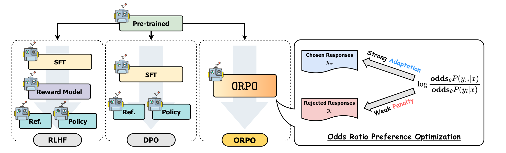
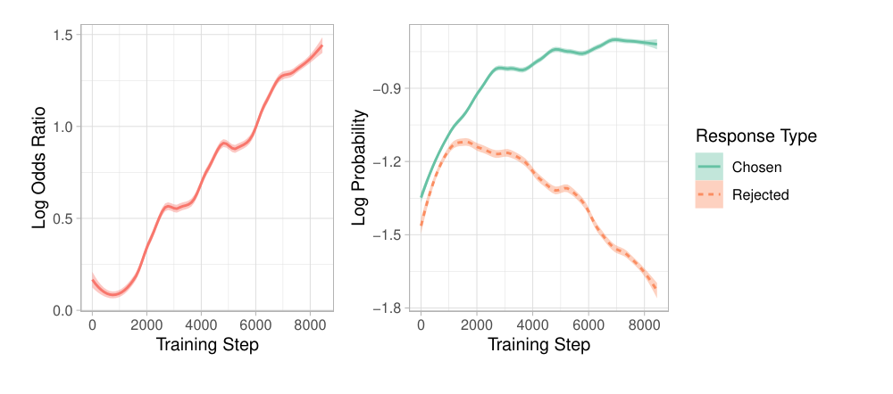

# ORPO：Odds Ratio Preference Optimization

## 来源

- 文件：`raw/2403.07691v2.pdf`
- 标题：ORPO: Monolithic Preference Optimization without Reference Model
- 团队 / 日期：Jiwoo Hong、Noah Lee、James Thorne；KAIST AI；arXiv:2403.07691v2，2024-03-14。PDF 未标会议。
- arXiv：<https://arxiv.org/abs/2403.07691>
- 代码：<https://github.com/xfactlab/orpo>
- 检查点：`kaist-ai/mistral-orpo-alpha`、`kaist-ai/mistral-orpo-beta`
- 定位：这是 **把偏好罚项直接加进 SFT** 的算法论文。放出两只 Mistral-7B 检查点，不另建模型页。对照从 OPT-125M 到 Mistral-7B。
- 易混：本页是 odds-ratio、无参考模型。不要写成 [Iterative RPO](iterative-rpo.md)（DPO+NLL，TRL `rpo_alpha`），也不要写成 [IPO](ipo.md)（平方损失，仍有 $\pi_{\mathrm{ref}}$）。

## 核心结论

1. **只在 chosen 上做交叉熵，rejected 的对数概率会一起升高。** OPT-350M 只在 HH-RLHF 的 chosen 上 SFT，Figure 3 里两条 log-prob 同步上升。Eq. 1–2 的交叉熵对非标签 token 没有直接惩罚（§3）。
2. **ORPO 是一条损失、没有参考模型、没有单独的偏好阶段。** $\mathcal{L}_{\mathrm{ORPO}}=\mathbb{E}[\mathcal{L}_{\mathrm{SFT}}+\lambda\mathcal{L}_{\mathrm{OR}}]$（Eq. 6）。$\mathcal{L}_{\mathrm{SFT}}$ 是 chosen 的长度平均 NLL；$\mathcal{L}_{\mathrm{OR}}$ 是 chosen 对 rejected 的 log odds ratio 上的 logistic（Eq. 7）。
3. **Odds 用的是长度平均后的序列概率，不是未归一化的联合概率。** Eq. 3 把 $\log P_\theta(y\mid x)$ 定义成 $(1/m)\sum_t\log P(y_t\mid x,y_{<t})$。Eq. 4 的 $\mathrm{odds}=P/(1-P)$ 用的就是这个 $P$。$1-P$ 因此落在 $(0,1)$ 的几何平均上。
4. **和 DPO 的受控对照只在 OPT 上用奖励模型胜率说话，而且不是全尺度都赢。** HH-RLHF 上 ORPO 对 +DPO 的胜率是 41.7% / 49.4% / 70.9%（125M / 350M / 1.3B，Table 2）。125M 低于 50%。UltraFeedback 上是 48.8% / 50.5% / 57.8%（Table 3）。胜率随尺寸上升是这三档的趋势，不是「处处超过 DPO」。
5. **7B 的榜单数字不能当成同协议打败 DPO。** Mistral-ORPO-β 的 AlpacaEval 2.0 是 12.20%，AlpacaEval 1.0 是 91.41%，IFEval instruction-level loose 是 0.6619（Table 1、Table 6）。对照的 Llama-2-Chat 与 Zephyr 是官方榜数字。作者自己的 Llama-2 + SFT + DPO 在一 epoch SFT、三 epoch DPO 的设定下「输出无法评测」（§6.1）。

## 架构与训练

> 论文 Figure 2 原文标题："Comparison of model alignment techniques. ORPO aligns the language model without a reference model in a single-step manner by assigning a weak penalty to the rejected responses and a strong adaptation signal to the chosen responses with a simple log odds ratio term appended to the negative log-likelihood loss."（第 2 页）

平均对数似然与 odds（Eq. 3–5）：

$$
\log P_\theta(y\mid x)=\frac{1}{m}\sum_{t=1}^{m}\log P_\theta(y_t\mid x,y_{<t}),\qquad
\mathrm{odds}_\theta(y\mid x)=\frac{P_\theta(y\mid x)}{1-P_\theta(y\mid x)}.
$$

$$
\mathrm{OR}_\theta(y_w,y_l)=\frac{\mathrm{odds}_\theta(y_w\mid x)}{\mathrm{odds}_\theta(y_l\mid x)}.
$$

损失（Eq. 6–7）：

$$
\mathcal{L}_{\mathrm{OR}}=-\log\sigma\Biggl(\log\frac{\mathrm{odds}_\theta(y_w\mid x)}{\mathrm{odds}_\theta(y_l\mid x)}\Biggr).
$$

相对 [DPO](dpo.md) Eq. 7：DPO 的括号里是 $\beta$ 倍的 $\log(\pi/\pi_{\mathrm{ref}})$ 之差，参考模型提供分母。ORPO 的括号里没有 $\pi_{\mathrm{ref}}$，对比的是 odds 而不是概率比，并且外面还加着 chosen 的 NLL。§7.1 用 $\mathrm{Unif}(0,1)$ 上的 50,000 对样本画 log 概率比和 log odds：同样的概率对，odds 的动态范围更宽。作者据此说，在 SFT 还没适应领域时，概率比会把 rejected 压得过狠；odds 更温和。这是均匀采样的示意图（Figure 6），不是语言模型上的消融。Appendix B 才是把概率比换进损失的训练对照。

梯度（Eq. 8–10）：$\nabla\mathcal{L}_{\mathrm{OR}}=\delta(d)\,h(d)$。$\delta(d)=[1+\mathrm{odds}(y_w)/\mathrm{odds}(y_l)]^{-1}$，rejected 相对更可能时权重大。$h(d)$ 是两侧 $\nabla\log P/(1-P)$ 的差；$1-P$ 在对应侧概率低时放大梯度。

主实验的 $\lambda$：Phi-2 为 0.25，Llama-2-7B 为 0.2，Mistral-7B 为 0.1（§6.1）。Figure 7 的监测用 $\lambda=1.0$。Appendix E 在 Mistral + UltraFeedback 上扫 $\{0.1,0.5,1.0\}$：$\lambda=0.1$ 时 rejected 的 log-prob 不降，chosen 上升来拉大 odds；$\lambda$ 更大时 rejected 被压得更明显。Appendix C 又写 ORPO「除学习率和 epoch 外没有特殊超参」。和正文按模型设置 $\lambda$ 不是同一口径。

Appendix C 的训练：SFT 最大学习率 $1\times10^{-5}$、1 epoch；DPO 的 $\beta=0.1$、学习率 $5\times10^{-6}$、最多 3 epoch，按评测损失选检查点，多数停在第一或第二轮。ORPO 最大学习率 $8\times10^{-6}$，OPT / Phi-2 / Llama-2 训到 10 epoch 再按最低评测损失挑选。HH-RLHF 截断到 1024 token，UltraFeedback 到 2048。Figure 1 的说明把 Mistral-ORPO-α/β 写成 **只在 UltraFeedback 上训一个 epoch**。10 epoch 的选择不自动套到这两只检查点上。

作者数前向：DPO 有冻结参考模型和正在更新的模型，chosen / rejected 各算一次，一批四次前向；ORPO 只有一个模型，一批两次（§7.3）。这是他们的计数方式。

## 后训练

ORPO 的主张是不再先 SFT 再跑偏好阶段。数据仍是成对偏好：Anthropic HH-RLHF，以及二值化的 UltraFeedback（丢掉 $y_w=y_l$ 或空回答）。Mistral-ORPO-β 换的是 Argilla 清洗版 UltraFeedback，规模相近，AlpacaEval 2.0 从 α 的 11.33% 到 12.20%（Table 1）。PPO 的奖励模型是同数据上训一个 epoch 的 OPT-350M；评测用的是 OPT-1.3B 奖励模型。作者把 Figure 5 里 RLHF 分布异常归到「用 350M 训、用 1.3B 评」的奖励错配（§6.3）。

## 评测要点

| 模型 | AlpacaEval 1.0 | AlpacaEval 2.0 | 备注 |
| --- | ---: | ---: | --- |
| Phi-2 + SFT | 48.37 | 0.11 | 2.7B，括号内是标准误 |
| Phi-2 + SFT + DPO | 50.63 | 0.78 | 同表，作者自己的 DPO |
| Phi-2 + ORPO | 71.80 | 6.35 | $\lambda=0.25$ |
| Llama-2-Chat 7B / 13B | 71.34 / 81.09 | 4.96 / 7.70 | 官方榜，表中带 * |
| Llama-2 + ORPO | 81.26 | 9.44 | 7B，$\lambda=0.2$ |
| Zephyr-α / β | 85.76 / 90.60 | 8.35 / 10.99 | 官方榜 |
| Mistral-ORPO-α / β | 87.92 / 91.41 | 11.33 / 12.20 | 7B，$\lambda=0.1$；β 用清洗数据 |

AlpacaEval 1.0 的评判是 GPT-4 对 text-davinci-003；2.0 是 GPT-4-turbo 对 GPT-4（§5.2）。

IFEval（Table 6，Gao et al. 的代码）：α 的 prompt-strict / prompt-loose / inst-strict / inst-loose 为 0.5009 / 0.5083 / 0.5995 / 0.6163；β 为 0.5287 / 0.5564 / 0.6355 / 0.6619。摘要里的 66.19% 是 β 的 instruction-level loose。

MT-Bench：Figure 4 与结论写 α / β 为 **7.23 / 7.32**。§2 的句子写成 7.24 和 7.32。差 0.01，以图和结论为准。训练数据是单轮 UltraFeedback，评测是多轮。

> 论文 Figure 7 原文标题："Average log-likelihood for chosen and rejected responses and log odds ratio per batch. The odds consistently increase during training with ORPO."（§7.2）

这张图与 Figure 3 同一数据集和模型（OPT-350M，HH-RLHF），$\lambda=1.0$。chosen 的 log-prob 仍上升，rejected 转为下降。

词法多样性（Table 4，Gemini-Pro 嵌入，温度 1.0）：每输入 5 条、跨输入取每条查询的第一条。余弦相似度越低越多样。Phi-2 的 per-input 相似度 ORPO 0.8909、DPO 0.8012；across-input 则是 ORPO 0.5173、DPO 0.6019。Llama-2 同样是 ORPO 的 per-input 更高、across-input 更低。作者读成：ORPO 在同一问上更集中，跨问更贴指令。

[SimPO](simpo.md) Table 4 在另一套协议里重调了 ORPO。AlpacaEval 2 length-controlled win rate：Mistral-Base 14.7（DPO 15.1），Mistral-Instruct 24.5（26.8），Llama-3-Base 12.2（18.2），Llama-3-Instruct 28.5（40.3）。四格都低于同表 DPO。那次比较换了数据构造和超参搜索，不能拿来改写 Table 2–3 的 OPT 奖励模型胜率。

## 待追问

- **需实验或作者披露**：Limitations 把「超过 7B」和「更多对齐算法的对照」留给后续。本 PDF 的 7B 榜单对照不是同 epoch、同实现的 DPO；Appendix C 的 10 epoch 选择也没有对应的公开 DPO 复跑。

## 相关页面

- 损失对照：[DPO](dpo.md)（Eq. 7 仍除以 $\pi_{\mathrm{ref}}$）、[IPO](ipo.md)（仍有参考模型，平方损失）、[KTO](kto.md)（不需要 pair）、[SimPO](simpo.md)（也去掉参考模型，但奖励是长度平均 log-prob 加 margin；Table 4 重调过 ORPO）、[Iterative RPO](iterative-rpo.md)（名字易混）
- 比较：[LLM RL policy optimization 对比](../comparisons/llm-rl-policy-optimization.md)
- 概念：[Agentic 模型的后训练](../concepts/post-training-for-agentic-models.md)
