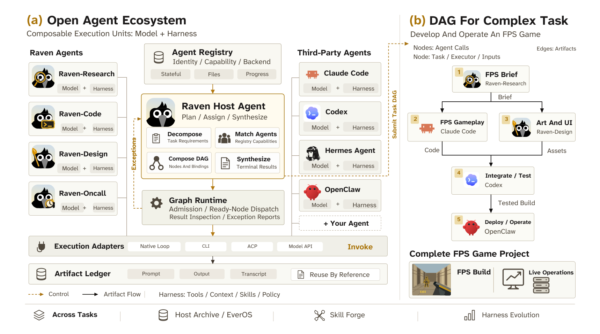
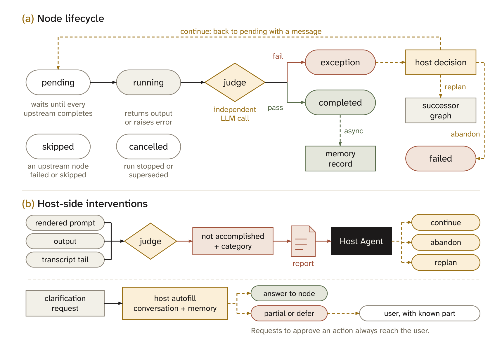
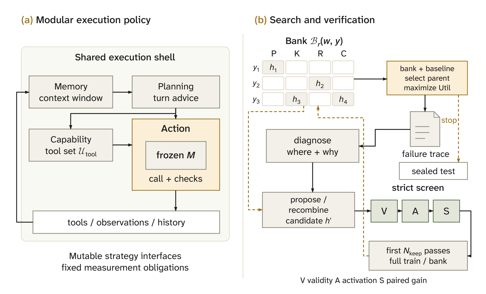
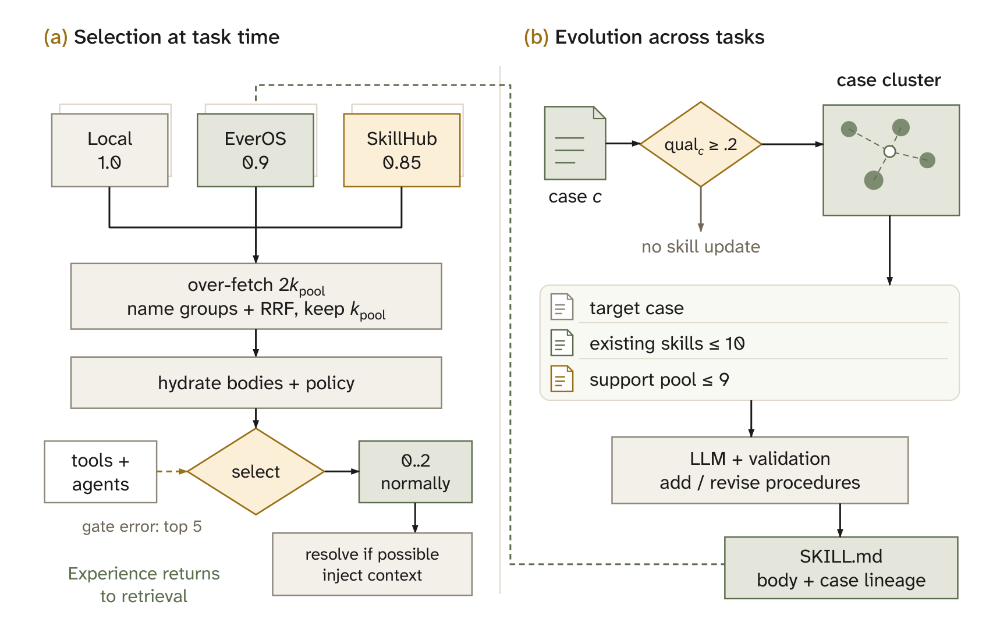
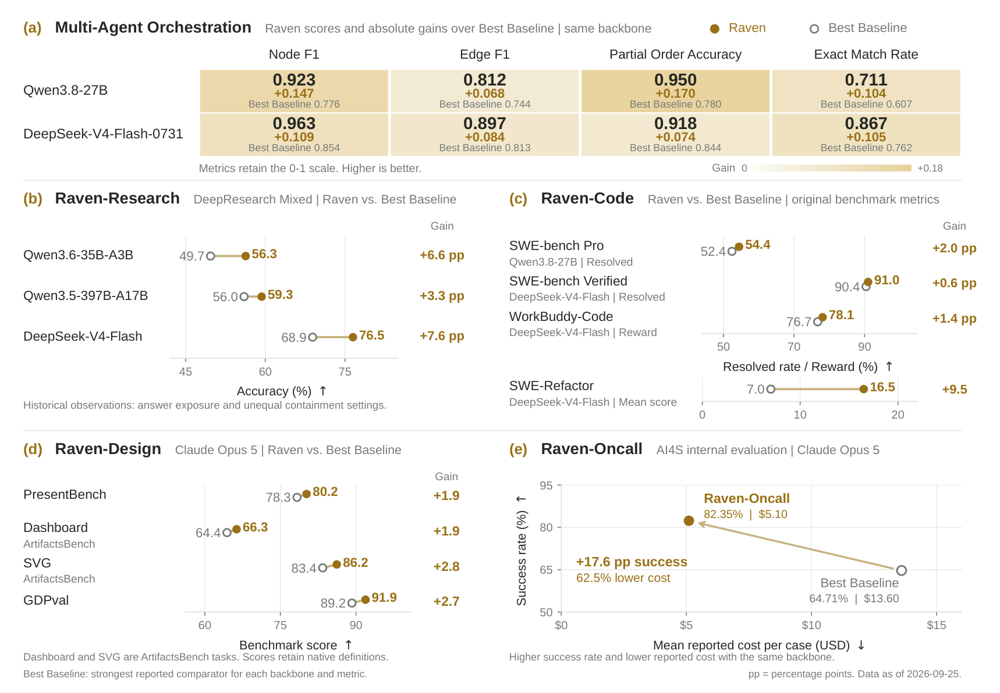
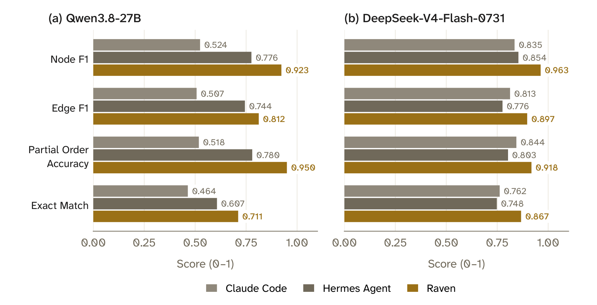

# Raven：The Harness of Harnesses

## 来源

- 本地 PDF：[`raw/2609.33439v1.pdf`](../../raw/2609.33439v1.pdf)
- 原文：[arXiv:2609.33439v1](https://arxiv.org/abs/2609.33439)（2026-09-27 提交，cs.AI；CC BY 4.0）
- 作者：EverMind AI。附录 D：项目负责人 Chuanrui Hu；核心贡献 Dizhan Xue、Chuanrui Hu；通讯作者 Yafeng Deng
- 篇幅：82 页。正文到第 59 页的结论，参考文献至第 64 页，其后是理论附录、实现默认值、评测细节与作者名单
- 项目链接（印在首页）：[evermind.ai](https://evermind.ai/)、[github.com/EverMind-AI/Raven](https://github.com/EverMind-AI/Raven)。记忆后端另有 [EverOS](https://github.com/EverMind-AI/EverOS)（参考文献 [15]）
- 未建模型页：组合单元是已有模型外面的 harness。原生专家和 Host 都不发布新的基座权重

## 核心结论

1. **可组合的单位是一份可执行的 model–harness 对。** Host Agent 按注册表把子任务配给 Raven-Research / Code / Design / Oncall，或配给 Claude Code、Codex、OpenCode、Hermes Agent、OpenClaw 这类第三方 agent。依赖写成 DAG，运行时先做结构、能力与环境检查，再调度就绪节点，交接走记录下来的 artifact（原文确证，§1、§3.1、Figure 2）。
2. **理论给的是充分条件，不是测出来的覆盖扩张。** 在共享资源预算下，若 Host 能以足够概率交出兼容计划，且每个节点和交接的条件失败率有统一上界，组合系统的成功概率有下界（Proposition 1）。两位独立公平比特的奇偶构造里，三个单 agent 的成功率都不超过 \(1/2\)，零误差三节点计划为 1（Corollary 1，§2.5）。作者写明：测到的平均成功率本身不建立这些条件（§2.6）。
3. **规划质量在工人开工之前单独打分。** Multi-Agent Orchestration Benchmark（MAOB）有 140 条职业任务，对照是四专家花名册上的参考 DAG。Qwen3.8-27B 与 DeepSeek-V4-Flash-0731 上，Raven 的 Node F1、Edge F1、Partial Order Accuracy、Exact Match 都高于 Claude Code 和 Hermes Agent。Exact Match 相对各自最强基线是 0.711 对 0.607、0.867 对 0.762（原文确证，§7.1、Figure 13）。
4. **四个原生专家、HarnessBank 和 SkillCorpus 是三本账。** 研究、代码、设计、值守各有自己的插件和评测协议。§7.2 的七项 held-out Pass@1 转述 HarnessBank；§7.7 的技能增益转述 SkillCorpus。它们不是同一次「Host 把四个专家串成一条长任务」的端到端实验。

## 架构与训练

本文没有新的网络，也没有预训练。架构是 Host、异构注册表、图运行时，加上可进化的单 agent 策略接口、EverOS 记忆和 Skill Forge。

### 注册表与 Host

一个 agent 在注册表里有名字、能力描述，以及四种后端之一：进程内 Raven loop、命令行、Agent Client Protocol（ACP），或 OpenAI 兼容的模型 API。规划还看三个标签：能否续接会话、能否读本地路径、能否流式报告进度。默认花名册是一个通用 Raven agent 加上四个专家。第三方预设走 ACP。Host 的模型在当前上下文里选条目，没有单独训练的路由分类器，也不假设有 oracle 能力分数（原文确证，§3.1）。

编排指南分阶段露出。每轮只带短摘要；Host 判断需要多个 agent 时再加载全文。运行时不因为指南没加载就拒绝提交。被拒的图返回第一条错误，并指回指南（原文确证，§3.1、Figure 4）。

> 原文 Figure 2：Raven As An Open Multi-Agent Ecosystem. (a) Built-in and third-party agents expose executable model–harness pairs through execution adapters. (b) An illustrative FPS game project combines gameplay development and visual design before integration, testing, and operation.

节点字段包括执行器、提示模板、依赖、输入绑定、可选的有状态 instance，以及不在模型侧 schema 里广告的技能 / MCP 覆盖。模板用 `{{ id.output }}` 或 `{{ id.output_path }}` 引用上游。代入的文件和节点内容标成不可信数据。默认后台执行：一提交就把控制权还回 Host。确认旗标默认关闭（原文确证，§3.1、式 (29)–(30)、Appendix B.2）。

### 准入、调度与判定

准入按五组检查停在第一处失败：格式、图结构、后端能力、注册状态、环境。环境检查拒绝从子 agent 内部再委派，图和单次委派共用每小时 30 次的调度预算。共享并发默认 8。同一 instance 句柄的节点串行，独立 instance 可以并行（原文确证，Table 1、式 (31)、Table 10）。

返回或报错都进一个独立模型调用做完成判定。判定读渲染后的提示、输出和至多 8,000 字符的转录尾部，超时 180 秒，只能答 accomplished 或 not accomplished。负判定要给类别：缺用户输入、缺凭证、工具失败、上游输出不可用、输出截断，或其他。研究问题上「有证据的否定回答」算完成，「研究没做成」不算。判定不认证客观正确。可用性回退：判定失败或超时，而调用本身正常返回时，节点被当成完成（原文确证，§3.2、Appendix B.3）。

> 原文 Figure 5：Node execution and host intervention. (a) A node runs once all predecessors have completed and settled. (b) A negative verdict becomes an exception report; clarification is answered from the host’s conversation and memory when possible.

每个节点默认还能再继续 2 次。Host 可以带消息继续、放弃，或提交后继图。挂起节点的决定期限是 600 秒，过期则失败。重规划用新的 run id，旧 run 里已完成的节点仍可按引用复用。批准动作（推送、删除、发送、付款）的澄清永远到用户（原文确证，§3.2、Table 10）。

产物和记忆分两条路。节点完成后依赖立刻放开；记忆记录异步写。文件型节点会拿到传递闭包上祖先的记忆路径，可以选择读，而不是把全部记忆抄进提示。会话内节点 id 全局唯一，后一张图可以依赖先前已完成节点（原文确证，§3.3）。

可选的共享群组记忆把一轮（一次图或一次单委派）收成三类记录：Host 库里的轮次摘要、各 agent 库里的 verdict、用户反馈后的 outcome。个人用户记忆不进这层。派发前的预取把 Host 库的相关记录和该 agent 最近的 verdict 拼进输入，并标成不可信上下文。归因从 Host 回复里抽出，不出现在用户可见回复和会话日志里（原文确证，§3.4、Figure 7、Table 2）。

### 组合何时能超过单个 agent

能力定义在任务 \(t\) 和预算 \(B\) 上：成功判定 \(V_t\) 为 1，且总成本 \(C_S \le B\)。成本把规划、工人、交接、运行时核查和重试各记一次。中止或不终止记失败。客观正确和 agent 自己宣布完成是两件事（原文确证，式 (2)–(3)）。

计划是一张有限 DAG，加上执行器指派、合同、交接、调度和预算分配（式 (4)）。兼容计划用 Hoare 式不变式：前一操作的断言推出下一操作的前提，全部成功则交付记录满足 \(V_t\)（Definition 1、Lemma 1）。并行执行要有保持观测、记录、状态效果、接受和计费的线性化；只凭 DAG 或互斥文件名不够。

Theorem 1：在一份已选定的合法计划上，各操作的条件失败率相加得到 \(\epsilon\)，条件成功概率至少是 \([1-\epsilon]^+\)。不要求失败相互独立。Proposition 1 再乘上 Host 选出合法计划的概率下界 \(1-\eta_H\)。Corollary 1：这个下界不低于 \(1-\delta\)，且严格高于每一个单 agent 在同一预算下的成功概率时，该任务落在组合相对个体的新覆盖里。

显式构造用两个独立公平比特 \(U,W\)。\(a_1\) 只能读 \(U\)，\(a_2\) 只能读 \(W\)，\(a_0\) 两个接口都没有。单跑时每个人的成功概率不超过 \(1/2\)。若 \(a_1,a_2\) 在读调用上原样返回自己的比特，\(a_0\) 在拿到两比特时返回奇偶，再加两条精确复制交接，且预算盖住规划、三次调用、两次交接和交付，则组合成功概率为 1。作者同时写明：一个同时拥有两个读接口的 agent 也能做这题；这个构造不声称优于那另一种 harness（原文确证，§2.5）。

Corollary 2 把同一组均匀的 \(\eta^\star,\epsilon^\star\) 推到事先指定的任务族。语法附录能编出有限 DAG，证明计划存在；它不要求 Host 复现那台编译器。分析也不区分「编排后的系统」和「用同样接口与资源模拟它的单个程序」（原文确证，§2.6）。

### 单 agent harness 的基因库搜索

这一层沿用 HarnessBank（arXiv:2607.13683v2）。冻结任务模型 \(M\)，可配置 harness 分成四个策略接口：Memory（上下文窗口）、Planning（回合建议）、Capability（暴露给模型的工具集）、Action（取模型响应并判断动作或完成）。共享外壳负责派发、记账、持久化和有界重试。可编辑位置与评测、记账、必需执行接口的不可变核不相交（原文确证，§4.1、式 (39)–(42)、Figure 8）。

> 原文 Figure 8：Harness self-evolution. (a) Four strategy interfaces expose decisions around a frozen model. (b) The bank stores one complete harness per edit-category/pathology cell.

搜索最大化训练集上的任务平均效用。每任务 \(K_{\mathrm{att}}\) 次尝试先在任务内平均，再对任务等权。二值分数估计的是每次尝试的平均成功，不是 \(K_{\mathrm{att}}\) 次里至少成功一次。效用里没有隐式的 token 或延迟惩罚（原文确证，式 (43)、§4.2）。

基因库的格子是编辑类别 prompt、knowledge、runtime、config 乘诊断出的失败标签。这四类和上面四个策略角色不是同一套划分：改 Memory 策略可以记成一次 runtime 编辑。每格只留一份训练效用最高的完整 harness。父代是基线与库中精英里训练效用最高者。候选要么从失败轨迹提出干预，要么与供体谱系重组。病理标签是假设，不是已经证实的原因（原文确证，§4.3）。

筛选门按顺序：日志按协议有效、声明的激活事件至少出现一次、任务级配对增益的统计量达到 \(\lambda_{\mathrm{screen}}=1.96\)。这个截断借用标准正态的形式，作者不把它当成有限样本的双侧 5% 检验。激活门只说明被插桩的干预至少跑过一次，不要求每个供体机制都执行，也不单独证明最新一处编辑的因果贡献。通过筛选的前 \(N_{\mathrm{keep}}\) 个候选才做全训练集确认。选中的 harness 在封存测试前冻结，测试结果不回头改提案、阈值或库（原文确证，§4.4、Algorithm 3–4）。

附录 B.4 写明：§7.2 的七个数复述 HarnessBank v2 的 Section 4 与 Table 1。任务模型是冻结的 Qwen3.6-27B，进化器是 Claude Opus 4.8，每任务 3 次尝试。已发表结果没有给出每次运行的筛选子集、提案顺序，以及 \((n,J,N_{\mathrm{keep}},R_{\mathrm{round}},P)\) 和重试上限的全部取值。

### 记忆与 Skill Forge

EverOS 把交互流按语义边界切成片段，再写成 MemCell：第三人称情节、可单独匹配的原子事实、带有效区间的前瞻陈述，以及来源元数据。用户记录和 agent 的 case / skill 分属不同 owner。情节嵌入做在线聚类得到 MemScene。情节、事实、画像、case 和 skill 以 Markdown 存放；SQLite 管运行状态；默认向量库是 LanceDB。索引异步跟上文件变更（原文确证，§5.1–§5.5）。

Skill Forge 在三个来源上选程序：本地技能、EverOS 里由 case 抽出的技能、SkillHub。目录与参考检索栈来自 SkillCorpus（arXiv:2607.15557v6）。参考快照有 96,401 条在册技能；在线 SkillHub 可以和这个快照不同。硬拒绝旗标包括 prompt injection、命令注入、不安全执行、认证绕过和 CSAM 风险；可解析的安全分还要不低于 0.3 才准入（原文确证，§6.1、式 (67)）。

在线路由按名字做加权倒数排名融合。默认权重是本地 1.0、记忆 0.9、SkillHub 0.85，RRF 阻尼 10。正常选择最多注入 2 份技能正文；门失败时回退看前 5。case 质量低于 0.2 不进入聚类。更新写成带 case 谱系的 Markdown，检索可以在索引完成前继续用旧条目（原文确证，§6.2–§6.3、Figure 11、Table 10）。

> 原文 Figure 11：Skill selection and experience-driven updates. (a) Ranked source hits are grouped by name and fused before body retrieval and LLM selection. (b) A case enters an intent cluster and conditions skill operations.

## 后训练

没有基座后训练，也没有把 Host 训成路由器。Harness 搜索期间任务模型权重不动；提案模型和任务模型可以不是同一个。进化器在 HarnessBank 转述实验里是 Claude Opus 4.8。技能实验把骨干和 harness 固定，只改变是否注入已选出的程序（原文确证，§4.2、§7 开篇、Appendix B.4）。

## 评测要点

作者把规划、专家执行、harness 适应和技能复用分开报。Figure 1 的总览截止日期是 2026-09-25。各面板的「Best Baseline」是该骨干、该指标上报告过的最强对照，不是同一个系统。

> 原文 Figure 1：Raven performance overview. Selected results for multi-agent orchestration, research, coding, design, and on-call tasks, compared with the strongest reported alternative in each setting.

### MAOB：图一致，工人不跑

140 题来自 137 个职业、140 个模板。参考图平均 2.72 个节点、1.84 条边；98 题纯串行，42 题允许并行。content / research / coding / oncall 出现次数是 106 / 103 / 102 / 70。参考图先由 Claude Opus 5 写成，请求再由 GLM-5.2 从这张图倒着生成。泄漏过滤丢掉「首先……然后……最后」和直接点名领域的句子。专家复核节点集、偏序和请求要素的归属（原文确证，§7.1.1、Table 3、Figure 12）。

指标都在领域折叠后的图上计算：同领域多次调用合成一个标签，领域内的边丢掉。Edge F1 比的是传递归约，多出来的传递边不扣分。Exact Match 要求节点集相同且共享对的可达关系落在参考接受的关系里，不要求原始边列表逐条相同。附录 C.1：投影冲突或环会让部分指标没有定义，无定义的记录不进该指标的分母。因此四个均值的分母可以不同，正文没有给出各指标实际用了多少条记录。

三个系统用各自的原生循环，在同一 140 题、同一骨干上只提交图、不派发工人。请求文本和委派指令逐字相同；领域说明只来自各自编排工具的 schema（原文确证，§7.1.3）。

> 原文 Figure 13：Multi-Agent Orchestration Benchmark results with backbone (a) Qwen3.8-27B and (b) DeepSeek-V4-Flash-0731.

| 指标 | Qwen3.8-27B：Claude Code / Hermes / Raven | DeepSeek-V4-Flash-0731：Claude Code / Hermes / Raven |
| --- | --- | --- |
| Node F1 | 0.524 / 0.776 / 0.923 | 0.835 / 0.854 / 0.963 |
| Edge F1 | 0.507 / 0.744 / 0.812 | 0.813 / 0.776 / 0.897 |
| Partial Order Accuracy | 0.518 / 0.780 / 0.950 | 0.844 / 0.803 / 0.918 |
| Exact Match | 0.464 / 0.607 / 0.711 | 0.762 / 0.748 / 0.867 |

Qwen 上 Hermes 四项都高于 Claude Code。DeepSeek 上 Hermes 只在 Node F1 更高，其余三项 Claude Code 更高。正文写 Hermes 在 DeepSeek 上「落后于 Claude Code 的是 POA」；图上 Edge F1 和 Exact Match 同样是 Claude Code 更高（原文确证，Figure 13、§7.1.4）。

### 四个专家

**Raven-Research。** 单一插件 `research-flow` 换掉内置搜索、抓取和澄清。重复查询有缓存，连续无新结果就停；固定相位的检查要求长搜索之后读页面、阻止过晚重开、并挽回没有答案就结束的回合。交付前另有一次看不到 agent 上下文的审阅，核对关键主张和已收集证据。DeepResearch Mixed 合并 BrowseComp、FRAMES、Humanity’s Last Exam 的纯文本精确匹配，以及中文 xBench-DeepSearch-2510。这是搜索答对率，和 [LongCat-DeepResearch](longcat-deepresearch.md) 的 DeepResearchBench / DeepResearchBench II / ResearchRubrics 长报告 rubric 不是同一套题。裁判是温度 0 的 GPT-5.6 Luna Pro。每个系统每题一次，跑在 2026-08-10 到 08-18（原文确证，§7.3、Appendix C.3）。

| 骨干 | MiroFlow | DeepSeek-Harness | Raven-Research |
| --- | --- | --- | --- |
| Qwen3.6-35B-A3B | 47.7 | 49.7 | 56.3 |
| Qwen3.5-397B-A17B | 48.0 | 56.0 | 59.3 |
| DeepSeek-V4-Flash | 67.2（\$0.0374） | 68.9（\$0.0211） | 76.5（\$0.0242） |

准确率是全部题目上的池化百分比。只有 DeepSeek 这一组报了按同一份价目表估算的每题成本。六组同骨干配对里，五组 McNemar \(p<0.02\)；对 DeepSeek-Harness、骨干为 Qwen3.5-397B-A17B 的 +3.3 个百分点对应 \(p=0.21\)。DeepSeek-V4-Flash 上 BrowseComp / HLE 是 69.3% / 60.0%，对照 harness 至多 62.4% / 43.3%；xBench-DeepSearch 上 DeepSeek-Harness 比 Raven 高 3.4 个百分点。附录写明：各 harness 的回合上限、时限和上下文策略不同，这是观察性比较；同一批题在研究流程开发期间用过；没有系统屏蔽基准的公开副本。同一批答案重判大约改动 1.3 个百分点。Figure 1 研究面板的脚注「answer exposure and unequal containment settings」和这段附录是同一边界（原文确证，Table 4、Figure 15、Appendix C.3）。

**Raven-Code。** 插件 `code-flow` 把仓库里的 `AGENTS.md` / `CLAUDE.md` 加进每次模型调用，未读过当前文件就拒绝编辑，每次 Python 写入带回语法检查。本地结果用内部框架 AgentEval：一次性容器里出补丁，换一个新容器跑官方评分。基础设施失败算未解决，不剔除题目（原文确证，§7.4、Appendix C.4）。

| 设置 | Raven-Code | 对照 |
| --- | --- | --- |
| SWE-bench Pro，731 题，Qwen3.8-27B，生成无网络 | 54.4% resolved | Claude Code 52.4%（多解 15 题） |
| SWE-bench Verified，500 题，DeepSeek-V4-Flash，生成有网络 | 91.0% | DeepSeek-Harness 90.4%，OpenCode 90.2% |
| SWE-bench Verified，Claude Opus 4.8 | 87.0% | Claude Code 的 VALS.ai 榜 85.8%（正文写 +1.2 个百分点，即 6 题） |
| WorkBuddy-Code，80 题，DeepSeek-V4-Flash，每题 3 次 | 奖励 78.1 | Claude Code 76.7，OpenCode 76.1，Hermes 74.1 |
| WorkBuddy-Code，Claude Opus 4.8 | 76.7 | 榜上 Claude Code 77.9，CodeBuddy 74.4 |
| WorkBuddy-Code，Qwen3.6-35B-A3B | 60.2 | OpenCode 60.6，Claude Code 58.4 |
| SWE-Refactor，20 题，DeepSeek-V4-Flash | 均分 16.5 | 榜上 Claude Code 7.0 |
| SWE-Refactor，GPT-5.6 Luna | 13.5 | 榜上 Codex 10.5 |

Verified 的 Opus 一行，绝对分与 Figure 16 的条形顺序以及正文的 +1.2 个百分点对齐。WorkBuddy 上 DeepSeek 与 Opus 的 Raven 运行额外屏蔽了 35 个代码托管和搜索域，比同表其他自跑系统更严。SWE-Refactor 的报告分合并了多次运行的题目结果；有一题的审计门被维护者认为不可靠，Raven 重跑了审计。空心标记是公开榜，不是同一次 AgentEval（原文确证，Figure 16、Appendix C.4）。

DataAgentBench：54 道题、12 个数据集、每题 5 次。Claude Opus 5 作主模型时 Pass@1 0.8762、Pass@5 0.9097。2026-08-24 的 Figure 17 里这是最高的 Pass@1，下一条公开榜是 0.8713。一次语义映射还用了 Claude Haiku 4.5 和 Claude Sonnet 5，按榜的分类这是 tuned-prompt 系统。该条目还没有提交给榜的维护者（原文确证，§7.4、Appendix C.4）。

**Raven-Design。** 注册表里一个入口后面有两套实现。设计引擎选打包好的领域技能，维护目标和需求的 Task State，并把 HTML、SVG、Office 渲成页和预览再给模型看。用户模板请求内部分给 Raven-PPT：大纲写每页主张，`python-pptx` 建文件，68 类检查里 9 类阻断发布。尚未被 agent 看过的幻灯片交给一个空上下文的第二审阅者（原文确证，§7.5）。

PresentBench 238 题，官方评估器、裁判 Gemini 3 Flash。Raven-Design 在 Claude Opus 5 上 80.2，对照同骨干 Claude Code 78.3；GPT-5.6 Luna 上 72.9 对 52.4。Luna 这次 229 份有效稿、228 份被打分，且没有用图像生成或图像搜索。失败的生成不进均值，也不是每组都评满 238 题。公开榜由基准作者在全部 238 题上评，模型配置未给出（原文确证，Figure 18、Appendix C.5）。

ArtifactsBench 的 SVG 与数据可视化看板，以及 GDPval 的公开金子集，用内部评分器、裁判 GPT-5.6 Luna，分数 0–100，作者写明不能和官方榜比。生成器也是 Luna 的配置里，生成和裁判是同一模型。

| 任务 | GPT-5.6 Luna：Raven / Hermes / Claude Code | Claude Opus 5：Raven / Hermes / Claude Code |
| --- | --- | --- |
| Dashboard | 69.1 / 68.4 / 53.6 | 66.3 / 64.4 / 62.8 |
| SVG | 77.2 / 76.9 / 72.7 | 86.2 / 83.0 / 83.4 |
| GDPval | 87.6 / 87.3 / 83.7 | 91.9 / 89.1 / 89.2 |

六组里 Raven 都是最高。相对最强对照的差距是 0.3 到 2.8；相对单个基线最大的一格是 Luna 的 Dashboard 上比 Claude Code 高 15.5。Figure 20 的七个案例是仓库 showcase 的定性交付，没有人类偏好分（原文确证，Figure 19、Table 5、§7.5）。

**Raven-Oncall。** 长作业记成 campaign：目标、测量、允许动作和预算。agent 一次提交一轮，向主动调度器登记唤醒，等待期间不再发模型调用。无模型的监视器在本轮结束或发散时提前叫醒。每条等待、终止或重交决策都要引用近期测量。结案报告若没有基线，或主张与记录状态矛盾，就被报告门拒绝（原文确证，§7.6）。

AI4AI 是 autoresearch：约 50M 参数的 GPT，单次训练 300 秒、一块 GPU，整个 campaign 5 GPU 小时、两块 A800 80GB。起点脚本 1.108 BPB，越低越好。每个系统一次 campaign。

| 系统 | 最终 BPB | 墙钟 | 报告 token | 报告成本 | 最终配置的种子数 |
| --- | --- | --- | --- | --- | --- |
| Claude Code，Claude Opus 5 | 1.053 | 4.99 h | 13.35M | \$50.00 | 5 |
| Raven-Oncall，Claude Opus 5 | 1.038 | 4.90 h | 9.38M | \$39.40 | 6 |
| Raven-Oncall，DeepSeek-V4.1-Flash | 1.037 | 3.74 h | 3.79M | \$0.97 | 10 |

两次 Raven 共用一份任务说明；Claude Code 收到的是另一份写明同样预算和约束的说明。三边的成本口径分别是 OpenRouter 账单、DeepSeek 峰时价格，以及按记录用量套 Claude Opus 5 API 价（原文确证，Figure 21、Appendix C.6）。

AI4S 是内部 17 题，成功与否由人工对照扣住的参考值判定。Claude Opus 5 上 Raven 完成 14/17（82.35%），Claude Code 11/17（64.71%）；每题平均成本 \$5.10 对 \$13.60，即低 62.5%。DeepSeek-V4-Flash 上 Raven 完成 7/17，每题平均 \$0.10。仿真和批推理题里，Claude Code 的任务说明还包含机器地址和作业命令，Raven 自己选（原文确证，Figure 22、Appendix C.6）。这里的 DeepSeek 骨干写成 V4-Flash；上一张 AI4AI 图写成 V4.1-Flash。

### 转述的两类已发表实验

HarnessBank 的 held-out Pass@1，冻结 Qwen3.6-27B，从初始 harness 到进化后（原文确证，Table 11；附录声明这些数字复述出处）：

| 基准 | 初始 | 进化后 | 增益（百分点） |
| --- | --- | --- | --- |
| AppWorld | 41.3 | 56.7 | +15.4 |
| BrowseComp+ | 16.9 | 30.8 | +13.9 |
| LiveCodeBench | 58.1 | 71.8 | +13.7 |
| Omni-MATH | 54.3 | 66.0 | +11.7 |
| Terminal-Bench-2 | 36.1 | 45.4 | +9.3 |
| GDPval | 43.7 | 52.9 | +9.2 |
| SWE-bench Verified | 47.4 | 52.6 | +5.1 |

七项都上升。六项通过出处的配对增益标准；SWE-bench Verified 的 26 题测试切分没有通过（原文确证，§7.2）。

SkillCorpus 把同一份预先算好的选择注入 Raven 和 OpenClaw，骨干是 Qwen3.5-27B 与 Qwen3.5-397B-A17B（4-bit GPTQ）。每格三次运行的均值：

| 格子 | SkillsBench Pass@1 | GDPval 奖励×100 | QwenClawBench 奖励×100 |
| --- | --- | --- | --- |
| Raven × 27B | 10.0 → 16.5 | 82.6 → 83.8 | 66.9 → 70.8 |
| Raven × 397B | 9.2 → 22.6 | 84.0 → 85.2 | 68.8 → 73.2 |
| OpenClaw × 27B | 8.8 → 13.0 | 81.2 → 83.1 | 65.2 → 66.7 |
| OpenClaw × 397B | 11.1 → 16.9 | 82.2 → 84.0 | 65.7 → 67.0 |

四格在三个基准上都高于无技能条件。池化增益是 SkillsBench \(+7.5\pm 2.3\)、GDPval \(+1.51\pm 0.49\)、QwenClawBench \(+2.79\pm 0.70\)。Raven 在 SkillsBench 和 QwenClawBench 上的增益大于拿到同一批技能的 OpenClaw。GDPval 上四格各自 +1.2 到 +1.9，作者写这些格子的增益与零不能区分。最强配置的单次消融：换成现成 Qwen3 嵌入和重排，SkillsBench 从 22.6% 降到 13.8%；换成约 82.1 万条未整理爬取，降到 14.9%；无技能基线是 9.2%（原文确证，§7.7、Figure 23、Appendix C.7）。

## 待追问

- MAOB 四个均值的实际分母。附录 C.1 允许无定义记录退出分母，正文和 Figure 13 没有给出各指标用了多少条记录。
- Proposition 1 的 \(\eta_H\) 与 \(\bar\epsilon\) 没有在 MAOB 或任一专家实验里估计。图一致、专家分数和充分条件是三件不同的事。
- 全文没有「同一批 agent、同一总预算，Host 组合对每个 agent 单独做完整请求」的对照。§2.5 把研究–代码–设计流程标成这种对照的候选，而不是增益证据。
- HarnessBank 转述实验缺少每次运行的 \((n, J, N_{\mathrm{keep}}, R_{\mathrm{round}}, P)\)、筛选子集和提案顺序。附录 B.4 写明重构这些运行需要运行记录。

## 相关页面

- [Agent harness](../concepts/agent-harness.md) - 执行膜的跨报告位置；本页是「多张异构膜怎么被 Host 排进一张 DAG」
- [Agentic engineering](../concepts/agentic-engineering.md) - 长周期任务把瓶颈放在运行系统上
- [Harness²](harness2.md) - 另一份「harness 的 harness」：无标签行为对照改单执行器的文件，下一题从公共初始 harness 重来
- [DeepSeek Harness 官方文档](deepseek-harness.md) - DeepResearch Mixed 上的同骨干对照之一
- [LongCat-DeepResearch](longcat-deepresearch.md) - 另一套长报告基准：DeepResearchBench / II / ResearchRubrics，不是本页的 DeepResearch Mixed
- [Prime Agent 技术报告](prime-agent.md) - 一张表达性膜上的 Continual Harness，不是异构花名册
- [Macaron-V1 技术报告](macaron-v1.md) - 同一家族里可版本化的 HCP，不是第三方 agent 的 DAG
- [Dream-RSI](dream-rsi.md) - 改探索策略代码，信号是已记录发现树上的回放分
