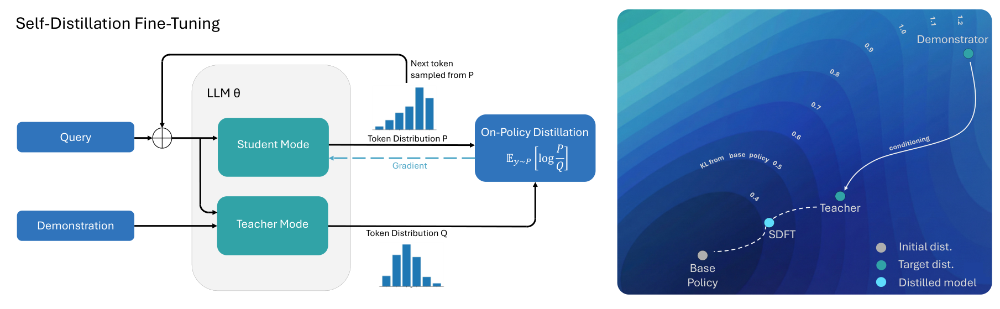
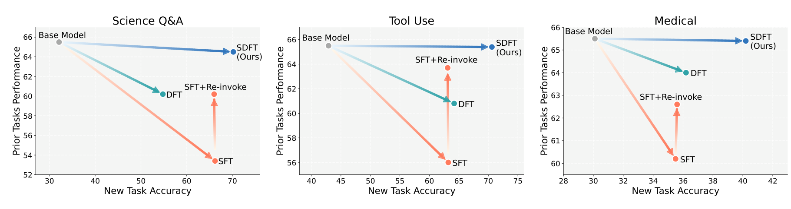
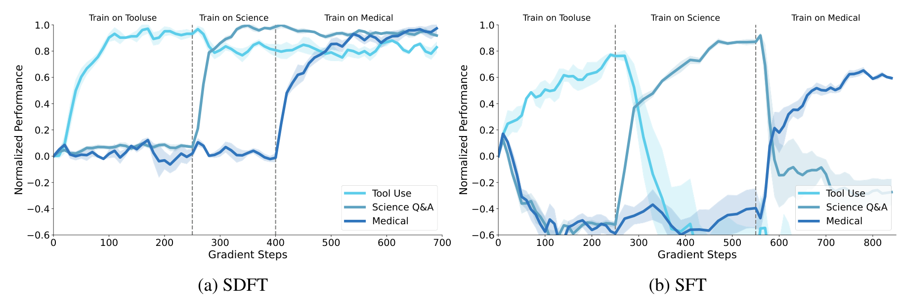
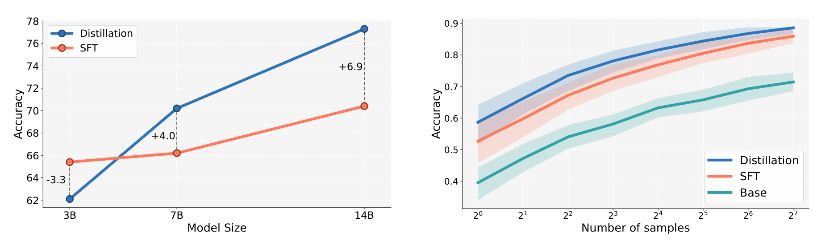

# SDFT：Self-Distillation Fine-Tuning

## 来源

- 原始 PDF：[`raw/2601.19897v2.pdf`](../../raw/2601.19897v2.pdf)
- 标题：Self-Distillation Enables Continual Learning
- 版本 / 日期：arXiv:2601.19897v2，2026-08-07（v1 2026-01-27），22 页
- 作者：Idan Shenfeld、Mehul Damani、Pulkit Agrawal（MIT / Improbable AI Lab），Jonas Hübotter（ETH Zurich）
- 代码与数据：<http://idanshenfeld.com/SDFT>
- 模型链接：**未建模型页**。主实验是 Qwen2.5-7B-Instruct 的全参数微调，另有 3B/14B 缩放和 Olmo-3-7B-Think。不发布新模型实体

## 核心结论

没有奖励函数、只有专家示范时，SFT 是离线模仿。SDFT 不先学一个奖励模型。同一套权重拆成两个角色：教师看题目 \(x\) 和这一条示范 \(c\)，学生只看 \(x\)。学生采样自己的回答，再让教师在同一前缀上给 next-token 分布。提示要求教师「用自己的话作答，并写出思考」，避免把 \(c\) 原样抄出来（`§3`）。

> Figure 2. (Left) SDFT leverages a model’s in-context learning ability to generate on-policy training signals. … Training minimizes the reverse KL divergence between the student and teacher. (Right) Conditioning the model on the expert demonstrations creates a teacher with an output distribution that is substantially closer to the base model, while maintaining the same new-task accuracy.（`§1` / Figure 2）

公式 1 写成序列级 **reverse KL**：

\[
\mathcal{L}(\theta)=D_{\mathrm{KL}}\big(\pi_\theta(\cdot\mid x)\,\|\,\pi(\cdot\mid x,c)\big).
\]

公式 2 是它的全词表逐 token 梯度。附录 A.1 比较了三种估计器：只在采样 token 上的部分导数、全词表解析式、以及 Rao–Blackwellized 的无偏序列梯度。主实验用**全词表解析式、每题 1 条 rollout**。采样 token 估计器方差更大；无偏估计器没有测出值得其算力的增益。每题多采样几条也几乎不涨。

同一节 Practical Implementation 写：**理论指向 reverse KL，实践中 forward KL 最好。** 算法 1 却写梯度用附录 A.1，而 A.1 的解析式是 \(\log(\pi_\theta/\pi_{\text{teacher}})\) 这一支，即 reverse KL 的形状。Table 5 和 Table 1 没有标注最终跑的是哪一个方向。引用散度时要带上这个分叉，不要写成「主表已核实为 forward KL」或「已核实为 reverse KL」。

教师默认是学生参数的 EMA：\(\phi\leftarrow\alpha\theta+(1-\alpha)\phi\)，\(\alpha\) 在 \(\{0.01,0.02,0.05\}\) 里扫，正文没有给出被选中的那一个值。冻住的基座当教师训得稳但跟不上学生的进步；直接用当前学生当教师会发散（Figure 8，附录 A.3）。

`§3.1` 把它读成隐式 IRL。信任域更新的最优策略若能被「看过示范的自己」近似，\(\pi^\star(y\mid x)\approx\pi(y\mid x,c)\)，则奖励就是 \(\log\pi(y\mid x,c)-\log\pi_k(y\mid x)\)。对这个奖励做 on-policy policy gradient，期望上等于 reverse KL 的梯度。这是作者的等价改写，成立条件是上面的 in-context 假设，不是从示范里辨识出的唯一奖励。

假设有两条可查的推论（`§3.2`，Qwen2.5-7B-Instruct，ToolAlpaca）。不给示范时基座解出 42% 的例子；每题配上对应示范后，教师成功率 100%。作者手看了 50 条教师推理，终答案和中间步骤都成立。对基座的 KL：SFT 模型 1.26 nats，示范条件教师 0.68 nats。Table 5 里工具使用的基座准确率是 42.9，和这里的 42% 是同一设定的两种四舍五入。

## 评测要点

主模型是 Qwen2.5-7B-Instruct，全参数，单张 H200，TRL。准确率用贪心解码。除非另说，3 个种子、95% 置信区间；Table 5 只给了点估计。每个基线按目标任务的验证集最高点选超参。技能学习的示范：科学问答用 GPT-4o 最多采 8 条、留下答对的一条，覆盖全部训练题；工具调用用数据集原有示范；医学用 HuatuoGPT-o1 的英文题，约 2 万条，评测 1000 道开放题由 GPT-5-mini 判对错。

先前能力是六项平均：HellaSwag、TruthfulQA、MMLU、IFEval、Winogrande、HumanEval。

> Figure 4. Performance trade-offs between new task accuracy and retention of prior capabilities. … SDFT consistently achieves superior Pareto efficiency compared to baselines across all three skill learning tasks.（`§4.2`）

Table 5 的点估计：

| 任务 | 方法 | 新任务 | 先前能力平均 |
| --- | --- | ---: | ---: |
| 科学问答 | Base | 32.1 | 65.5 |
| 科学问答 | SFT | 66.2 | 53.4 |
| 科学问答 | SFT + re-invoke | 66.0 | 60.2 |
| 科学问答 | DFT | 54.8 | 60.2 |
| 科学问答 | SDFT | **70.2** | **64.5** |
| 工具使用 | Base | 42.9 | 65.5 |
| 工具使用 | SFT | 63.2 | 56.0 |
| 工具使用 | SFT + re-invoke | 63.1 | 63.7 |
| 工具使用 | DFT | 64.2 | 60.8 |
| 工具使用 | SDFT | **70.6** | **65.4** |
| 医学 | Base | 30.1 | 65.5 |
| 医学 | SFT | 35.5 | 60.2 |
| 医学 | SFT + re-invoke | 35.6 | 62.6 |
| 医学 | DFT | 36.2 | 64.0 |
| 医学 | SDFT | **40.2** | **65.4** |

re-invoke 是 SFT 之后再用基座策略、在通用提示上做一轮 on-policy 蒸馏，出处是 [Thinking Machines 博客](thinking-machines-on-policy-distillation.md)。它把先前能力拉回一截，科学问答仍停在 60.2，低于基座 65.5。SDFT 的先前能力平均也不是零遗忘：科学问答 65.5→64.5，其中 IFEval 74.3→66.8。节标题里的 without forgetting 要配这张表读。

> Figure 3. … SDFT is able to learn each one while retaining performance on the others. In contrast, SFT performance on each task drops once it starts learning the next one.（`§3.2` 图、`§4.3` 正文）

这张图的纵轴是归一化分，不是 Table 5 的绝对准确率。顺序实验没有另给一张绝对分表。

> Figure 5. (Left) SDFT benefits from model scale. … (Right) SDFT improves pass@k across various k, indicating genuine skill acquisition rather than entropy collapse.（`§4.4`–`§4.2`）

7B 的 +4.0 与 Table 5 一致（70.2−66.2）。3B 上 SDFT 低于 SFT。右图 pass@k 用 temperature 1.0、top-p 0.95，\(k\) 到 128；正文没有把每档数字列表。增益在各 \(k\) 上都在，所以不是只把分布变尖。

知识注入是 2025 年自然灾害的维基文章，约 200K token，问答由 GPT-5 生成，大约是原文的 5 倍。评测分严格（细节都对）、宽松（有对的、没有错的）和间接问法。Table 1：

| 方法 | 严格 | 宽松 | 分布外 |
| --- | ---: | ---: | ---: |
| Base | 0 | 0 | 0 |
| Oracle RAG | 91 | 100 | 100 |
| CPT | 9 | 37 | 7 |
| SFT | 80 | 95 | 80 |
| SDFT | 89 | 100 | 98 |

Oracle RAG 每次都给对文章。SDFT 的严格分比它低 2，分布外低 2。附录 Figure 7 在同样的 on-policy 训练下改教师上下文：只给答案 37%，只给文章 75%，文章加答案 89%（严格）。

离线对照在工具使用上（Figure 6）：用同一教师做 SFT，或在教师生成的固定数据上做 KL，都高于普通 SFT，仍低于 on-policy SDFT。正文没有给这张图的终点数字。

Olmo-3-7B-Think 用只有最终答案、没有思维链的医学数据（Table 2）：基座准确率 31.2、平均 4612 token；SFT 降到 23.5 和 3273 token；SDFT 升到 43.7，长度 4180。这是另一个基座，不能和 Qwen 医学的 40.2 相减。

相对 SFT，作者写 SDFT 大约 2.5× FLOPs、约 4× 墙钟。没有单独的计时表。

## 与现有 wiki 页的关系

- **[OPSD](opsd.md)**：也是「看过额外上下文的自己」当教师。OPSD 的上下文是参考解答 \(y^\star\)，教师冻在初始策略，主实验写成 full-vocab forward KL，并在表上和 reverse KL 对过。SDFT 的上下文是专家示范或文章，教师是 EMA，任务是工具、科学、医学和 2025 年事实。两篇互相点名为 concurrent。
- **[SDPO](sdpo.md)**：Hübotter 等人的在线环境反馈版。privileged 信息是报错或同组成功样本，不是固定示范集。SDPO 的公式 1 也是 reverse KL，无丰富反馈的实验改用 Jensen–Shannon。SDFT 的 related work 把 SDPO 和 OPSD 一起写成「固定示范、无在线环境」并不准确：那句话覆盖的是示范设定，SDPO 正文有 LiveCodeBench 的在线环境。
- **[Thinking Machines 博客](thinking-machines-on-policy-distillation.md)**：re-invoke 基线的出处。本页用它当 SFT 之后的补救，不是主方法。
- **[GKD](generalized-knowledge-distillation.md)**：发散度本来就是旋钮。本页理论段选 reverse KL、实践段改口 forward KL，和 GKD「依任务而定」同方向，实验协议不同。

## 证据边界与阅读提示

- 局限节把小模型失败指到 Figure 4a。缩放曲线在 Figure 5 左图；Figure 4 是三张 Pareto 散点。
- 主表的 KL 方向没有和 Practical Implementation 的 forward KL 对齐。见核心结论。
- 不能把非推理模型训成显式长思维链。作者写成未解决。
- 学生会学到教师口癖（“Based on the text…”）。对策是训练时掩掉前几个 token 的损失，作者称为启发式。
- 示范和医学、知识题的对错依赖 GPT-4o / GPT-5 / GPT-5-mini。换评判器是否改变 Table 1 和 Table 5，论文没有报。

## 待追问

- **需实验或作者披露**：主实验最终用的是 forward KL 还是附录 A.1 的 reverse KL 解析梯度。两处写法冲突，表上没有消融。
- **需实验或作者披露**：噪声示范、用户对话，以及和奖励 RL 同时混训。`§5` 只列了方向。
- **需实验或作者披露**：顺序学习只有归一化曲线。三技能结束时的绝对分没有表。

## 相关页面

- [OPSD](opsd.md)
- [SDPO](sdpo.md)
- [On-Policy Distillation 跨报告对比](../comparisons/on-policy-distillation.md)
- [Multi-Teacher On-Policy Distillation](../concepts/multi-teacher-on-policy-distillation.md)
- [Thinking Machines Lab On-Policy Distillation 博客](thinking-machines-on-policy-distillation.md)
- [GKD](generalized-knowledge-distillation.md)
