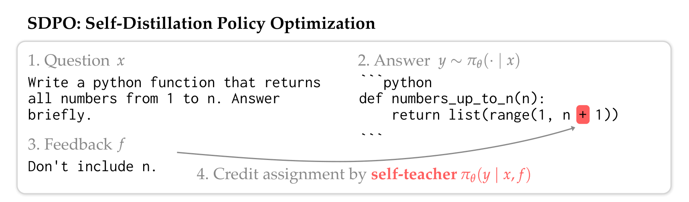
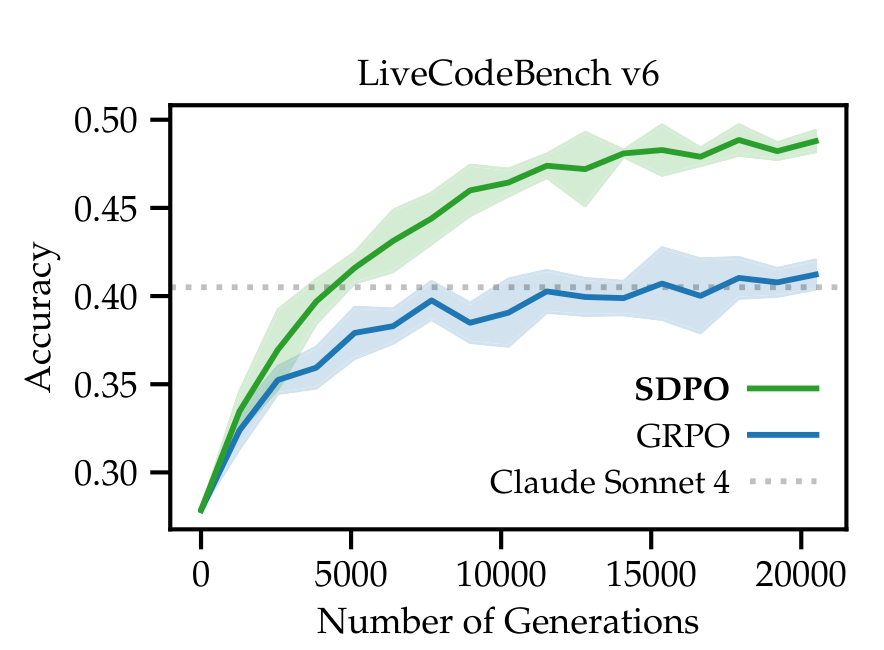
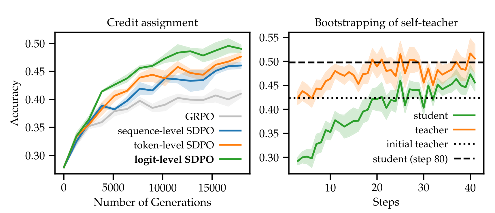
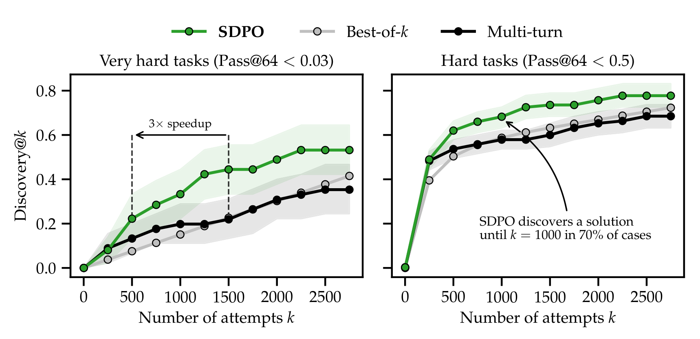

# SDPO：Self-Distillation Policy Optimization

## 来源

- 原始 PDF：[`raw/2601.20802v2.pdf`](../../raw/2601.20802v2.pdf)
- 标题：Reinforcement Learning via Self-Distillation
- 版本 / 日期：arXiv:2601.20802v2，2026-02-16（v1 2026-01-28），50 页
- 作者：Jonas Hübotter（ETH Zurich）等；Frederike Lübeck、Marco Bagatella（ETH / MPI-IS），Idan Shenfeld（MIT），Carlos Guestrin（Stanford），Andreas Krause（ETH）
- 代码：<https://github.com/lasgroup/SDPO>
- 模型链接：**未建模型页**。实验是 Qwen3、Qwen2.5-Instruct 与 Olmo3-7B-Instruct 上的后训练，不发布新模型实体

## 核心结论

SDPO 把可验证环境里的文本反馈（报错、失败测试、评审）当成 dense 信用分配，不另训奖励模型，也不请外部 teacher。学生先按 \(\pi_\theta(\cdot\mid x)\) 采样；自教师是**同一套参数**在反馈 \(f\) 下的条件分布 \(\pi_\theta(\cdot\mid x,f)\)，只重算原回答的 log-prob，不再采样。\(f\) 可以是环境输出，也可以是同一 rollout 组里另一条成功样本。成功的尝试把自己当成「正确解答」传给教师（Table 2）。

> Figure 4. Example of self-teaching with Qwen3-8B. … we re-evaluate the log-probs of the original attempt with the self-teacher after seeing the feedback.（`§2`）

公式 1 写的是逐位置

\[
\mathcal{L}_{\mathrm{SDPO}}(\theta)=\sum_t \mathrm{KL}\big(\pi_\theta(\cdot\mid x,y_{<t})\,\big\|\,\mathrm{stopgrad}\,\pi_\theta(\cdot\mid x,f,y_{<t})\big).
\]

这是 **reverse KL**（学生分布对自教师）。`stopgrad` 挡住梯度流进教师，避免教师丢掉 \(f\)、退回学生。Proposition 2.1 的梯度是 logit 级 policy gradient：实现里的 advantage 是 \(\log\pi_\theta(\hat y\mid x,f,y_{<t})-\log\pi_\theta(\hat y\mid x,y_{<t})\)，教师更看好的 token 为正。和 GRPO 的差别是：GRPO 的 advantage 在一条 rollout 里对所有 token 是同一个标量；SDPO 对每个位置、词表里每个候选 token 各有一个 advantage。

三套实验的发散度并不相同（Table 12）：

| 设定 | 发散度 | 学生 top-K | Teacher EMA \(\alpha\) |
| --- | --- | ---: | ---: |
| §3 只有标量奖励 | Jensen–Shannon | 100 | 0.05 |
| §4 LiveCodeBench | reverse KL | 20 | 0.01 |
| §5 测试时发现 | reverse KL | 20 | 0.01 |

§3 的网格只扫了 forward KL 与 Jensen–Shannon，选中的是后者（`§E.2.1`）。附录 A.3 的 top-K 是**学生**概率最高的 K 个 token，再加一项尾质量；不是把教师分布重归一化到教师 top-K。三套实验都关闭 thinking。

无正则的当前策略当教师会发散（Table 4，到 step 90 的最佳 / 平均准确率 36.1 / 29.8）。EMA 与 trust-region（\(\alpha=0.01\)）是 49.3 / 45.3 和 50.6 / 45.6，冻在初始教师上是 48.8 / 44.4。主实验用 EMA：\(\theta'\leftarrow(1-\alpha)\theta'+\alpha\theta\)（附录 A.2）。

## 评测要点

### 没有环境文本时

成功样本充当失败样本的 \(f\)。SciKnowEval L3 与 ToolAlpaca 上，Qwen3-8B 与 Olmo3-7B-Instruct，指标是 avg@16。Table 3 报的是 1 小时 / 5 小时墙钟内的最高值，不是单一最终检查点。Olmo3 化学：SDPO 的 5 小时点是 80.0，GRPO 是 56.7；正文写 50 分钟达到 GRPO 的 5 小时准确率（6×）。跨任务平均长度，on-policy GRPO 对 SDPO 是 820.8→255.8（Qwen3-8B）和 1095.4→343.9（Olmo3），都是 3.2×（Table 8）。化学图上的 11× 是这一对、这一任务（Figure 6），不能写成所有任务。

引言里的合计 70.2% 对 66.6% 没有对应的表。引用分任务数字时用 Table 3。

### LiveCodeBench v6

131 题（2025-02 至 2025-05）。训练用公开测试，验证用私有测试；公开集是私有集的 50% 随机子集。Qwen3-8B，每题 4 条验证 rollout，3 个种子。

> Figure 1. SDPO substantially outperforms an improved version of GRPO on LCB v6 with Qwen3-8B. … SDPO achieves GRPO’s final accuracy in 4× fewer generations.（`§1`）

正文给出的终点是 **48.8% 对 41.2%**。公开榜上 Claude Sonnet 4 为 40.5%，Claude Opus 4 为 39.7%。基座在 Table 5 是 27.9。每步时间相对 GRPO：无代码环境 +5.8%，有代码环境 +17.1%（Figure 5，micro batch 2）。

> Figure 10. Left: … logit-level > token-level > sequence-level … Right: The self-teacher improves during training.（`§4.2`–`§4.3`）

sequence-level 仍高于 GRPO，所以增益不全来自更密的 advantage。右图的学生曲线在 step 80 越过初始教师的生成准确率；这是训练 batch 上的滚动平均，不是 LCBv6 验证集。

Table 6（训到 step 60）里，环境输出加同组成功样本的学生准确率是 48.3；再把学生原回答 \(y\) 放进教师模板会把「教师与学生撞上同一环境输出」的比例从 10.1% 抬到 30.0%，学生准确率降到 44.5，熵从 0.38 降到 0.23。

Qwen3 缩放（Figure 8，step 80）：模型越大，SDPO 相对 GRPO 的差距越大；0.6B 上只略好。把 GRPO advantage 以 \(\lambda=0.9\) 混进去（公式 3），0.6B 上明显高于纯 SDPO，8B 上略低于纯 SDPO（Figure 11）。Qwen2.5-Instruct 上，正文写 1.5B 的 SDPO **低于** GRPO、7B **高于** GRPO；同一段还写了「Qwen2.5-8B 持平」。Figure 17 的 Qwen2.5 横轴是 1.5 / 3 / 7，没有 8B。1.5B 的方向以正文为准，8B 这一句没有图上的点。

遗忘对照（Table 5，最终检查点）：

| 检查点 | LCBv6 | IFEval | ArenaHard-v2 hard | ArenaHard-v2 creative | MMLU-Pro | holdout 平均 |
| --- | ---: | ---: | ---: | ---: | ---: | ---: |
| Base | 27.9 | 83.9 | 14.0 | 13.7 | 62.5 | 43.5 |
| SFT on self-teacher | 42.7 | 83.7 | 11.2 | 8.9 | 61.9 | 41.4 |
| GRPO | 41.2 | 82.2 | 12.0 | 10.8 | 62.3 | 41.8 |
| SDPO | 48.8 | 83.2 | 12.3 | 11.1 | 62.9 | 42.4 |

SDPO 的 holdout 平均高于 GRPO 和那条 off-policy SFT，仍低于基座 43.5。节标题写 avoids catastrophic forgetting；表上是轻度下降，不是零遗忘。SFT 基线要额外生成教师回答，同样步数下生成量是 SDPO 的 2×。

### 测试时，单题

只给一道二元奖励的难题，batch 里还没有成功样本时，环境输出仍然能提供梯度。Hard：Qwen3-8B 的 pass@64 < 0.5，19 题。Very hard：pass@64 < 0.03，9 题。保留的是三种方法里至少一种能在 512 步、5 个种子内找到一次解的题。discovery@k 是 k 次尝试内至少成功一次的概率。

> Figure 13. Self-distillation at test-time solves LiveCodeBench questions that neither the base model nor multi-turn conversations can solve.（`§5.2`）

正文的终点（discovery@2750）：极难题 SDPO 53.2%，多轮 35.6%，best-of-k 41.5%；到达约 22% 发现概率大约少 3× 生成。难题 SDPO 78%；约 67% 发现概率少 2.4× 生成。多轮和 best-of-k 在难题上分别解出 68.4% 和 72.3%。图上难题标注写的是 k=1000 时 70%，和正文的 67% / 2.4× 不是同一句。Q3 只有 SDPO 解出，第一次在第 321 次尝试（batch 16 的第 20 步）。初始自教师在几乎所有题上准确率 < 1%，其中 78% 的题是 0（Table 11）：单轮把反馈放进上下文并不等于已经会做。

## 与现有 wiki 页的关系

- **[OPSD](opsd.md)**：也是同一权重、两种条件。OPSD 的 privileged 信息是参考解答 \(y^\star\)，教师冻在初始策略，主实验是 full-vocab **forward** KL，任务是竞赛数学。SDPO 的 privileged 信息是环境输出或同组成功样本，教师用 EMA 跟着走，代码实验是 reverse KL 的 top-K 加尾项。两篇互相点名为 concurrent，数字不能相减。
- **[SDFT](sdft.md)**：固定示范集上的持续学习。没有在线环境。本页 related work 把它和 OPSD 并成「无在线环境」的 concurrent；那句话不要用来描述本页自己的 LiveCodeBench 实验。
- **[GKD](generalized-knowledge-distillation.md)**：外部教师、学生数据比例 \(\lambda\) 与发散度都是旋钮。SDPO 的 \(\lambda\) 固定为在线学生采样；§3 选了 JSD，§4 选了 reverse KL，和 GKD「发散度依任务而定」同方向，不是同一组实验。
- **[ExOPD](exopd.md)**：公式 3 的 \(\lambda\) 是 GRPO advantage 和 SDPO advantage 的混合权重，主实验 0.9。不是 ExOPD 的 reward scale，也不是 GKD 的数据混合比例。
- **[Revisiting OPD](revisiting-opd.md) / [Many Faces](many-faces-opd.md)**：那边的 top-K 是教师支撑上的 reverse KL，重归一化与否会改变目标。SDPO 的 top-K 是省显存的学生侧截断，尾项还在，意图仍是逼近全词表散度。

## 证据边界与阅读提示

- 最大学生是 Qwen3-8B。正文把 retrospection 写成随规模出现，并写更强模型还没做。
- 全部主实验关闭 thinking。不要和开 thinking 的 OPSD 主表比增益。
- 环境反馈如果无信息或误导，作者把失败写成局限，没有单独消融。
- Agentic 长轨迹、无验证器的开放生成、每批多步 off-policy 更新，都在 `§7` 标成未做。长周期 agent 里环境输出能否当 \(f\)、以及只有文本反馈时会不会写入评审噪声，原文都没有实验。
- 原文没有和 [SDFT](sdft.md) 在同一基座、同一任务上，对照在线环境反馈多出来的梯度。

## 相关页面

- [OPSD](opsd.md)
- [SDFT](sdft.md)
- [On-Policy Distillation 跨报告对比](../comparisons/on-policy-distillation.md)
- [Multi-Teacher On-Policy Distillation](../concepts/multi-teacher-on-policy-distillation.md)
- [GKD](generalized-knowledge-distillation.md)
- [ExOPD](exopd.md)
- [Thinking Machines Lab On-Policy Distillation 博客](thinking-machines-on-policy-distillation.md)
