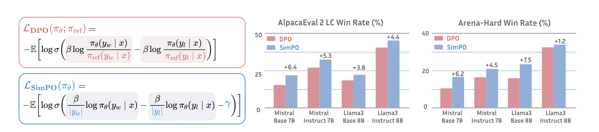
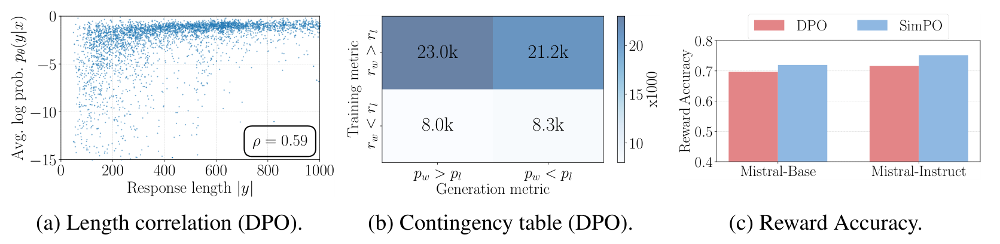

# SimPO：Simple Preference Optimization

## 来源

- 文件：`raw/2405.14734v3.pdf`
- 标题：SimPO: Simple Preference Optimization with a Reference-Free Reward
- 团队 / 日期：Yu Meng（University of Virginia）、Mengzhou Xia、Danqi Chen（Princeton Language and Intelligence）；NeurIPS 2024；arXiv:2405.14734v3，2024-11-01
- arXiv：<https://arxiv.org/abs/2405.14734>
- 代码：<https://github.com/princeton-nlp/SimPO>
- 定位：这是 **参考模型无关的离线偏好损失**。主实验是 Mistral-7B 与 Llama-3-8B 的 Base / Instruct 四组；最强检查点是 Gemma-2-9B-it 上的 SimPO。不另建模型页。
- 易混：奖励里的 $\beta$ 不是 [DPO](dpo.md) 那个 0.1 量级的 KL 系数。这里 $\beta$ 缩放的是已经除以长度的平均 log-prob，主表用 2.0 或 2.5。目标 margin $\gamma$ 也不是 [IPO](ipo.md) 的 $1/(2\tau)$。

## 核心结论

1. **DPO 的隐式奖励和生成时的排序指标不是同一个量。** DPO 的 $r=\beta\log(\pi_\theta/\pi_{\mathrm{ref}})+\beta\log Z$（Eq. 1）。推理时没有 $\pi_{\mathrm{ref}}$，常用的是长度平均 log-prob。作者在训练集上看到：DPO 奖励把 $y_w$ 排在 $y_l$ 前面，并不保证平均 log-prob 也如此；Figure 4b 的一致比例约一半（§2.2）。
2. **SimPO 把奖励换成长度平均 log-prob，并在 Bradley-Terry 里减去 $\gamma$。** $r_{\mathrm{SimPO}}(x,y)=(\beta/|y|)\log\pi_\theta(y\mid x)$（Eq. 4）。偏好概率是 $\sigma(r(y_w)-r(y_l)-\gamma)$（Eq. 5）。没有 $\pi_{\mathrm{ref}}$，也没有单独的 SFT 项。
3. **去掉长度归一化会往长回答上偏。** 直接用 token log-prob 之和当奖励时，更长的 $y_w$ 要靠抬高每个 token 的概率才能赢过 $y_l$，作者认为这会增加退化风险（§2.2、§4.2）。
4. **四组设定里 AlpacaEval 2 的 length-controlled win rate 都高于同协议 DPO，幅度不是每一格都大。** 最大差是 Mistral-Base 的 21.5 对 15.1（+6.4）。Arena-Hard 最大差是 Llama-3-Base 的 23.4 对 15.9（+7.5）。Llama-3-Instruct 的 MT-Bench（GPT-4 Turbo）DPO 与 SimPO 都是 7.0（Table 4）。
5. **边界：** 没有 KL 项。作者把「离参考模型的 KL 仍然低」归因于小学习率、偏好数据覆盖多领域、以及 LLM 本身不容易忘（§2.3），证据在 §4.4 的 KL 曲线，不是定理。附录 A 写缺少更严格的理论，安全 / 诚实不在目标里，推理任务上偏好优化经常掉点。和 PPO 的对照留给未来工作（脚注 7）。

## 架构与训练

> 论文 Figure 1 原文标题："SimPO and DPO mainly differ in their reward formulation, as indicated in the shaded box. SimPO outperforms DPO significantly across a range of settings on AlpacaEval 2 and Arena-Hard."（第 2 页）

损失（Eq. 6）：

$$
\mathcal{L}_{\mathrm{SimPO}}(\pi_\theta)=-\mathbb{E}_{(x,y_w,y_l)\sim\mathcal{D}}\Biggl[\log\sigma\Biggl(\frac{\beta}{|y_w|}\log\pi_\theta(y_w\mid x)-\frac{\beta}{|y_l|}\log\pi_\theta(y_l\mid x)-\gamma\Biggr)\Biggr].
$$

和 [DPO](dpo.md) Eq. 7 的两项差别：分母从 $\pi_{\mathrm{ref}}(y\mid x)$ 换成响应长度 $|y|$；sigmoid 内部多减一个与策略无关的 $\gamma>0$。$\gamma$ 过大时生成质量回落（§4.3）。

[IPO](ipo.md) 也把间隙拉向一个有限目标。SimPO Table 3 把 IPO 写成 $\bigl(h_\pi-1/(2\tau)\bigr)^2$，其中 $h_\pi$ 仍是 $\log(\pi/\pi_{\mathrm{ref}})$ 之差。那是平方回归，而且保留参考模型。SimPO 的 $\gamma$ 减在长度平均 log-prob 的 sigmoid 里。§2.3 说 IPO 的目标 margin「类似」，但完整目标不如 SimPO；Table 4 是这句话的实验，不是把两个 margin 写成同一个符号。

Table 3 同时把 [ORPO](orpo.md) 写成 $-\log p_\theta(y_w)-\lambda\log\sigma(\log\mathrm{odds}_w-\log\mathrm{odds}_l)$，其中 $p_\theta(y\mid x)=\exp\bigl((1/|y|)\log\pi_\theta(y\mid x)\bigr)$。这和 ORPO Eq. 3–7 一致：ORPO 多一条 chosen 上的 NLL，对比的是 odds。SimPO 没有这条 NLL。

没有 KL 正则时，作者列举三件保持泛化的做法：小学习率、领域多样的偏好数据、模型对旧知识的稳健性（§2.3）。

### 四组数据从哪来

Base：先在 UltraChat-200k 上 SFT（`Mistral-7B-v0.1` 或 `Meta-Llama-3-8B`），再在 UltraFeedback 上做偏好优化。偏好对是数据集里现成的，不是当前策略新采样的。

Instruct：起点是现成的 `Meta-Llama-3-8B-Instruct` 或 `Mistral-7B-Instruct-v0.2`。作者注明不清楚这些检查点是否只做了 SFT。为了减轻分布差，用 UltraFeedback 的 prompt、由 SFT 模型自己采样：温度 0.8，每个 prompt 5 条，`llm-blender/PairRM` 取最高为 $y_w$、最低为 $y_l$。只采一轮，不迭代。正文把这组称为更接近 on-policy（§3）。

Table 8 的 SimPO 超参：

| 设定 | $\beta$ | $\gamma$ | 学习率 |
| --- | ---: | ---: | --- |
| Mistral-Base | 2.0 | 1.6 | $3\times10^{-7}$ |
| Mistral-Instruct | 2.5 | 0.3 | $5\times10^{-7}$ |
| Llama-3-Base | 2.0 | 1.0 | $6\times10^{-7}$ |
| Llama-3-Instruct | 2.5 | 1.4 | $1\times10^{-6}$ |

§3 说 $\beta\in[2.0,2.5]$、$\gamma\in[0.5,1.5]$ 在各组都不错。Table 8 的 Mistral-Instruct $\gamma=0.3$、Mistral-Base $\gamma=1.6$ 落在这个区间外，以表为准。附录 B 写所有离线方法都做了超参搜索，包括 DPO。附录 A 把自动决定 margin 留给后续；已公开的是按设定搜索，不是一条选择公式。

Gemma-2 沿用 Instruct 的造对方式，但排序模型换成 `RLHFlow/ArmoRM-Llama3-8B-v0.1`（脚注 5、Appendix J）。放出检查点的学习率是 $8\times10^{-7}$（Table 17 的 *）。

## 后训练

SimPO 是偏好优化那一步的损失，不是多阶段 agent recipe。Base 仍然先有一阶段 UltraChat SFT，再换损失；Instruct 直接从指令模型起步。两种设定都不用第二次前向去算 $\pi_{\mathrm{ref}}$。

## 评测要点

评判（Table 2）：AlpacaEval 2 为 805 题，baseline GPT-4 Turbo，评判 GPT-4 Turbo，报 length-controlled 与 raw win rate。Arena-Hard v0.1 为 500 题，baseline GPT-4-0314，评判 GPT-4 Turbo。MT-Bench 为 80 题，GPT-4 与 GPT-4 Turbo 各打 1–10 分。

Table 4 的 AlpacaEval 2 LC / Arena-Hard（只列 SFT、DPO 和本库已有的三条损失；全表还有 RRHF、SLiC-HF、CPO、R-DPO）：

| 设定 | SFT LC / AH | DPO | IPO | ORPO | SimPO |
| --- | --- | --- | --- | --- | --- |
| Mistral-Base | 8.4 / 1.3 | 15.1 / 10.4 | 11.8 / 7.5 | 14.7 / 7.0 | 21.5 / 16.6 |
| Mistral-Instruct | 17.1 / 12.6 | 26.8 / 16.3 | 20.3 / 16.2 | 24.5 / 20.8 | 32.1 / 21.0 |
| Llama-3-Base | 6.2 / 3.3 | 18.2 / 15.9 | 14.4 / 17.8 | 12.2 / 10.8 | 22.0 / 23.4 |
| Llama-3-Instruct | 26.0 / 22.3 | 40.3 / 32.6 | 35.6 / 30.5 | 28.5 / 25.8 | 44.7 / 33.8 |

摘要的「AlpacaEval 2 最多 +6.4」是 Mistral-Base 的 21.5−15.1；「Arena-Hard 最多 +7.5」是 Llama-3-Base 的 23.4−15.9。Llama-3-Instruct 上 R-DPO 的 LC 是 41.1，仍低于 SimPO 的 44.7，高于 DPO 的 40.3。MT-Bench 上 SimPO 与 DPO 的差距多在 0.1 以内；Llama-3-Instruct 的 GPT-4 Turbo 分两者都是 7.0，GPT-4 分都是 8.0。

> 论文 Figure 4 原文标题："Comparison between SimPO and DPO, measured on UltraFeedback. (a) Spearman correlation between average log probability and response length for DPO. (b) Contingency table of rankings based on DPO rewards and the average log likelihood (measured on the training set). (c) Reward accuracy of DPO and SimPO."（§4.4）

列联表里，DPO 奖励把 winner 放在前面的样本约 23.0k+21.2k，其中平均 log-prob 也把 winner 放在前面的是 23.0k，约一半。这是 §2.2「约 50%」的那张表。

Gemma-2-9B（Table 17，回答由 Gemma-2-9B-it 重采样，ArmoRM 排序）：

| 模型 | AlpacaEval 2 LC | Arena-Hard | GSM | MMLU |
| --- | ---: | ---: | ---: | ---: |
| Gemma-2-9B-it | 51.1 | 40.8 | 87.4 | 72.7 |
| Gemma-2-9B-DPO | 67.8 | 58.9 | 88.5 | 72.2 |
| SimPO，$8\times10^{-7}$（放出） | 72.4 | 59.1 | 88.0 | 72.2 |

同一表里学习率 $6\times10^{-7}$ 与 $1\times10^{-6}$ 的 LC 是 71.7 和 71.0。摘要的 72.4 与 59.1 对的是放出检查点。这组 GSM 相对 it 检查点是 87.4→88.0，没有掉；MMLU 是 72.7→72.2。

Chatbot Arena（LMSYS）：Gemma-2-9B-it-SimPO 把原 it 检查点从第 36 名升到第 25 名，作者写截至 **2024-09-16** 它是真实用户投票下排名最高的 <10B 模型（Appendix J）。这是当时的榜，不是持续排名。

附录 A：Table 9 上各偏好方法相对 SFT，知识（MMLU）掉得少，阅读和常识（ARC、HellaSwag）多数上升；GSM8K 一类推理任务则普遍下降，SimPO 有时与 DPO 相当或更低。作者的一个解释是奖励间隙拉开了，偏好序列的似然却没有升高；改一个 token 就能翻转数学标签时这会妨碍学习。他们引用的补法是加回带参考模型的 SFT 项，本方法没有接上。

## 证据边界与阅读提示

- 附录 A 观察到推理任务上偏好优化普遍掉点，并提到可加回参考模型校准的 SFT 项。主损失没有这一项，原文没有这条补丁的实验。

## 相关页面

- 损失对照：[DPO](dpo.md)（Eq. 7）、[IPO](ipo.md)（$1/(2\tau)$ 的平方损失，Table 4 的基线）、[ORPO](orpo.md)（odds ratio + chosen NLL；Table 4 重调后 LC 低于同协议 DPO）、[KTO](kto.md)、[Iterative RPO](iterative-rpo.md)（DPO+NLL，不是本页的 R-DPO）
- 比较：[LLM RL policy optimization 对比](../comparisons/llm-rl-policy-optimization.md)
- 概念：[Agentic 模型的后训练](../concepts/post-training-for-agentic-models.md)
