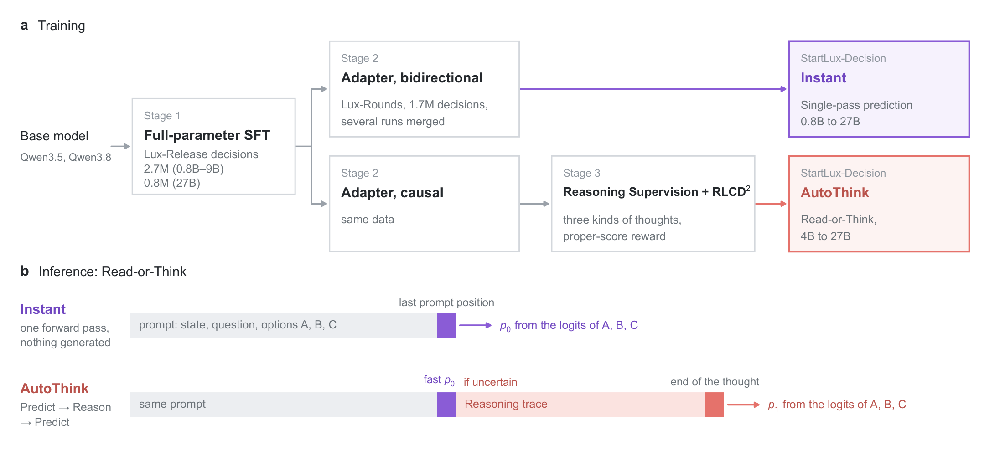
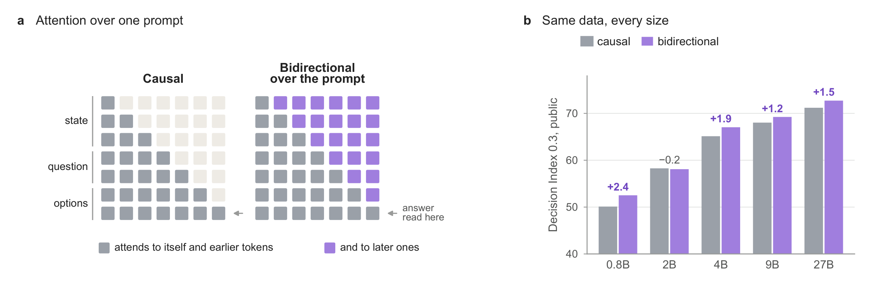
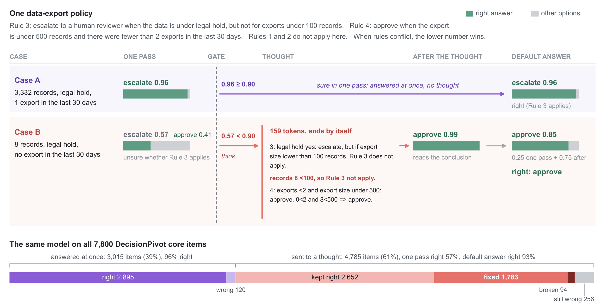
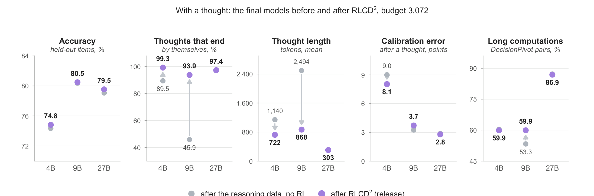
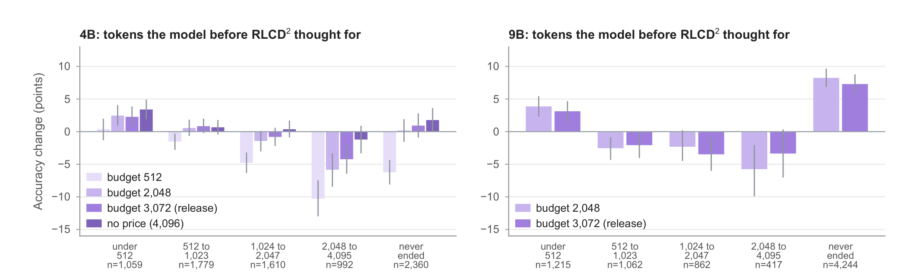
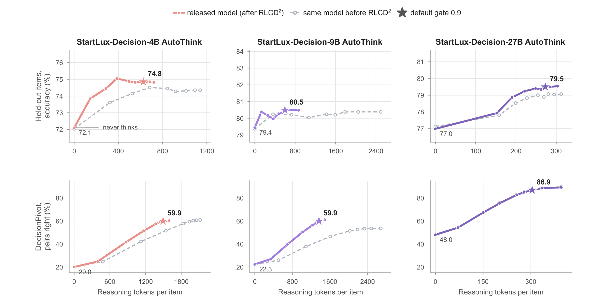
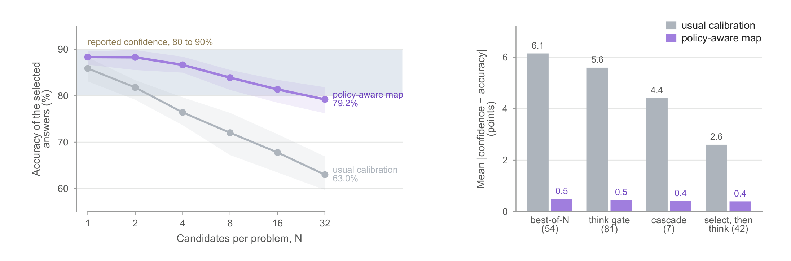

# StartLux-Decision：AutoThink 决策模型与 RLCD2

## 来源

- 原始 PDF：[`raw/2610.17309v2.pdf`](../../raw/2610.17309v2.pdf)
- 标题：StartLux-Decision: AutoThink Decision Models with Reinforcement Learning for Calibrated Deliberative Decisions
- 版本 / 日期：arXiv:2610.17309v2，2026-10-20（v1 2026-10-12）。评论写 technical report、38 页、16 图、15 表；本地 PDF 为 37 页
- 作者：Xialie Zhuang、Zunhai Su（StartLux、香港大学）；Jia Pan（香港大学）；Ngai Wong（香港大学、EMUS Lab）；Guanhua Chen（南方科技大学）；Chuan-Wei Kuo（StartLux）。Chen 与 Kuo 为通讯作者
- 代码：<https://github.com/StartLuxLabs/StartLux-Decision>
- 权重：<https://huggingface.co/startlux-models>（v1.1 Instant / AutoThink）
- 博客：<https://decision.startlux.com>
- 模型链接：[StartLux-Decision](../models/startlux-decision.md)

## 为什么这篇在 wiki 里独占一席

它把「决策模型」写成一个有概率接口的模型族，而不是又一篇通用 reasoning RL。请求是带类型的问题：在命名选项里选一个、做二元判断，或在 2–10 级有序刻度上选一级。模型在 prompt 最后一个位置读选项字母的 logits，softmax 成分布。下游用这个分布决定自动执行、换更大的模型，还是交给人。

两条变体共用这套读出。Instant 不生成 token。AutoThink 先读一次；最高概率达到门槛才直接交卷，否则生成推理后再读一次，并把两次分布混在一起。RLCD2 优化的是这次推理让**概率质量**变好了多少，外加超长轨迹的软惩罚，而不是只奖最终选项对不对。

## 核心结论

1. **公开的 Decision Index 0.3 子集上，Instant 在五个尺寸都高于作者评过的同尺寸开源决策模型 7.4–16.9 分。** 对照全是 vLLM Semantic Router 的 Decision 3.0 家族（Figure 7、Table 4）。4B Instant 的 67.88 高于表里所有参照决策模型，包括 27B 的 Decision 3.0 d3（65.44）、Perplexity Decider v1.1（62.25）和托管的 Jev（57.96）。27B AutoThink 为 73.37。这组公开分参与过选配方和种子平均，不是独立测试（`§4.1`）。

2. **DecisionPivot 上，AutoThink 相对同尺寸 Instant 的 pair accuracy 高 11.5–18.4 个百分点。** 27B AutoThink 为 86.9%，高于文中列出的参照，包括 low reasoning effort 的 GLM-5.3（82.2%）。4B 与 9B AutoThink 都是 59.9%（Figure 9）。这个基准没有参与任何数据、检查点或配置选择。

3. **RLCD2 主要买到的是推理会自己停、并且更短。** 在 2,986 条 held-out、每题强制想一次、生成上限 4,096 token 时，9B 的自行终止率从 45.9% 到 93.9%（+48 个百分点），平均轨迹从 2,494 token 到 868（少 65%）。4B 从 89.5% 到 99.3%，平均长度少 37%。27B 监督之后已经 97.2%、平均 313 token，RL 之后几乎不动（Table 2）。Held-out 的 default-answer 准确率变化，作者写其区间包含 0。

4. **单条预测校准好，不保证选完或路由之后还校准。** 9B 验证器把单条响应标成 80–90% 置信时，92% 是对的；从 32 个候选里取出最高分之后，同一置信段只剩 78%。Policy-aware calibration 在 184 个设置里把带符号的置信–准确率差从 \([-11.7,+20.5]\) 收到 \([-2.7,+2.1]\) 个百分点，不改模型权重（`§5.4`–`§5.5`）。

## 架构与训练

### 概率读出

每个问题单独做成一条 prompt：状态、问题、标成 A–Z 的选项。概率来自语言模型输出投影在**最后一个 prompt 位置**的字母 logits，除以按题型在 held-out 上拟合的温度 \(T\)，再在 \(K\) 个选项上 softmax（公式 1）。不另加预测头。一次读出最多 26 个选项；更长的列表按至多 25 个一组并行读，每组前三名进入决赛（Appendix D.4）。一个请求里的多个问题是 batch 里的不同行。

两种变体都声明上下文最多 262,144 token。图像走预训练视觉塔，训练全程冻结（`§2.2`）。报告里的 Decision Index 与 DecisionPivot 数字是文本决策，没有视觉任务分数。

### 两种变体从 Stage 2 分开

> Figure 2. Training and inference workflows of StartLux-Decision. … Instant adopts bidirectional attention in full-attention layers, while AutoThink retains causal attention.（`§2.3`）

Figure 2 把基座写成 Qwen3.5、Qwen3.8，没有按尺寸点名检查点。发布的 v1.1 4B Instant 与 27B Instant 的 `config.json` 都是 `model_type: qwen3_5`、`Qwen3_5ForConditionalGeneration`（外部，[4B](https://huggingface.co/startlux-models/StartLux-Decision-v1.1-4B-Instant/blob/main/config.json)、[27B](https://huggingface.co/startlux-models/StartLux-Decision-v1.1-27B-Instant/blob/main/config.json)）。4B 为 32 层、hidden 2560，`full_attention_interval` 为 4，与正文「4B 和 9B 改 32 层里的 8 层」一致。27B 为 64 层、hidden 5120，和 [Qwen3.5-27B](../models/qwen3.5.md) 的层数与 hidden 相同。论文正文只说线性注意力层保持因果、full-attention 层可以改 mask，没有写 GDN。

> Figure 4. Bidirectional attention improves single-pass decision performance across most evaluated model scales.（`§2.3.2`）

Instant 在训练时就去掉 full-attention 层的因果 mask，让状态 token 能看到后面的问题和选项。线性层的递推仍是因果的。作者引用 LLM2Vec：只在推理时改一个因果模型的 mask 会打乱预测，所以 mask 必须参与训练。同数据、同 Stage 1 的对照里，五个尺寸有四个上涨；同配置不同种子的波动是 0.2–0.7 个指数点，2B 的 −0.2 落在这个幅度里（Figure 4b）。Perplexity Decider v1.1 用了同类双向设计，本文没有把它的实现和自己的 mask 对齐。

**Stage 1** 在 Lux-Release 上全参 SFT，包括输出投影。损失是候选分布上的 soft cross-entropy。0.8B–9B 约 270 万条，27B 约 80 万条，后者更偏 benchmark 训练划分和知识多选题（Table A.1）。选项顺序用记录哈希做确定性置换。与 Decision Index 测试集、JevBench v1.4.2 的 231 条公开题、以及同一 parent group 的记录都排除。拟合温度全都大于 1，即校准前偏自信。

**Stage 2** 在 Lux-Rounds（约 170 万条）上训 adapter，再合并回 Stage 1。GSM8K 只贡献按 DI 0.3 改写过的训练题。API 生成的样本要两个独立验证模型都同意才留下。每个发布的 Instant 是多种子均匀平均：0.8B 三次，2B–27B 四次，然后重拟合温度。AutoThink 用同一份 Stage 2 数据，但保持因果注意力。原文只写 Instant 做了平均，没有写 AutoThink 的 Stage 2 是否同样平均。

**Stage 3** 只加在因果分支上。决策训练会伤到「生成并且停下来」：被要求推理时，4B 约 40% 的问题几乎不产生推理，9B 约 70% 一直生成到长度上限。Lux-Think 上每模型约 4,000–21,000 条监督推理，adapter 再合并。监督之后，评过的 AutoThink 的推理后准确率都高于单次读出，但终止和长度仍没修好，所以才上 RLCD2。Figure 2 的方框写 “three kinds of thoughts”，正文没有定义这三类。

### Read-or-Think

AutoThink 先做一次因果读出，得到 \(p_0\)。若 \(\max_k p_{0,k}\ge g\)，直接返回 \(p_0\)。否则用同一套权重生成最多 4,096 token 的推理，再在轨迹之后的字母 logits 上读 \(p_1\)。默认答案是

\[
p_{\mathrm{default}}=
\begin{cases}
p_0, & \max_k p_{0,k}\ge g,\\
(1-\alpha)p_0+\alpha p_1, & \max_k p_{0,k}< g,
\end{cases}
\quad g=0.9,\;\alpha=0.75.
\]

门槛按问题独立施加。生成到上限仍未停止时，运行时把轨迹收口。\(g\) 与 \(\alpha\) 是在训练分布的 held-out 上定的，不是在 Decision Index 上定的（`§4.1`、`§5.2`）。

> Figure 3. AutoThink selectively invokes reasoning for uncertain decisions.（`§2.2`）

融合权重按 held-out 上默认预测的 Brier score 最小来选。9B 与 27B 的最小点在事后权重 75%；4B 接近最优。DecisionPivot 上，9B 等权 pair accuracy 56.6%，75% 为 59.9%，只用 \(p_1\) 为 61.5%。只追 benchmark 准确率会选更重的 \(p_1\)，但 held-out 上推理后的读出更过度自信，所以发布默认仍是 75/25。相对等权，这个选择让 4B 的 DecisionPivot pair accuracy 高 2.7 点，同时让 9B / 4B 的 held-out 准确率低 0.5 / 0.3 点；DI 0.3 变化小于 0.15 点。27B 上它把 held-out 校准误差从 3.7 点降到 1.6 点，但按 Decision Index 榜单的校准指标，同一权重比等权高 0.8–2.0 点。

仓库 README 把服务默认 `gate` 写成 0.6，并注明论文数字用 0.9（外部：<https://github.com/StartLuxLabs/StartLux-Decision>）。那组引擎数字和 Table 4 不是同一次测量，见待追问。

## 后训练

### RLCD2 的奖励

RLCD 这个名字来自 Jev 的博客（Almeida，2026-09-15，<https://typesafe.ai/blog/introducing-system-one-models-and-jev>），训练过程未公开。OpenJev-RLCD（Gao and Wang，arXiv:2609.38850）先校准 rationale 之后的读出，再用 proper scoring rule 优化推理。本文的 RLCD2 把奖励定义成推理前后概率质量之差。

Proper scoring rule 在真实分布上期望最大，严格 proper 时最大值唯一。文中比较 Brier score、对数分数，以及决策加权分数。发布模型用最后一种。对单个选项，报告概率 \(q\)、结果 \(z\in\{0,1\}\)：

\[
s(q,z)=z\,W(q)-C(q),\quad
W(q)=\int_0^q w(c)\,dc,\quad
C(q)=\int_0^q c\,w(c)\,dc.
\]

\(w(c)\) 是均匀密度与 \(\mathrm{Beta}(8,2)\) 的等权混合，把权重放在高置信段。有序刻度改在累积概率上计分。期望分数对 \(q\) 的导数是 \(w(q)(\pi-q)\)，非负的 \(w\) 使 \(q=\pi\) 为最大点。

推理轨迹 \(\tau\) 的奖励是

\[
r(x,\tau)=S\big(p_1(x,\tau),t\big)-S\big(p_0(x),t\big)-\lambda\max\big(0,|\tau|-B\big).
\]

\(p_0\) 和 \(p_1\) 都由**冻结的起点模型**读出，不是正在更新的策略自己的 logits。\(S\) 是决策加权分数，\(B\) 是软预算，发布配置 \(B=3072\)，\(\lambda=10^{-4}\)。超过 \(B\) 只扣分，生成硬上限仍是 4,096。8 个 token 以内结束的轨迹当成空推理，奖励为 0。训练只保留 \(\max p_0<0.9\) 的问题，和推理时的门槛对齐。

长度项引用了 [DAPO](dapo.md) 的 overlong 惩罚，以及 Kimi k1.5 相对同题其他样本偏好更短的回答。DAPO 的软惩罚是截断窗口里的线性 shaping；这里是超出固定预算后按 token 线性扣分，两套区间不要并成一个公式。

### 策略更新

优化的是推理策略的全部语言模型参数。每个 prompt 采一组轨迹，组内中心化奖励，再裁到 \([-5,5]\)：

\[
A_i=\mathrm{clip}(r_i-\bar r,-5,5).
\]

目标是 token 级 clipped surrogate，外加把策略拉回起点的 KL。KL 估计是生成 token 上的 \(\pi_{\mathrm{ref}}/\pi_\theta-\log(\pi_{\mathrm{ref}}/\pi_\theta)-1\) 的平均，和 [GRPO](deepseekmath.md) 写进 loss 的无偏估计同形。原文写 group-relative policy gradients，并引用 DeepSeekMath 与 DeepSeek-R1。按 Liu et al.（2025，arXiv:2503.20783），advantage **不除**组内标准差，奖励差小的组更新也小。

全是非空轨迹时，\(p_0\) 的分数在组内是常数，中心化之后消掉，相对优势只剩事后分数和长度惩罚。空轨迹保持 0 奖励。组大小 \(G\)、clip \(\varepsilon\)、KL 系数 \(\beta\)、学习率和采样温度，正文都没有给数值。

### 预算换来的准确率

> Figure 5. RLCD2 improves termination and efficiency while largely preserving held-out accuracy. … budget of 3,072 tokens (distinct from the 4,096-token generation limit).（`§3.3`）

Table 2 与 Table 3 是同一批 2,986 条 held-out（另排除 35 条与训练或 RL 数据重叠的样本）和 7,800 条 DecisionPivot 核心题。Default-answer 把事后读出和单次读出按 75/25 混合。括号里是温度缩放之后的校准误差。

| 检查点 | Default 准确率 | 终止率 | 平均 token | 事后校准误差 | DecisionPivot pair |
| --- | ---: | ---: | ---: | ---: | ---: |
| 4B 监督后 | 74.35 | 89.5% | 1,140 | 9.03（3.08） | 60.4 |
| 4B，Brier，预算 512 | 74.68 | 99.3% | 504 | 6.96（3.06） | 53.8 |
| 4B，决策加权，预算 512 | 74.58 | 99.7% | 511 | 6.29（2.44） | 52.9 |
| 4B，决策加权，预算 2,048 | 74.28 | 99.3% | 677 | 8.11（2.55） | 59.2 |
| 4B 发布（预算 3,072） | 74.82 | 99.3% | 722 | 8.05（3.24） | 59.9 |
| 4B，决策加权，无长度惩罚 | 74.48 | 91.6% | 1,186 | 9.38（2.73） | 61.7 |
| 9B 监督后 | 80.38 | 45.9% | 2,494 | 3.25（2.15） | 53.3 |
| 9B，预算 2,048 | 80.64 | 98.1% | 601 | 3.29（2.32） | 61.1 |
| 9B 发布（预算 3,072） | 80.48 | 93.9% | 868 | 3.72（1.42） | 59.9 |
| 27B 监督后 | 79.07 | 97.2% | 313 | 2.88（1.97） | 87.2 |
| 27B 发布（预算 3,072） | 79.54 | 97.4% | 303 | 2.79（2.00） | 86.9 |

4B 在温度缩放之前，事后校准误差从 9.0 降到 8.1，变化区间 \([-1.7,-0.1]\)。缩放过后再比是 3.1 对 3.2。9B 在 DecisionPivot 上从 53.3% 到 59.9%，区间 \([+5.0,+8.3]\)。4B 发布配置相对监督后的 pair accuracy 差 −0.4，区间 \([-1.8,+0.8]\)。去掉长度惩罚，pair accuracy 到 61.7%，轨迹长约 40%，大约三分之一在 4,096 处仍不停；3,072 预算下大约十分之一不停。Held-out 准确率在这些配置之间最多差 0.6 点。

> Figure 6. RLCD2 improves decisions with previously unterminated traces but can reduce accuracy on long computations.（`§3.4`）

4B、预算 2,048：原先短于 512 token 的题准确率 +2.5 点，原先 2,048–4,095 token 的题 −5.9 点；预算提到 3,072 后，后一箱的损失收到 4.2 点。9B 在 RL 前有 54% 的 DecisionPivot 题没有自行结束，这些题 +7.3 点；原先 2,048–4,095 token 的题在预算 3,072 / 2,048 下仍掉 3.4 / 5.8 点。27B 没有统计上清楚的变化。

9B 变短和重复循环有关。RL 早期，9B 有 29% 的轨迹顶到上限，4B 为 9%。惩罚把超长轨迹的奖励和组均值压低，终止轨迹的相对优势变大。在一个更早的检查点上，作者把预测奖励换成随机噪声、只留长度惩罚，终止仍然接近普遍；去掉长度惩罚则轨迹更长、更常停不住。校准改善依赖 proper-score 奖励：它优于只奖对错；把长度惩罚换成终止奖金则没有校准收益。这段是更早检查点上的对照，不是发布检查点的消融表。

Appendix B.4 的直接概率优化是另一组 4B 单次读出实验，不进入发布的 Instant。对数分数加上效用项和记录级乘积，再加 0.05 的 KL。校准误差从 5.1 点到 3.9 点，Brier 从 0.278 到 0.271，DI 0.2.1 为 52.49 对 52.57。采样式 policy gradient 的 DI 为 52.55，校准没有同样的改善。各项的贡献没有拆开。

## 评测要点

DI 0.2.1 把 38 个 benchmark 收成五个域的机会校正分，\((s-c)/(1-c)\) 再截到 \([0,1]\)，未作答题算错。DI 0.3 拿掉 ForecastBench，并把 GSM8K 换成 2,638 条去掉选项泄题的重构请求。公开子集占榜单分数的 20%，私人评测占 80%。本文只跑公开子集，而且用它比较过 Stage 2 配方、注意力变体和 Instant 的种子平均。校准温度、AutoThink 的门槛、混合权重和推理预算定在训练分布的 held-out 上。DecisionPivot 是文中的独立评测。重复采样推理轨迹时，指数大约波动 0.05 点（Appendix D.1）。榜单排除会生成推理轨迹的模型，所以表里的 AutoThink 分是作者自己的管线，不是榜单投稿。

| 系统 | DI 0.3 公开 | DI 0.2.1 |
| --- | ---: | ---: |
| 27B AutoThink | 73.37 | 72.60 |
| 27B Instant | 72.83 | 72.12 |
| Decision 3.0 d3（作者复测） | 65.44 | 64.77 |
| Perplexity Decider v1.1 | 62.25 | — |
| Jev（托管） | 57.96 | 57.91 |
| 9B AutoThink | 70.45 | 69.65 |
| 9B Instant | 69.96 | 69.04 |
| Decision 3.0 d3-flash | 57.88 | 57.08 |
| 4B AutoThink | 68.21 | 67.42 |
| 4B Instant | 67.88 | 66.73 |
| Decision 3.0 d3-mini | 54.93 | 54.11 |
| 2B Instant | 59.14 | 57.80 |
| Decision 3.0 d3-nano | 42.24 | 41.23 |
| 0.8B Instant | 53.75 | 52.37 |
| Decision 3.0 d3-lite | 36.89 | 35.97 |

27B Instant 在五个域都高于评过的参照决策模型；4B 与 9B Instant 领先其中四个。Knowledge & Reasoning 上，4B / 9B AutoThink 比 Instant 高 7.0 / 6.2 个域分数点（Figure 8）。语言理解等域上 AutoThink 可以略低于 Instant。27B 的 MuSR，AutoThink 的 skill 是 49.7，Instant 是 61.5，低 11.8 点；在 AutoThink 检查点内部打开推理只改 +0.5 点。同一 Stage 1、同一数据下，因果与双向在 MuSR 上是 50.3 对 64.9，另外三个双向种子是 55.8–58.1。SATA-Bench 上，Stage 3 和显式推理解释了变体差距 6.7 点中的 4.4 点（Appendix D.1）。HLE 上各尺寸 StartLux 为 0.0 或 27B Instant 的 1.4，Jev 为 4.7。

§5.2 用 accuracy 点差讲计算题：4B AutoThink 相对 Instant，重构 GSM8K +26、CRUXEval +22、GPQA Diamond +10、MMLU-Pro +11。9B 的 GSM8K / CRUXEval 为 +24.4 / +14.4，DI 0.3 只高 0.5。27B Instant 在重构 GSM8K 上已经 83% accuracy，AutoThink 再高 13.6；GPQA +19、CRUXEval +10、MMLU-Pro +9，DI 0.3 同样只高约 0.5。Table D.1 报的是 chance-corrected skill，和这些 accuracy 点差不是同一列。4B GSM8K 的 skill 是 94.9 对 63.7。

> Figure 13. Confidence-guided reasoning captures most of the attainable accuracy gains, while RLCD2 reduces reasoning cost at 4B and 9B.（`§5.2`）

在固定的 AutoThink 检查点里把门槛从 0（从不推理）扫到 1（总是推理）：held-out 上，9B 在 0.9 处相对单次读出 +1.0 点、平均 596 token，再强制全想没有更多收益；27B 为 +2.5 点、273 token。DecisionPivot 上，9B 在 0.9 处 pair accuracy 59.9%、1,365 token，同一检查点关闭推理是 22.3%；27B 为 86.9%、304 token，对 48.0%。RLCD2 让 9B 的 pair accuracy 从 53.3% 到 59.9%，推理 token 少 40%；4B 的 token 少 25%，pair accuracy 变化小于 0.5 点。

Decision Index 上，默认门槛让 4B / 9B / 27B 分别对大约 33% / 29% / 28% 的问题推理，把直接作答算进去后平均 372 / 271 / 110 token。Instant 没有自回归生成。

DecisionPivot 核心轨是 13 个程序生成的任务族、每族 600 题，共 7,800 题，多数成对，两题只差一个会改答案的细节。Pair accuracy 要求一对里两题都对，再对 13 族平均。另有一条复用任务参照轨：35 个公开测试集里不在训练数据中的 34,104 题。27B Instant 的 pair accuracy 75.4%，高于 Decision 3.0 d3（71.3%）、Perplexity Decider v1.1（70.1%）和 Jev（31.0%），低于 GLM-5.3 的 82.2%（low reasoning effort）。4B / 9B AutoThink 相对 Instant，在 filtering 上大约 +51 / +56 点，goal-state verification 上 +30 / +44，schedule-conflict 上 +46 / +25。政策解释、条款改写和依赖解析上，单次读出仍然够用（Figure 10）。

Stage 2 数据的增益主要落在训练里出现过的任务族。复用任务上，加入评分、安全、偏好和逻辑族之后，18 个对应任务 +8.6 点，族外任务 +0.3 点。更窄的 Stage 2 混合物上，双向注意力让 16 个混合物里没有的任务族 +3.0 点（`§5.1`）。程序模板与 DecisionPivot 的模板相互独立，生成器不喂评测题。

### 概率在下游策略下

DecisionPivot 的 7,800 题上，置信度取最大选项概率，15 个箱的校准误差：AutoThink 在 4B / 9B / 27B 为 2.4 / 3.3 / 5.2 点，Instant 为 7.3 / 6.4 / 5.1。27B AutoThink 是族内唯一平均欠自信的模型。Perplexity Decider v1.1、Jev、Clef 为 8.9 / 13.8 / 19.3，且系统性过度自信（Figure 11）。

> Figure 15. Selection and routing induce miscalibration that policy-aware calibration mitigates without retraining the underlying models.（`§5.4`）

正文的 78% 是选出最高分之后、同一 80–90% 置信段的准确率，没有写成「已经做过常规校准」。Figure 15a 的 63.0% 与 79.2% 是这张图上 N=32 的两条曲线。两个数不要并成同一次测量。

Proposition 1：在两个单调条件下，固定分数处的选中准确率不随候选数 \(N\) 上升。个体上校准的验证器，选出的响应是弱过度自信的。Proposition 2：若正确性随初始置信不减，则同一事后置信下，被送去推理的那一路准确率不高于边际准确率。Proposition 5 给出带计分和计算成本时的最优门是逐点 \(1\{v(x)>0\}\)；作者写明这并不证明发布模型的固定 0.9 最优。

常规校准之后，\(N=16\) 的 113 对生成器–验证器里有 111 对选出的响应过度自信，126 次运行里差距都随 \(N\) 变大。11/12 个模型上，think-gate 在配平报告置信后准确率更低；方向取决于任务。目标错误率 5% 的 best-of-16，用个体预测认证的门槛在 67 对里有 44 对超标；用策略选出的响应来认证则 0 对超标（Appendix C.5）。

Policy-aware 映射用部署策略在带标签校准集上的返回结果来拟合：门控和级联按路由置信的分位分层做保序回归；候选选择用报告置信、候选均分、\(N\) 和 \(\log N\) 的 logistic，再保序。换数据集时，在 held-out 分布上拟合的映射仍可有最多 6.1 点的残余过度自信。

证据敏感性用单次读出：去掉 HoVer 的一句支持句或 HotpotQA 的一段金段落，90–97% 的例子里被支持答案的概率下降，平均下降 0.29–0.61；加一句无关句或删干扰段，平均变化在 0.015 以内。这些探针只用评测题。互斥且穷尽的选项各自改写成是否题时，肯定概率之和偏离 1 的平均绝对差，从 0.8B Instant 的 0.25 降到 27B Instant 的 0.04（Figure 14）。

### 部署时延

单次读出、vLLM 0.31、一张 H200、一次一个请求、含分词、1024 token prompt 的中位延迟：Instant BF16 在 0.8B / 2B / 4B / 9B / 27B 为 31 / 32 / 41 / 42 / 98 ms（Table 5）。约 90% 的 DI 请求短于 1,000 token。4B–27B 在 BF16 与 FP8 下，Instant 比因果的 AutoThink 单次读出大约慢 2–8%（1,024 token）和 6–14%（8,192 token）。FP8 在 8,192 token 上把 9B 与 27B Instant 的读出延迟降大约 25–30%。

和第三方决策模型比的是另一张表：186/300 个大家都能一次前向做完的请求，客户端送的是 token id。4B 与 9B Instant 的中位延迟距同尺寸最快参照在 3 ms 以内，27B 大约 6 ms 以内，DI 0.3 更高（Table 6）。vLLM 插件在 full-attention 层重算无因果 mask 的 prompt，与参考实现对 top choice 的一致率 99.5–99.8%。MLX BF16 为 99.4–99.9%。Top-choice 一致不等于概率数值一致。

Table 9 的 DecisionPivot 列是七个评分层上的平均机会校正准确率，不是 §4.3 的 pair accuracy。FP8 与 GGUF Q8_0 接近 BF16。Q4_K_M 的损失可以更大：27B AutoThink 在这一列从 BF16 的 88.6 到 84.3。MLX 8-bit 与 vLLM BF16 的 top-choice 一致率 99.5–99.6%，4-bit 为 96.3–97.5%。权重是 CC BY-NC 4.0，推理代码是 Apache-2.0。

## 证据边界

- DI 0.3 公开分被用来选 Stage 2 配方、注意力变体和 Instant 的种子平均。把它读成「未参与开发的测试集领先 7.4–16.9 点」会越过 `§4.1`。私人 80% 不在这篇 PDF 里。
- DecisionPivot 的 86.9% 高于的是文中评过的系统，其中 GLM-5.3 明确写的是 low reasoning effort。没有更高推理档位的对照。
- RL 的奖励读出是冻结起点，发布时的 \(p_0\) / \(p_1\) 来自更新后的同一套权重。文中没有报告这两者在发布检查点上的差。
- 9B DecisionPivot 的 pair accuracy 在预算 2,048 时是 61.1，发布用的 3,072 是 59.9。发布点不是这张表上的 pair accuracy 最高点。
- Appendix B.4 的校准改善不属于发布的 Instant 训练目标。

## 待追问

- **需核对原文**：Figure 2 写 “three kinds of thoughts”，正文没有定义这三类监督轨迹各是什么。
- **需核对原文**：Figure 2 同时写 Qwen3.5 与 Qwen3.8，没有按尺寸对应。v1.1 的 4B 与 27B Instant 配置（外部）都是 `qwen3_5`。0.8B / 2B / 9B 的层宽，以及 AutoThink 的 Stage 2 是否像 Instant 那样多种子平均，正文都没有写。
- **需核对原文**：公式 6 的 \(G\)、\(\varepsilon\)、\(\beta\)、学习率与采样温度没有数值。
- **数字相互对照**：§5.2 的 accuracy 点差与 Table D.1 的 chance-corrected skill 不是同一列。4B GSM8K 的 skill 差是 31.2（94.9 对 63.7），正文写 accuracy +26。skill 差乘 \(5/6\) 等于 26.0，和六选一的机会校正形式相符，但原文没有写出这个 chance 率。
- **外部与正文不一致**：仓库 README 的服务默认 gate 是 0.6。它另给 27B AutoThink 在该引擎上从 0.9 调到 0.6 时，DI 0.3 从 73.22 到 72.85、DecisionPivot pair accuracy 从 88.1% 到 68.4%。论文表是 \(g=0.9\) 下的 73.37 与 86.9%。两套不要并表。
- **外部后续榜**：同一 README 在 2026-10-16 写 v1.1 27B Instant 于 Decision Index 0.3.2 的 Full 分为 69.12（公开 72.88、同技能私有 64.82、新域私有 61.41）。Full 分不在这篇 PDF 里，也不能回头改写 Figure 1 的「as of 11 October 2026」。

## 相关页面

- 模型：[StartLux-Decision](../models/startlux-decision.md)
- 基座家族：[Qwen3.5](../models/qwen3.5.md)。论文 Figure 2 还写了 Qwen3.8；已核对的 v1.1 配置是 `qwen3_5`，不要写成 [Qwen3.8-Next](qwen3.8-next.md)
- 算法谱系：[LLM RL policy optimization 对比](../comparisons/llm-rl-policy-optimization.md)、[DeepSeekMath / GRPO](deepseekmath.md)、[DAPO](dapo.md)、[Agentic 模型的后训练](../concepts/post-training-for-agentic-models.md)
- DecisionPivot 上的通用模型参照：[GLM-5.3](glm-5-3-blog.md) 只作为本文 Figure 9 的 82.2%（low reasoning effort）出现，那篇博客本身没有这个基准
