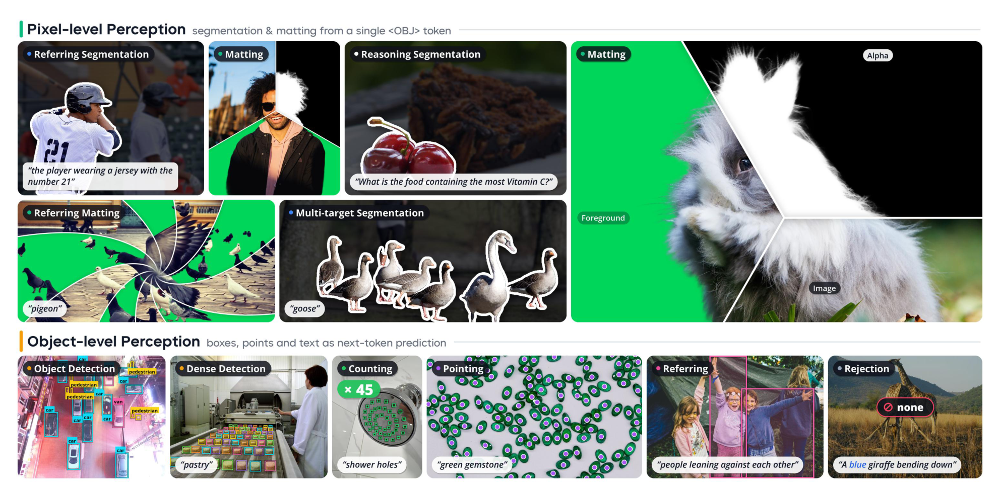
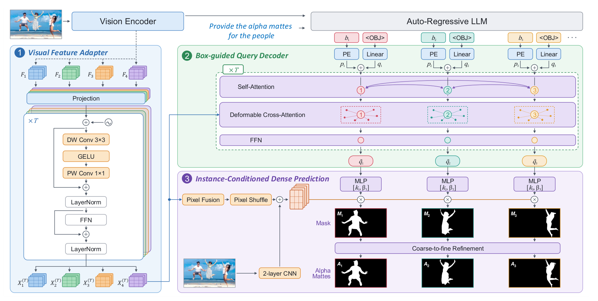

# WeVisOne-VL

## 来源

- 文件：`raw/2610.31329v1.pdf`
- 标题：WeVisOne-VL: Unified Visual Perception from Objects to Pixels
- 团队 / 日期：Tianming Liang、Junyi Pan、Yuxi Li（同等贡献），Canmiao Fu、Zhipeng Huang，Chong Sun（项目负责人），Chen Li（通讯），Jing Lyu；WeChat Vision, Tencent Inc.；arXiv:2610.31329v1，2026-10-22，36 页
- 项目 / 代码 / 权重：[项目页](https://tencent.github.io/WeVisOne-VL)、[Tencent/WeVisOne-VL](https://github.com/Tencent/WeVisOne-VL)、[Hugging Face collection](https://huggingface.co/collections/tencent/wevisone-vl)
- 模型页：[WeVisOne-VL](../models/wevisone-vl.md)
- 定位：把检测、指代定位、计数、指点、OCR、指代分割和抠图收成**同一个结构化 next-token 接口**。基座是 [Qwen3-VL](qwen3-vl.md) 的 2B 与 4B。像素输出不另挂 SAM，而用约 9.6M 的解码器读 `<OBJ>` 的隐状态。

## 核心结论

1. **物体级和像素级走同一条生成序列。** 框写成四个坐标 token，点写成两个；目标不在图里时坐标填 `None`。分割和抠图在每个框后面再生成一个 `<OBJ>`，解码器只对这个 token 出全图 mask 或 alpha matte（§3、Figure 3–4）。
2. **监督来自一套实例对齐的数据引擎，不是把公开检测集和抠图集简单拼起来。** 库存超过 1 亿张图、约 36 亿个框。类别和指代表达进同一张知识图谱；框由检测器提出、Qwen3-VL 核验；mask 继承同一个 query；alpha 在二值 mask 上补连续透明度（§2）。
3. **课程是三阶段 SFT，再加混合任务 GRPO。** 前两阶段像素样本只做 next-token，解码器不更新。Stage 3 用 2.5 亿分割样本热身解码器后，丢掉热身里更新过的 VLM 权重，只把解码器和 `<OBJ>` embedding 接回 Stage 2。抠图微调冻结 VLM。RL 抽样偏爱「有时对、有时错」的题，奖励打在整段结构化输出上（§4）。
4. **4B 在论文列出的 VLM 里，检测 mean F1、计数精确匹配和 RefCOCO 族 cIoU 领先。** 拒识是和 Rex-Omni / LocateAnything 拉开的地方：RefCOCOg-Rej 上 4B 为 67.4%，LocateAnything-3B 为 0.6%（Table 3）。2B 不是每项都弱于 4B：P3M / PPM 的多数误差、Ref-ZOM 的 cIoU、COCO 指点的 F1 是 2B 更高。
5. **像素 RL 不看 mask。** 分割和抠图的强化学习奖励仍是框的 IoU；指代分割只额外要求框后有 `<OBJ>`。最终榜是 SFT 加 RL 之后的模型，原文没有把 RL 对 mask 质量的贡献拆开（§4.2）。

> Figure 1（原文截图，摘要后）："Overview of WeVisOne-VL’s unified object- and pixel-level perception capabilities."

## 数据引擎（已据原文核实）

WDE 的底库来自 GRIT、CC3M、LAION、SA-1B 和若干任务集。Figure 2 把流程画成三段：语义发现与定向采集、定位与语义复核、跨任务实例对齐。训练后的错误再回流到采集、改标和难例。

> Figure 2（原文截图，§2 开篇）："Overview of the WeVisOne-VL Data Engine (WDE)."

### 概念、框和 mask

检测类别来自优化过的 Tokenize Anything。指代表达由 Qwen3-VL 按属性、状态、动作和关系生成。两者都进一张知识图谱：从 Wikipedia 和 WordNet 初始化，节点是规范类名、别名、上下位和整体–部分。新术语要先经过文本检索和视觉–语言核验，并且有稳定视觉证据才加入。等价类名合并，但决定指代范围的描述约束保留（§2.1）。

检测提案并行来自 SAM3 和自研 DINO 式开放词汇检测器，合并后由 Qwen3-VL 判断区域是否匹配类别，再去重、解冲突。**留下的框仍是定位模型的框**，不是 VLM 重画的框。指代段写在 SAM3 Agent 上，并加 Rex-Omni 作为另一路定位专家；Qwen3-VL 核验属性、状态、动作、关系，以及表达指的是整体还是部分（§2.2–§2.3）。Figure 2 的指代框画的是 SAM3 Agent 下的 SAM3 + 自研检测器，没有画出 Rex-Omni。这个图文差别记在文末待追问。

每个留下的实例用 SAM2 出**可见区域**的二值 mask，mask 继承产生该框的 query。类别 query 同时监督检测和类别条件下的分割；指代表达同时监督指代定位和指代分割。抽查子集，并记录每条标注的来源以便回滚（§2.4）。

难例的负样本必须是整张图都不满足全部条件，不能只因为检测器没返回框就当负例。人工复核后，若当前模型仍画出框，这条才成为 hard negative：目标集为空，用来学拒识。hard positive 保留可靠标注，覆盖漏检、指错和拥挤遮挡。难度按模型版本重估（§2.5）。

### 抠图伪标签

公开高质量 alpha 又贵又窄，合成贴图的光照和边界又不像真实场景。WDE 已有实例和二值 mask，缺的是连续 alpha。对每个实例 crop，同时取 BiRefNet 的软前景 $\alpha_B$（只看 RGB）和 MatAnyone2 的 $\alpha_M$（用膨胀/腐蚀后的 $S$ 初始化，把 crop 重复成短序列，warmup 后取最后一帧）。

BiRefNet 不看实例提示，所以只在空间一致时采用。阈值 $\tau_\alpha=0.5$，二值前景 $B=\mathbf{1}[\alpha_B\ge\tau_\alpha]$ 要同时满足：$|B|\ge 8$，$\mathrm{IoU}(B,S)\ge 0.5$，覆盖 $|B\cap S|/|S|\ge 0.5$，精度 $|B\cap S|/|B|\ge 0.8$，面积比 $|B|/|S|\in[0.5,2]$，框 IoU 至少 0.7，质心偏移不超过 $S$ 的框对角线的 0.15。通过后再保留 $\alpha_B\ge 0.01$ 且至少 10% 面积落在轻微膨胀的 $S$ 上的连通域，**alpha 不裁回 $S$**，细结构可以超出粗边界。不通过、或过滤后前景像素少于 8 时，若 $\mathrm{IoU}(\mathbf{1}[\alpha_M\ge\tau_\alpha], S)\ge 0.9$ 就退回 $\alpha_M$，否则保留二值 $S$（§2.6）。

标注器是冻结的 SAM2.1-Base+ 加一个可训练的轻量 alpha 头，灵感来自 SAM2Matting。初始标签和高质量抠图数据按 1:1 采样。头融合多尺度图像特征、逐级注入的 prompt mask，以及浅层 RGB stem 的局部细节。训练时的 prompt mask 可以是目标 alpha 的二值、实例分割 mask、随机扰动，或框提示的 SAM2。损失是多尺度 L1、Laplacian、前景/背景，以及只加在未扰动物体级 prompt 上的一致性项；连续 alpha 样本另加过渡区损失，小目标除外。训完后用它重标全部实例，替换初始标签，并保持与原来的描述和框绑定。

每轮训练后按概念、图像域、尺度、遮挡、任务和失败类型聚类错误。标注可靠就加重采样或当检索种子；标注有错才改。漏检推动补采集，指代混淆推动对比实例，误报进入 hard negative。正式 benchmark 与训练、以及与反馈驱动的数据构造隔离；另有一份固定监控集不进训练、也不参与阈值标定（§2.7）。附录把若干与评测同名的数据集列进训练集，划分没有写明，见待追问。

## 架构与训练（已据原文核实）

### 输出格式

坐标用专用 token `<0>` 到 `<1000>` 表示归一化位置，做法沿 Rex-Omni 和 LocateAnything。Figure 3 的格式是：

| 任务 | 坐标字段 | 备注 |
| --- | --- | --- |
| 检测 / 指代 | `<box>` 内 `[x0,y0,x1,y1]` | 多个实例逗号分隔 |
| 指点 | `<point>` 内 `[x0,y0]` | |
| 计数 | 同上框，句末 `Total number: N` | |
| OCR | `<ref>` 里是转写文本，后接框 | 转写本身当类别 |
| 分割 / 抠图 | 每个四元组后紧跟 `<OBJ>`，仍在同一个 `<box>` 里 | `<OBJ>` 的隐状态交给解码器 |
| 目标缺失 | 坐标字段为 `None` | |

推理用贪心、temperature 0，每张图最多 1,960 个视觉 token（§5）。

### 像素解码器

解码器约 9.6M，分割和抠图共用，抠图多一个细化模块，参数量含这个模块。它不另跑 SAM。输入是 Qwen3-VL ViT 的 **pre-merge** 多层特征、`<OBJ>` 隐状态，以及该 token 前面的预测框。三块：视觉特征适配器、框引导的 query 解码器、实例条件的稠密预测（§3.2、Figure 4）。

> Figure 4（原文截图，§3.2）："Overview of the lightweight pixel decoder. Qwen3-VL provides multi-level ViT features, the hidden state of each generated <OBJ> token, and its predicted box. The decoder builds shared visual features, updates a box-guided target query, and converts the two representations into a full-image prediction."

适配器从 ViT 中间层取 $L$ 组 pre-merge 特征。Figure 4 画了 $F_1$ 到 $F_4$。每层投影到 $d$ 维，加上 2D 位置编码和可学习的 level embedding，再过 $T$ 个块：深度可分离 $3\times 3$、GELU、逐点 $1\times 1$，残差后 LayerNorm，再接 FFN（Eq. 1–2）。各层展平拼接成视觉记忆 $M$。正文没有给出 $L$、$T$、$d$ 的数字；图只把层数画成 4。

Query 解码器沿 Deformable DETR，但 query 不是学出来的静态向量。第 $i$ 个实例的内容 query 是 $q_i=W_h h_i$，位置 query 是框的 Fourier 编码再过 MLP。六个可变形块：自注意力里 $q_i+p_i$ 当 query 和 key、$q_i$ 当 value；交叉注意力以框中心、宽和高为 reference box，在 $M$ 上做多尺度可变形注意力（§3.2.2）。

稠密头自顶向下融合多层特征（Eq. 3）。原图缩到 $1024\times 1024$ 进两层 CNN，与上采样到 $512\times 512$ 的 $G_1$ 相加得到 $P$（Eq. 4）。实例 query 过 MLP 产生动态核，像素 logit 是 $M_i=k_i^\top P+\beta_i$（Eq. 5）。然后三个上采样阶段，把上一阶段特征、原图、$P$ 和此前的 mask 拼在一起，用 query 做通道 scale-shift，残差卷积预测 logit 残差（Eq. 6–8）。输出 $A_i=\mathrm{Sigmoid}(M_i^{(3)})$。

### 三阶段 SFT

Table 1 的样本量和任务占比：

| 阶段 | 样本量 | 组成 |
| --- | ---: | --- |
| SFT Stage 1 | 90.2M | 检测 67.2%，指代 20.1%，计数 2.7%，指点 3.1%，OCR 2.3%，caption 3.0%，分割 1.7% |
| SFT Stage 2 | 40.5M | 检测 66.4%，指代 18.8%，计数 3.0%，指点 2.2%，OCR 1.7%，caption 2.2%，分割 5.7% |
| 分割热身 | 250M | 公开 37.3%，WDE 62.7% |
| SFT Stage 3 | 41.8M | 检测 37.3%，指代 6.2%，计数 1.4%，指点 1.0%，OCR 0.7%，caption 1.0%，分割 52.4% |
| 抠图微调 | 130M | 语料里公开 0.2%、WDE 99.8%；每个 batch 按公开:WDE = 1:4 采样 |
| RL | 178K | 检测 44.0%，密集检测 20.8%，指代 17.5%，OCR 7.9%，分割 5.8%，指点 4.0% |

附录 Table 10 的分割池是公开 171.4M 加 WDE 288.4M，大于热身实际使用的 250M。抠图池是公开 0.3M 加 WDE 129.8M，与 130M 相符。公开抠图在语料里只占 0.2%，batch 里被抬到 1/5。

Stage 1 从扩过词表的 Qwen3-VL 出发，冻结视觉编码器和视觉–语言投影，只训语言模型，13,000 步。像素样本只做 NTP，让 `<OBJ>` 和实例对上号，解码器不激活。视觉 token 16–512，上下文 4,096。这一阶段每类最多约 50 个框或点，避免超密样本把输出训成复读（§4.1）。

Stage 2 解冻整个 VLM。视觉 token 上限提到 1,960，单条回复的框/点上限提到 500，上下文 8,192。Table 11 的步数是 8,995；正文写成约 9K。像素样本仍只有 NTP。SFT-S2 和 SFT-S3 里，OCR 样本的视觉 token 改用 16–256，给长转写留位置（附录 B.1）。

Stage 3 先把 SFT-S2 的 VLM 和随机初始化的解码器在 250M 分割样本上联合训 100,000 步，损失 $\mathcal{L}_{\mathrm{seg}}=20\mathcal{L}_{\mathrm{focal}}+\mathcal{L}_{\mathrm{dice}}$，解码器学习率 $1\times 10^{-6}$，mask 分辨率 $512\times 512$。热身结束后**只保留解码器权重和学到的 `<OBJ>` embedding**，热身里改过的其他 VLM 权重丢弃，再接到原来的 Stage 2 检查点上联合训。正文写 9,000 步，Table 11 写 9,062 步。NTP 与像素任务 1:1 交替，$\mathcal{L}_{\mathrm{joint}}=\mathcal{L}_{\mathrm{NTP}}+10\mathcal{L}_{\mathrm{seg}}$。每个 GPU 的每条 packed 序列随机抽 24 个 `<OBJ>` 进解码器，文本序列仍全部参与 NTP。

交替训完后冻结 VLM，用 130M 抠图样本把解码器再训 100,000 步，输出 $1024\times 1024$。$\mathcal{L}_{\mathrm{mat}}=200\mathcal{L}_{\mathrm{l1}}+5\mathcal{L}_{\mathrm{grad}}+50\mathcal{L}_{\mathrm{lap}}+\mathcal{L}_{\mathrm{hard}}$。解码器学习率 $5\times 10^{-7}$，粗到细分支 $2.5\times 10^{-6}$。每个 GPU 最多 8 个 `<OBJ>`。热身和抠图用 DDP、权重衰减 0.05、梯度范数上限 5.0、每 GPU 98,304 token；主 SFT 是 ZeRO-2、权重衰减 0.01、梯度范数上限 1.0。SFT 用 128 张 GPU。

Table 11 里和阶段绑定的学习率与可训练范围：

| | SFT-S1 | SFT-S2 | SFT-S3 联合 | RL |
| --- | --- | --- | --- | --- |
| 可训练 | LLM | 整个 VLM | VLM + 解码器；LLM 用 LoRA | 仅 LLM |
| LLM 学习率 | $2\times 10^{-5}$ | $5\times 10^{-6}$ | $5\times 10^{-6}$ | $1\times 10^{-6}$ |
| 视觉编码器 | 冻结 | $5\times 10^{-7}$ | $5\times 10^{-6}$ | 冻结 |
| 投影 | 冻结 | $5\times 10^{-6}$ | $5\times 10^{-6}$ | 冻结 |
| 解码器 | 未启用 | 未启用 | $1\times 10^{-5}$ | 冻结 |
| 步数 | 13,000 | 8,995 | 9,062 | 593 |

SFT-S3 的 LoRA 是 $r=128$、$\alpha=256$、dropout 0.05；token embedding 和输出头全参数可训。SFT 用 AdamW、BF16、余弦学习率。RL 的学习率日程正文只写 constant 或 cosine，随配置而定，没有指定最终跑的是哪一种。

## 后训练

RL 在 SFT 之后，直接优化整段结构化输出，而不是逐 token 似然。对每个候选 prompt，用 SFT 模型采样一组回复，记奖励均值 $\mu_x$ 和标准差 $\sigma_x$，不确定性 $U(x)=4\mu_x(1-\mu_x)\sigma_x$（Eq. 12）。$\mu(1-\mu)$ 在 0.5 处最大、在全对或全错处为 0，再乘上组内波动，所以选出的是中等难度且 rollout 之间不一致的题。由此约 140K，再补框监督和指点，一共 178K。RL 用 160 张 GPU、593 步、FSDP2 + vLLM，prompt 和回复各最长 4,096。

GRPO 的组大小 $G=8$。检测、密集检测和指代定位的奖励，是类内一对一匈牙利匹配之后

$$r_i=\frac{2\sum_{(\hat b,b^\star)\in\mathcal{M}_i}\mathrm{IoU}(\hat b,b^\star)^3}{N_{\mathrm{gt}}+N_{\mathrm{pred}}}.$$

分子对立方是为了让高 IoU 的改进更值钱；分母同时罚漏检和重复框。分割和抠图的 RL **只用这个框奖励**，不算 mask 或 alpha。指代分割还要求框后面有 `<OBJ>`，否则预测无效。负样本只有在一个对象都不预测时奖励才是 1。指点的奖励是点落在真值 mask 内的一对一 F1。OCR 使用 transcription reward，附录 B.3 没有给出公式（§4.2）。

这是 [GRPO](deepseekmath.md) 的采用，不是新的 policy gradient。原文没有写 KL 系数、clip 范围，以及 advantage 是否做标准差归一化。

## 评测要点

协议先说清楚再读分。生成式模型没有可用的置信度，所以检测报的是 F1，不是 AP：同类、未匹配的真值框，IoU 过阈值算一次命中，按类算 precision / recall 再平均，F1 是调和平均。Mean 是 IoU 从 0.5 到 0.95、步长 0.05 的平均。Qwen3-VL 评的是 Instruct；Qwen3.5 打开 thinking，因为作者在自己的评测里这样更高。加粗规则在各表不同：检测和指代只在 VLM 之间排名，计数和 OCR 的加粗也排除专用系统；指点和分割的加粗包含表内全部已报告结果（§5）。

COCO 和 LVIS 检测被明确写成 zero-shot。VisDrone、HierText、ICDAR2015、SROIE、RefCOCO 族、HumanRef、PixMo、CLOC、MixCount、KubriCount、AM-2K 这些名字也出现在附录训练集里。§2.7 又说正式 benchmark 与训练隔离。划分未写，分数不能直接读成「没见过该测试集」。

### 检测（Table 2，mean F1）

| 方法 | COCO | LVIS | Dense200 | VisDrone |
| --- | ---: | ---: | ---: | ---: |
| GroundingDINO-T | 56.6 | 38.8 | 33.1 | 38.5 |
| Qwen3-VL-4B | 48.7 | 44.0 | 15.2 | 31.0 |
| LocateAnything-3B | 54.7 | 50.7 | 58.7 | 39.9 |
| WeVisOne-VL-2B | 55.2 | 53.3 | 61.4 | 40.4 |
| **WeVisOne-VL-4B** | **57.1** | **55.3** | **71.3** | **44.7** |

4B 的 mean F1 在四项上都高于表内 VLM，也高于这张表里的 GroundingDINO-T。IoU = 0.95 不是格格都领先：LVIS 上 LocateAnything-3B 为 31.1，4B 为 28.8。4B 的 IoU = 0.95 在 COCO / Dense200 / VisDrone 为 19.5 / 23.2 / 3.9。密集场景的差距更大：Dense200 mean F1 从 Qwen3-VL-4B 的 15.2 到 4B 的 71.3。

### 指代、计数、指点

指代主指标是 mean F1。WeRef-Bench 是内部集，2,880 条中英查询，含单目标、多目标和缺失目标。4B 的 RefCOCOg val / test 为 80.8 / 81.8。拒识率：RefCOCOg-Rej 上 4B 67.4%、2B 50.2%，Qwen3-VL-8B 22.5%，LocateAnything-3B 0.6%，GroundingDINO-T 0.0%。WeRef-Bench 的 mean F1 / 拒识率，4B 为 78.7 / 96.4，2B 为 73.2 / 92.9。PR-Bench 上 4B 为 54.1 / 52.6。HumanRef、Ref-Adv-s、DVG、Ref-L4 上 4B 为 80.7 / 50.5 / 45.2 / 78.1（Table 3）。

计数是精确匹配：差一个物体就算错。检测式输出用框的个数；直接给数字的模型从回复里取数。4B 在每一列都是表内 VLM 最高：CountQA 57.1，PixMo-Count val/test 93.7 / 89.6，CLOC val/test 28.2 / 28.3，KubriCount testA/testB 37.7 / 40.1，MixCount val/test 42.0 / 40.4。对照 LocateAnything-3B 为 52.4、88.7 / 82.8、22.8 / 23.9、18.5 / 22.4、12.5 / 15.2。2B 的 CountQA 是 47.9，低于 LocateAnything。Figure 3 的计数输出同时有框和 `Total number`；正文没有写两者不一致时计哪一个（Table 4）。

指点：点落在真值 mask 内算对，没有 mask 时用框；每个目标最多一个真阳性。4B 的 PointBench / PixMo-Points 为 71.9 / 74.7，高于 Rex-Omni-3B 的 69.9 / 72.9。由检测集改标的指点上，COCO 是 2B 85.8、4B 85.4；Dense200 是 LocateAnything 87.6、4B 87.0（Table 5）。

### OCR（Table 6，mean F1）

OCR 被做成 grounding：转写必须与真值逐字相同，框还要过 IoU。4B 的 HierText / ICDAR2015 / TotalText / SROIE mean F1 为 39.0 / 47.8 / 52.0 / 68.1。表内专用系统 PP-OCRv5 为 30.5 / 25.6 / 25.7 / 58.6。2B 为 30.5 / 42.6 / 42.5 / 62.1：HierText 的 mean 与 PP-OCRv5 同为 30.5，IoU = 0.5 时 2B 是 44.3、PP-OCRv5 是 45.2、4B 是 51.6。Qwen3.5-9B 在这四项 mean 上只有 10.0 / 13.4 / 30.8 / 16.7，和它在检测上的位置不是同一量级。这组 F1 与 [HunyuanOCR 1.0](hunyuan-ocr-1.0.md) 的 OmniDocBench 文档解析分不是同一协议。

### 指代分割与可提示抠图

分割：RefCOCO 族和 Ref-ZOM 报 cIoU，ReasonSeg 报 gIoU。4B 在表内每个 RefCOCO 族划分上都是最高，RefCOCO val / testA / testB 为 81.4 / 84.5 / 80.1。对照 UniPixel-7B 的 RefCOCO val 是 80.8，Youtu-VL-4B 是 80.7，2B 是 79.7。ReasonSeg val / test 上 4B 为 71.2 / 66.8，LISA-13B（微调）为 65.0 / 61.3，2B 为 60.9 / 56.9。作者把推理分割写成没有显式 CoT。Ref-ZOM 含零目标、单目标和多目标：cIoU 是 2B 73.4、4B 72.2；拒识率是 4B 86.0、2B 62.4，GSVA-7B 为 66.6 / 41.9，UniPixel-7B 的拒识率是 0.3（Table 7）。

抠图的 MAD 和 MSE 乘了 $10^3$，五类误差都是越低越好。框提示用的是真值框：基线先用 SAM 从该框出 mask 再抠图；WeVisOne 把真值框写成序列前缀，只生成后续的 `<OBJ>`，再把隐状态送进解码器。因此 P3M-500-NP、AM-2K、PPM-100 比的是**给定框之后的 alpha**，不是端到端找物体。语言提示的 WeRefMat 才是从类别名或指代表达直接出 matte（§5.1.7）。

| 数据 | 提示 | 对照（MAD） | 2B | 4B |
| --- | --- | --- | ---: | ---: |
| P3M-500-NP | 框 | SAM2-Matting（SAM3）15.4 | **6.6** | 7.3 |
| AM-2K | 框 | SAM2-Matting（SAM2.1-T）11.0 | 5.7 | **5.0** |
| PPM-100 | 框 | SAM2-Matting（SAM2.1-B+）9.3 | **5.3** | 6.1 |
| WeRefMat | 类别 | SAM2-Matting（SAM3）70.8 | 17.7 | **16.4** |
| WeRefMat | 指代 | Qwen3.5-9B + SAM2-Matting 22.4 | 15.8 | **9.8** |

P3M 上梯度误差是 4B 更低（10.5 对 2B 的 10.7），其余四项是 2B 更低。WeRefMat 的类别提示上，Qwen3-VL-8B 先定位再交给 SAM2-Matting 的 MAD 是 80.7，高于 SAM3 直接做文本定位的 70.8，两者都远高于 WeVisOne。

Figure 13 另展示带框的细粒度 caption。SFT 里 caption 大约占 1%–3%，没有单独榜。

## 证据边界与阅读提示

论文自称 2B 和 4B。Hugging Face 模型卡把 `tencent/WeVisOne-VL-4B` 的 safetensors 标成 5B，并把 `mask_decoder.pt` 写成 9,609,764 个参数（外部佐证，2026-10-24）。原文的「about 9.6M」与这个文件大小同量级；5B 这个总参原文没有。模型卡还写 video grid 会被像素解码器拒绝，并给出 `<OBJ>` 的 token id 152678。这两句不在 PDF 里。模型卡把腾讯撰写的代码标成 Apache 2.0；论文没有写权重许可。

适配器的 $L$、$T$、$d$ 没有数字，Figure 4 只画出四层特征。GRPO 的 KL、clip 和标准差归一化没有写。OCR 的 transcription reward 没有公式。Stage 2 / Stage 3 的正文步数（约 9K / 9,000）与 Table 11（8,995 / 9,062）差在取整。RL 学习率是 constant 还是 cosine 没有落到最终配置。

框提示抠图给定真值框。分割和抠图榜没有 RL 消融，不能把 alpha 的下降记到 GRPO 头上。Qwen3.5 开了 thinking，Qwen3-VL 用 Instruct，两组通用 VLM 的解码方式不同。GroundingDINO-T 和 PP-OCRv5 只是表内的专用对照，不是该类系统的全量上界。

§8 写了三条取舍：通用指令数据少，相对基座的一般能力可能变弱；为了推理效率不做 CoT；目前是单轮。作者把含糊、犹豫的真实指令留到以后的意图推理，本文的 benchmark 查询是清楚的。

## 待追问

- **图文不一致**：§2.3 写指代提案来自 SAM3 与 Rex-Omni。Figure 2 的指代框画的是 SAM3 Agent 下的 SAM3 + 自研开放词汇检测器，没有 Rex-Omni。检测正文则只写 SAM3 与自研检测器。三路提案在指代流程里如何合并，原文没有并到一处。
- **需核对原文**：§2.7 写正式 benchmark 与训练和反馈式造数隔离。Table 9 仍把 VisDrone、HierText、ICDAR2015、SROIE、RefCOCO / RefCOCO+ / RefCOCOg、HumanRef-CoT、PixMo、CLOC、MixCount、KubriCount 列进 SFT 来源，Table 10 把 AM-2K 列进抠图来源。除 P3M 明确写成 train split、检测明确把 COCO / LVIS 写成 zero-shot 以外，评测划分没有写。
- **需核对原文**：计数输出同时含框和 `Total number`。§5.1.3 只区分「用框计数的模型」和「直接返回数字的模型」，没有写 WeVisOne 冲突时采用哪一个字段。

## 相关页面

- 模型：[WeVisOne-VL](../models/wevisone-vl.md)
- 基座：[Qwen3-VL 技术报告](qwen3-vl.md)、[Qwen3-VL](../models/qwen3-vl.md)
- 同实验室、另一任务：[WeMM-Embedding](wemm-embedding.md)（检索向量，不是检测或抠图）
- 算法出处：[DeepSeekMath](deepseekmath.md)（GRPO；本页只改了感知奖励，没有改组内相对优势的定义方式）
- 不要对读的 OCR 协议：[HunyuanOCR 1.0](hunyuan-ocr-1.0.md)（OmniDocBench 文档解析；本页是转写加框的 F1）
